# Lance 接入现有 Iceberg 生态：4+1 架构视图

> 文档日期：2026-10-29。本文对应[开发功能规格说明书](functional-spec.md)第 17 章，可直接复制各 Mermaid 代码块使用。

## 17. 4+1 架构视图与关键流程

本章将前述功能规格整理为逻辑、开发、进程、物理和场景五个视角，流程以第 12—15 章的存储、权限和外部交互规则为准。三种协议共用 OpenSearch 主元数据存储；底层已支持固定 Lance 协议；权限策略和安全属性由外部权威系统提供。

所有图使用 Markdown 的 `mermaid` 围栏代码块，节点、连线和判断条件均可直接编辑。支持 Mermaid 的 Markdown 阅读器可渲染图形；其他阅读器保留图形源代码。可复制的独立文件见 [4+1 架构视图 Markdown](architecture-4plus1.md)。实线表示调用、依赖或流程推进，标注“异步”的连线表示后台处理，不表示必须引入消息中间件。

| 视图 | 回答的问题 | 本章内容 |
|---|---|---|
| [逻辑视图](#view-logical) | 系统有哪些职责与核心对象 | 共享业务服务、元数据对象与外部系统边界 |
| [开发视图](#view-development) | Java 模块如何组织、依赖如何约束 | 协议入口、应用服务、领域模型、接口与实现 |
| [进程视图](#view-process) | 一次操作如何执行、失败后如何处理 | 请求、鉴权、创建、变更、补齐、恢复、批量提交、异步作业与删除 |
| [物理视图](#view-physical) | 服务和存储部署在哪里 | 无状态服务实例、后台任务、OpenSearch 与外部依赖 |
| [场景视图](#view-scenarios) | 上述设计如何支撑真实业务 | 典型使用场景与功能、流程、验收用例对应关系 |

### 17.1 逻辑视图：职责与共享元数据

三种协议只形成不同的请求与响应视图，业务服务操作相同的对象。Table 元数据与 Table 数据分别管理；Schema、Index、Version、Tag / Branch 等通过稳定表身份关联。下图中的元数据对象均落在同一套主存储体系中，不表示各自独立建库。

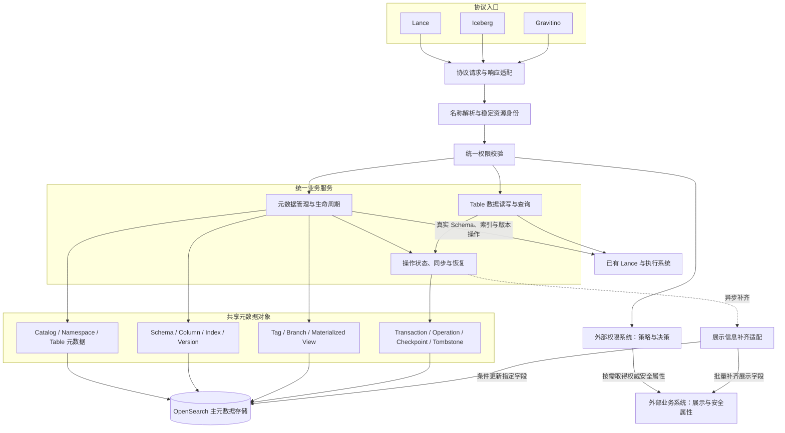

权限系统使用稳定 resourceId，业务补齐系统使用同一引用或显式绑定的 externalObjectId。展示字段只影响展示与检索；安全属性通过权限系统参与决策。Lance 的物理事实与平台身份分别有明确来源，不能仅写 OpenSearch 就认为底层数据操作已成功。

### 17.2 开发视图：Java 模块与依赖方向

以下为建议的包或模块边界，可映射到现有工程，无须为每个框框创建独立进程。箭头表示代码依赖；应用服务通过接口调用基础设施，协议入口不直接操作 OpenSearch 或调用外部权限客户端。

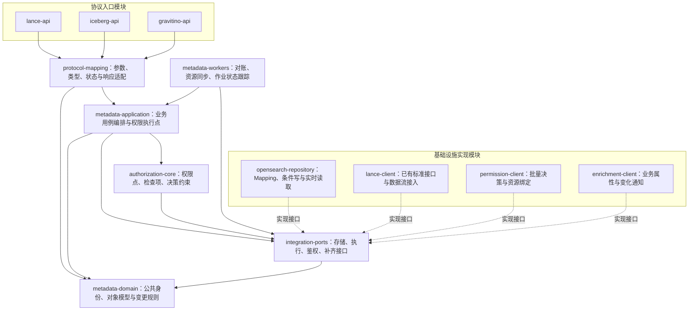

协议 DTO 的缺失字段不能转成全量文档覆盖。公共转换、权限执行和恢复框架各实现一次；后台任务复用业务规则，使用明确的服务身份或用户委托。模块拆分不新增功能范围，Java 估算仍对应第 1.5 节及各对象章节。

### 17.3 进程视图：关键执行流程

流程中的“条件写”指携带当前文档并发版本的 OpenSearch 更新；冲突后重新读取和判断，不能取消条件强行覆盖。“待核实”与“失败”不同：结果未知时保留占用和操作状态，通过已有查询能力确认结果后再推进。

#### 17.3.1 统一请求与读取流程

该流程覆盖三种协议的共同入口。列表先检查父级列表权限，再批量检查候选对象；数据查询及统计按数据读取权限执行。展示信息只在业务响应允许的字段中输出。

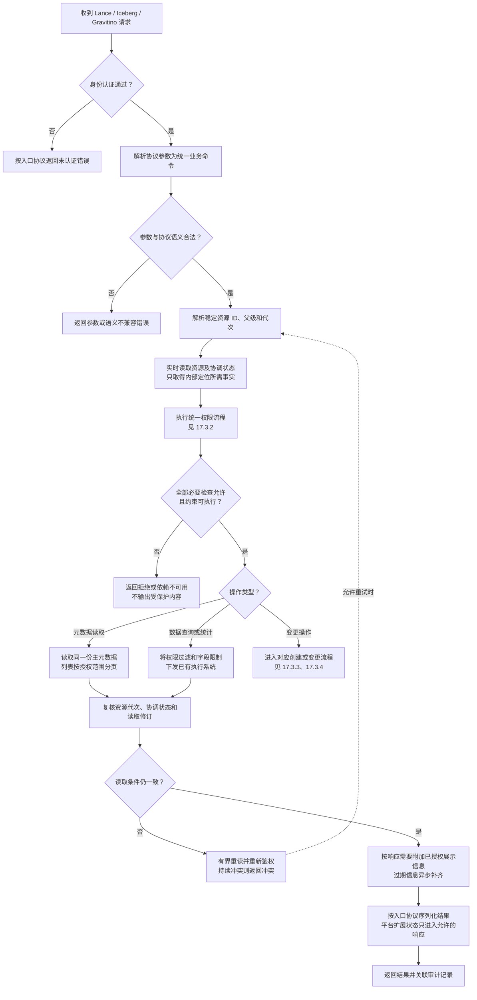

列表候选来自 Search，但结果输出前仍核对当前资源状态。批量鉴权和游标遵守第 14.4 节：继续扫描候选以填充授权页，不返回未授权对象数量。

#### 17.3.2 权限系统与安全属性系统交互

一次业务操作展开为全部检查项后统一调用 batchCheck。权限系统取得安全属性并作出决策，平台执行约束；业务系统的展示字段不进入这条放行链路。

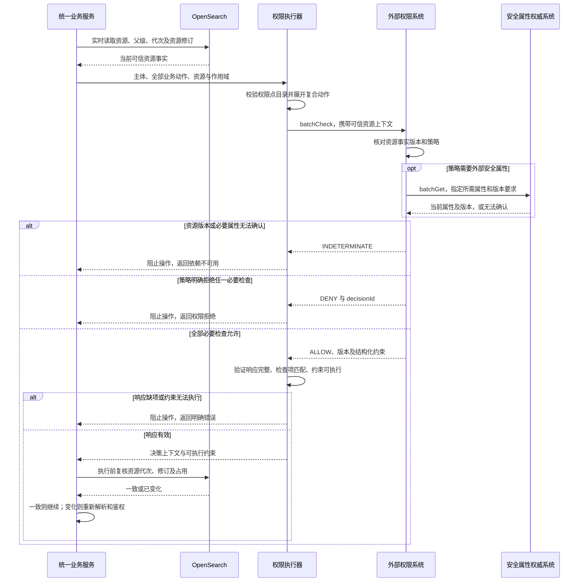

安全属性系统与权限系统可以部署在同一产品内，职责仍分开。权限系统无需回调同一个受保护业务接口；超时、缺项和未知版本均不允许回退到 OpenSearch 中的展示值。

#### 17.3.3 创建或注册对象与权限资源绑定

适用于 Namespace、Table、物化视图等需要新建平台身份的操作。各对象的底层调用及模式以对应规格为准；存在同名对象时，先按 Create / ExistOk / Overwrite 的语义和附加权限处理。

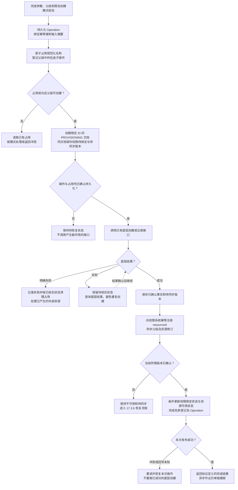

权限资源存在不代表创建者自动获得全部权限。外部绑定确认之前，普通业务查询不可见；创建者通过经授权的 Operation 查询进度，标准接口不把待绑定状态伪装成完成。

#### 17.3.4 元数据变更、Schema 变更与跨 Namespace 移动

同一个流程区分平台自身字段更新和需要调用底层的真实变更。跨 Namespace 移动须检查源、目标和继承关系；外部权威安全属性修改走其维护方，不通过普通 properties 更新。

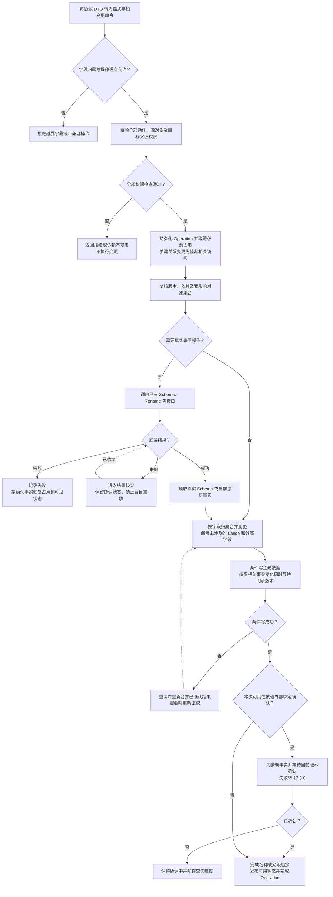

同对象的不同字段更新仍受并发控制保护。对已成功的底层变更，恢复目标是补齐主元数据；对尚未执行的变更，资源修订变化后必须重新鉴权。不能重新调用底层操作来“修复”一次 OpenSearch 写入失败。

#### 17.3.5 展示信息补齐与降级

展示请求已获得相应业务权限后，可以使用已有补齐结果。后台补齐只更新白名单字段；权限所需的安全属性不走该降级流程。

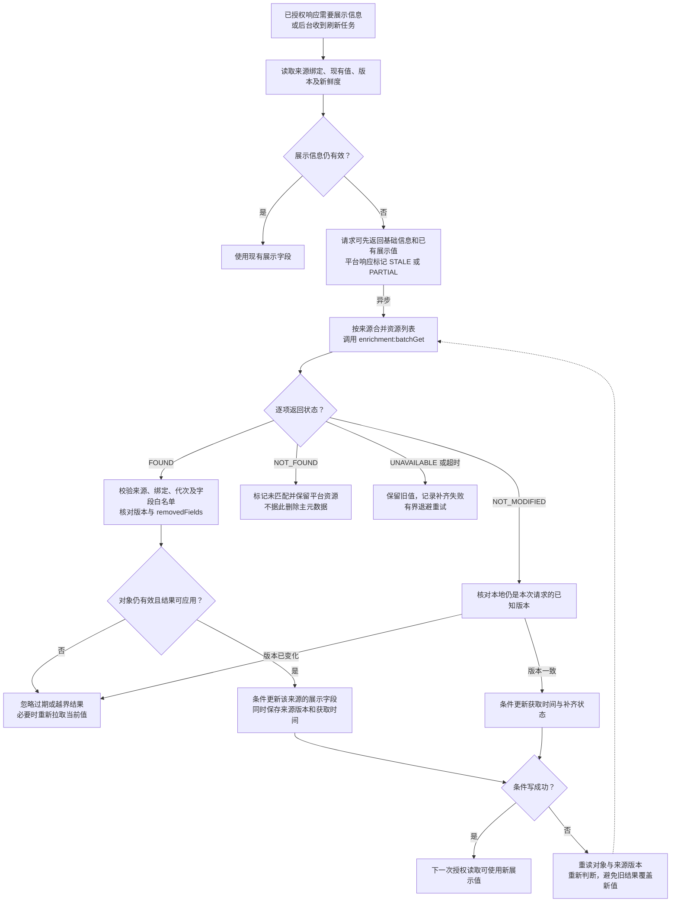

外部 ownerName 是展示名，不能借补齐修改 ownerId 或组织授权关系。每个来源保存独立版本；不可比较的来源修订号通过重新取当前值判断，不能按字符串大小排序。

#### 17.3.6 权限资源同步与故障恢复

正常提交、外部变化通知、周期扫描和进程重启都可以触发同一恢复流程。待同步标记与资源事实在同一文档中保存，扫描只负责发现任务，处理资格仍通过实时读取及条件写取得。

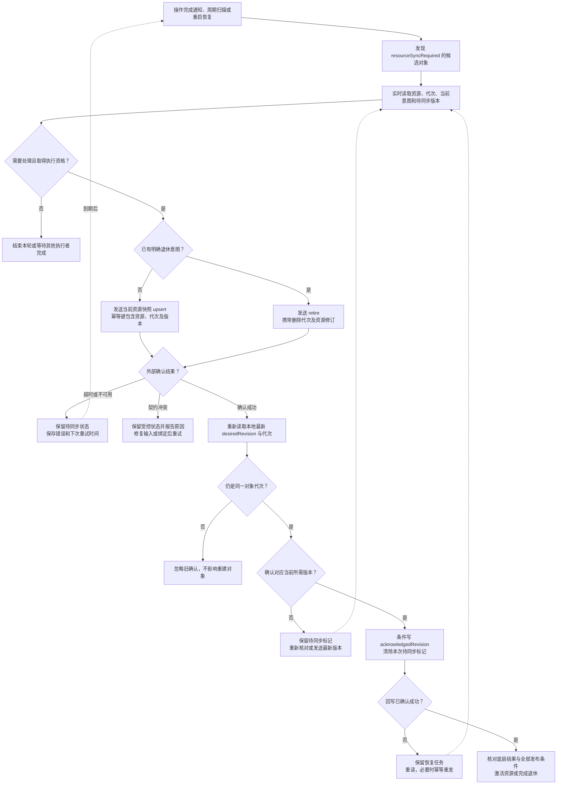

外部成功而平台回写失败只会引起幂等重发，不能生成第二个权限资源。确认回写本身不增加资源事实修订，避免无限同步；较旧确认不能清除更新版本的任务。

#### 17.3.7 多表原子提交与主元数据发布

底层原子性由已有 BatchCommitTables 等接口提供。平台负责全量鉴权、参与资源占用和 OpenSearch 主元数据恢复；Bulk 逐项写入完成之前，不发布一个伪完整的业务结果。

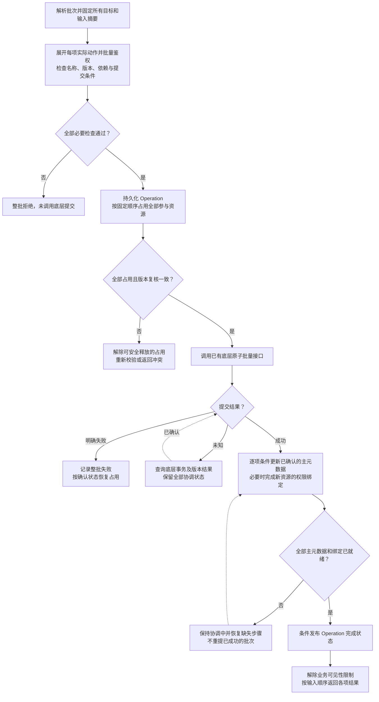

参与对象的读取均检查关联 Operation；需要一致的多对象结果时还须复核整个读取集合。协调中可等待或返回明确的暂不可用状态，不能返回部分新值混合部分旧值。

#### 17.3.8 回填、索引构建与物化视图刷新

平台接入已有执行能力并跟踪结果。job_id、transaction_id 和平台 operationId 分别保存；自动刷新仍由已有系统调度，调度时须执行相同的委托和权限检查。

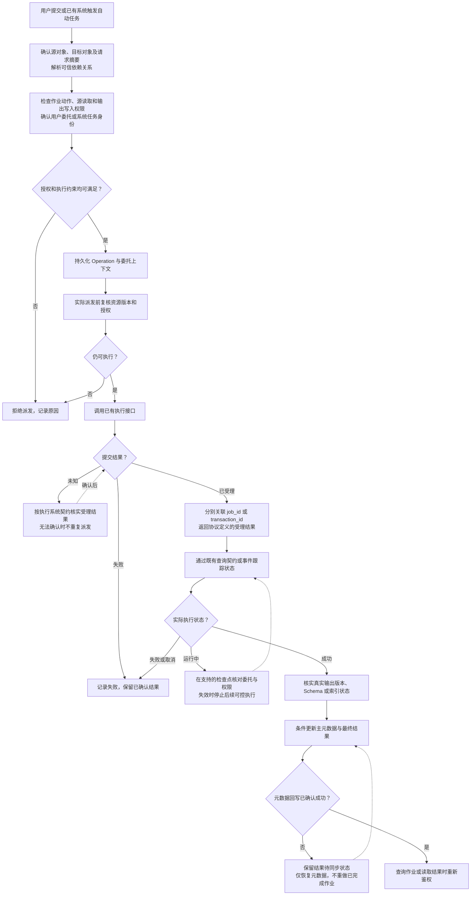

已受理不等于已成功。撤权不被描述为能回滚所有在途底层操作；执行系统无法满足所需委托检查或行列约束时，不启用相应运行配置。

#### 17.3.9 注销、物理删除与外部资源退休

注销和物理删除使用不同权限点。Cascade 先确定并保护受影响对象集合，逐项检查权限；删除期间阻止新的子对象创建和受保护业务访问。

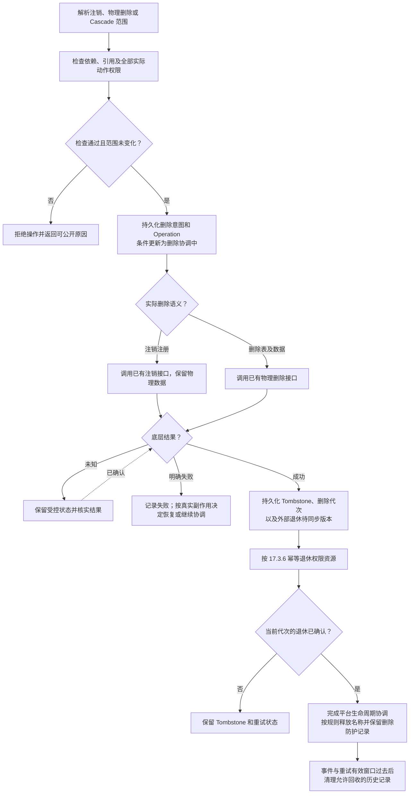

同名重建使用新 ID 或代次。旧补齐响应、旧授权确认和旧删除任务均不能修改新对象；清理前不能删除唯一待同步记录。

### 17.4 物理视图：部署与故障边界

下图表示逻辑部署关系，实例数量、分片和容量沿用实际环境配置。接口服务与后台任务可共部署，也可分别扩容；持久状态都保存在共享主存储，不依赖单个 JVM 的内存锁或任务队列保证一致性。

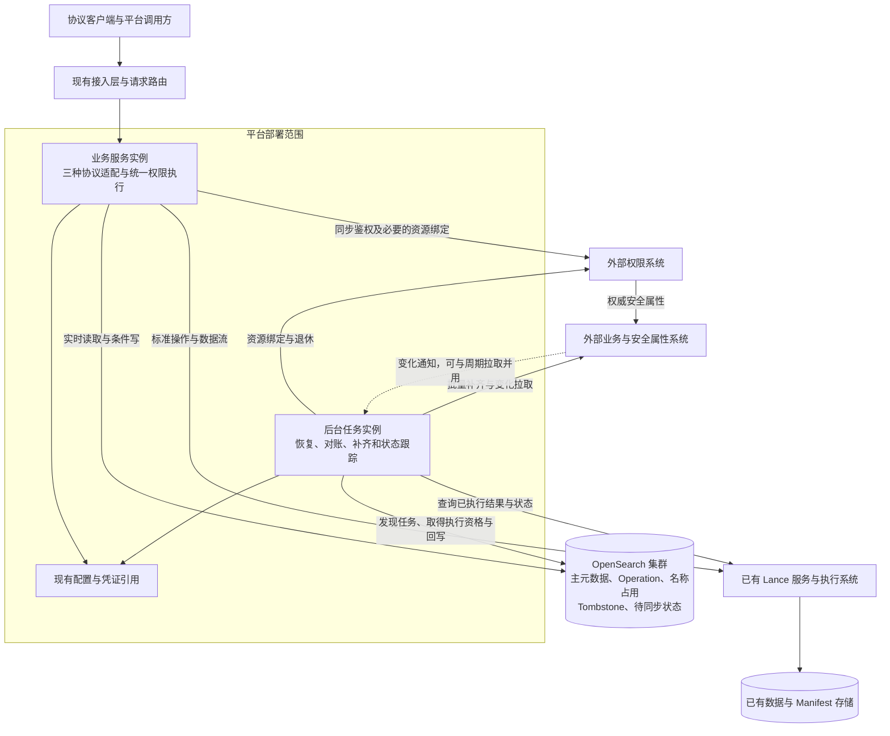

| 故障边界 | 对业务的影响与恢复方式 |
|---|---|
| 业务实例退出 | 其他实例依据持久 Operation 恢复；不能靠进程内状态推定底层失败 |
| 后台实例退出或重复执行 | 条件占用、幂等外部接口及版本确认避免重复副作用 |
| OpenSearch 不可用 | 无法确认资源和写入意图时阻止新副作用；已执行操作恢复后核实并补齐主元数据 |
| 权限或安全属性系统不可用 | 受保护访问不能放行；已有执行中的任务按委托及执行系统契约处理 |
| 展示补齐系统不可用 | 权限已通过的请求可以返回基础信息和已有展示值，后台重试 |
| Lance 操作超时 | 保留结果未知状态，通过真实查询核实，不立即重做修改操作 |

### 17.5 场景视图：用例驱动的“+1”

场景视图将调用者、业务目标、关键流程和验收用例串联起来，用来核对前四个视图能否共同完成需求。

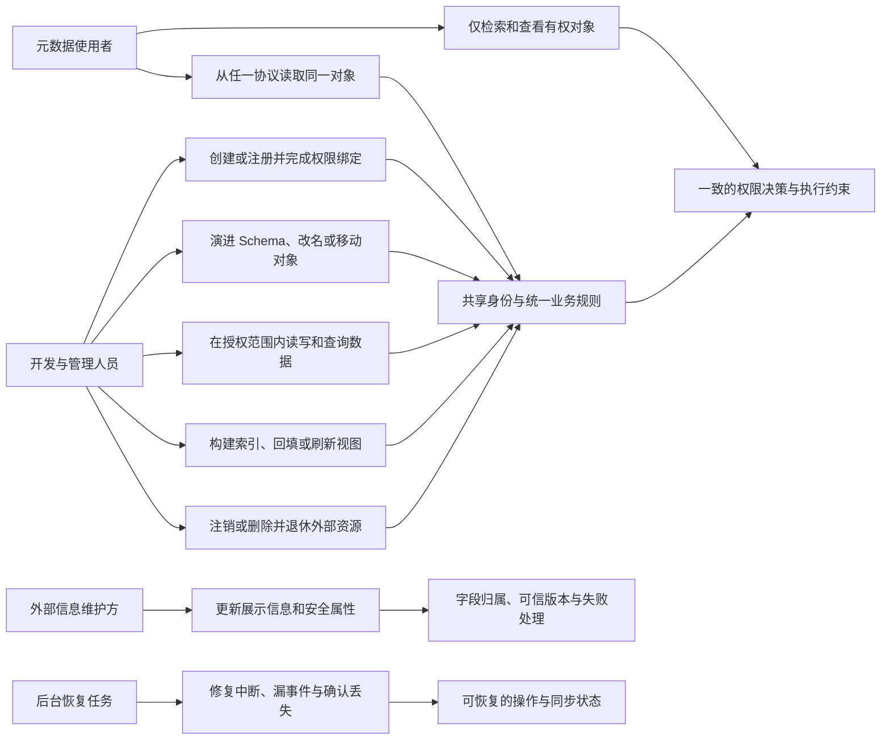

| 场景 | 关键流程 | 需要验证的结果 | 对应验收 |
|---|---|---|---|
| 同一表从三种协议访问 | [统一请求](#flow-request)、[统一鉴权](#flow-authorization) | 定位相同对象 ID，同一动作使用相同权限点，响应符合入口协议 | AT-02、AT-26、AT-28 |
| 列表搜索中混有无权对象 | [统一请求](#flow-request)、[统一鉴权](#flow-authorization) | 无越权结果、数量或统计泄漏，授权分页可以继续 | AT-24、AT-33 |
| 创建成功但权限绑定暂时失败 | [对象创建](#flow-create)、[同步恢复](#flow-recovery) | 对象保持受控，恢复后激活，不重复创建底层表 | AT-07、AT-31、AT-32 |
| 旧协议更新公共字段 | [元数据变更](#flow-change) | Lance 扩展字段保留，条件冲突不覆盖其他已生效修改 | AT-12、AT-26、AT-27 |
| 跨 Namespace 移动并发生继承变化 | [元数据变更](#flow-change)、[统一鉴权](#flow-authorization) | 校验源和目标，外部确认新关系前不按旧关系继续访问 | AT-10、AT-28、AT-31 |
| 展示信息超时或权限属性缺失 | [展示补齐](#flow-enrichment)、[权限交互](#flow-authorization) | 前者允许授权后的降级展示，后者阻止操作 | AT-29、AT-30 |
| 原子提交成功但主元数据只写入部分 | [批量提交](#flow-batch)、[同步恢复](#flow-recovery) | 不暴露伪完整结果，恢复缺失记录，不重新提交底层事务 | AT-08、AT-21、AT-34 |
| 后台作业排队期间权限变化 | [异步作业](#flow-jobs) | 派发前重新鉴权，受理与完成分开，不能借服务账号越权 | AT-13、AT-20、AT-28 |
| 删除重建后收到旧事件或旧确认 | [注销删除](#flow-delete)、[同步恢复](#flow-recovery) | 对象 ID 与代次隔离，旧对象不复活，新对象不被修改 | AT-23、AT-31、AT-32 |

上述流程与对象章节共同作为实现和联调依据。图中的外部交互仍按第 15 章自定义契约实施，不能将其当作 Lance 标准路由；图中的状态和示例名称也不改变既有 54 个标准接口的请求与响应模型。
