# Lance 接入现有 Iceberg 生态：开发功能规格说明书

> 文档日期：2026-10-29。  
> 用途：定义开发功能、接口契约及示例、元数据模型、处理规则、验收标准与 Java 开发代码量估算。  
> 生产 Java 行数为平台侧新增及修改的非空、非纯注释行数估算，不含测试、生成代码和技术穿刺，非现有代码实测。  
> 组织方式：按 Catalog、Namespace、Table 元数据、Table 数据、Schema / Column、Index、Version、Tag / Branch、Materialized View、Transaction 等对象展开。

> **全文统一前提：默认底层系统已完整支持本文固定版本的 Lance 协议及所列 54 个标准操作。三种协议共用 OpenSearch 主元数据存储；本需求开发平台侧协议适配、Lance 元数据字段扩展、统一权限校验、外部信息补齐与同步能力，不包含底层 Lance 协议服务、执行引擎及协议能力补齐。该前提同时适用于接口规格、处理规则、参考示例、验收和 Java 代码量估算。**

## 1. 需求范围与接口约定

### 1.1 需求目标

在现有 Iceberg 生态的 Catalog 管理能力上接入 Lance，使用户能够通过统一业务入口管理两种表格式。平台负责对象身份、命名、生命周期、权限校验及元数据读写；OpenSearch 是三种协议共用的主元数据存储。Lance 执行服务提供真实数据、Schema、索引和版本操作；外部权限系统维护策略并作出授权决策，外部业务系统提供展示信息及权限判定所需的权威属性。

本说明书定义一个完整需求。下述全部对象的平台管理能力、54 个 Lance 标准操作的接入、共享元数据模型与三种协议的适配、Lance 所需 OpenSearch key 扩展、权限校验、外部信息补齐、同步恢复和验收要求，统一构成开发范围。第 13—15 章分别说明共享模型、权限机制和外部交互，并单独列入工作量汇总。

保留原需求中已明确的业务边界：跨系统同步包括平台与 Lance 的状态同步，以及与外部权限、业务信息系统的资源事实和属性同步；Table 数据接口处理 Lance 数据集中的行读写。Iceberg 与 Lance 之间的全量数据格式转换、CDC 复制不属于该同步定义。

### 1.2 基础条件与协议基线

1. 平台已有 Catalog、Namespace、Table 业务管理基础，元数据结构参考 Iceberg；本次补充平台对 Lance 版本、索引、事务等对象的接入与同步恢复能力。
2. 原有 Iceberg 接口行为和存量元数据必须兼容，按表格式选择对应实现。
3. 默认底层系统已实现下表固定版本的 Lance 协议及本文所列全部标准操作，包括数据读写与查询、Schema 演进、索引构建、版本与引用管理、物化视图执行及协议规定的事务原子性。
4. 全文描述标准操作“支持”“执行”“提交”时，表示平台调用底层已有能力；不要求平台重新实现 Lance 协议服务、存储格式、计算算法、作业执行引擎、自动刷新调度或底层原子提交设施。
5. 协议中的可选字段、运行模式、参数约束、权限校验和错误语义仍然有效。默认支持协议不等于任意输入均成功，也不将固定协议未定义的 Job 查询或事件通知自动视为标准接口；这些接入按既有执行系统的扩展契约处理。

| 协议 | 固定版本 | 使用目的 |
|---|---|---|
| [Lance Namespace OpenAPI](https://github.com/lance-format/lance-namespace/blob/62db3400027a6afb4759e84be64365889565c7e6/docs/src/spec.yaml) | `62db3400027a6afb4759e84be64365889565c7e6` | 核对 54 个操作的路径、参数位置、请求及响应模型 |
| [Iceberg REST Catalog OpenAPI](https://github.com/apache/iceberg/blob/f2b45bdff1fd1d01294647353ba4787ae6d381cc/open-api/rest-catalog-open-api.yaml) | `f2b45bdff1fd1d01294647353ba4787ae6d381cc` | 明确既有生态接口与 Lance 的语义差异 |
| [Gravitino REST API](https://gravitino.apache.org/docs/1.3.1/api/rest/gravitino-rest-api/) | `1.3.1` | 核对 Metalake / Catalog / Schema / Table 层级、列类型、属性和元数据操作的转换 |

### 1.3 接口阅读规则

- 各对象的接口表是 **Lance Adapter 对接的标准接口契约**。平台统一业务 API 继续使用现有路由规范；单列的“平台接口”是本需求的逻辑操作名，不是新增的 Lance 标准路由。
- 参数位置统一写为“路径参数”“查询参数”“JSON 请求体”“Arrow IPC 流请求体”；`!` 表示必填。表中列出主要业务字段，完整字段、数据类型、默认值与响应结构以固定协议模型为准。
- 含 `{id}` 的路径隐含路径参数 `id`（必填）及查询参数 `delimiter`，默认分隔符为 `$`。JSON 公共请求字段按具体模型传递 `id/identity/context`；没有额外业务字段不等于没有 请求体。表中明确标注“无请求体”的操作不得发送虚构请求体。
- Namespace 的 id 是层级路径，Table 的 id 是 Namespace 路径加表名，Transaction 的 id 是事务标识；统一平台另行绑定 catalogId。先按各协议规则生成标识，保留协议规定的分隔符，再对路径参数和查询参数值中需要转义的内容分别编码；不能直接拼接未经校验的用户输入，也不能对整条 URL 一次性编码。具体规则见 1.6.1。
- 除接口表注明的 201、202 外，所列标准接口成功状态为 200；Exists 成功无响应体。协议响应中的可选字段缺失时保持缺失语义，不补造版本号、事务号或统计值。
- `operationId` 是平台一次业务操作的追踪标识；协议的 `OperationId` 是固定接口名称；`transaction_id`、`job_id` 是底层执行标识，分别存储并关联。
- 统一平台的状态、同步信息和追踪字段在业务 DTO 中返回，不擅自修改标准 Lance 响应模型。异步受理与最终完成必须分别表达。

**名称路径与内部 ID 的区别。** Lance Namespace / Table 接口中的 `id` 是按名称组成的路径标识；协议模型以字符串数组表示，REST 路径再将它序列化为字符串。它不要求使用 UUID，也不承诺对象改名后仍保持不变。下面的内部 tableId 为平台自定义示例值，用来说明稳定身份与可变名称的区别。

| 标识 | 改名前示例 | 改名后示例 | 来源及含义 |
|---|---|---|---|
| Namespace identifier | `["lance_catalog", "sales"]` | 不变 | Lance Namespace 名称路径 |
| Table identifier | `["lance_catalog", "sales", "orders"]` | `["lance_catalog", "sales", "orders_archive"]` | Lance Table 名称路径 |
| Lance 字符串标识 | `lance_catalog$sales$orders` | `lance_catalog$sales$orders_archive` | 用 Lance 默认分隔符 `$` 连接名称路径 |
| 实际请求 URL 中的 `{id}` | `lance_catalog$sales$orders` | `lance_catalog$sales$orders_archive` | 本例名称均为普通字符，层级分隔符 `$` 保持原样 |
| 平台内部 tableId | `tbl-001` | `tbl-001` | 本平台设计的稳定身份，可使用 UUID 或其他唯一 ID；不是 Lance 请求的 id |
| 物理 location | `s3://example-bucket/orders.lance` | 可以保持不变 | 表的数据位置，不等于名称路径 |

因此，“Rename 保持 tableId”仅指本平台的内部身份。Adapter 需要由该身份解析当前 Lance identifier，再调用标准接口。事务的 id、作业的 job_id、索引的 index_uuid 各有自己的语义，不套用 Namespace / Table 的名称路径规则。

Iceberg 同样区分目录寻址与表身份：REST TableIdentifier 使用 `namespace` 名称数组和 `name` 表名，表元数据中的 `table-uuid` 则是 UUID。参考 [Lance Namespace 模型](https://lance.org/format/namespace/)、[Iceberg REST 协议](https://github.com/apache/iceberg/blob/f2b45bdff1fd1d01294647353ba4787ae6d381cc/open-api/rest-catalog-open-api.yaml)及 [Iceberg Table Metadata Fields](https://iceberg.apache.org/spec/#table-metadata-fields)。

### 1.4 元数据与数据接口覆盖

| 对象 / 功能模块 | 功能范围 | Lance 标准操作数 |
|---|---|---:|
| Catalog | 格式接入配置、路由、能力描述、访问控制 | 0，复用或补充平台接口 |
| Namespace | 创建、列举、查询、存在性、删除、平台属性更新 | 5 |
| Table 元数据 | 生命周期、表统计 | 11 |
| Table 数据 | 行读写、查询、条件计数与执行计划 | 8 |
| Schema / Column | 列演进、字段及 Schema 元数据、回填 | 6 |
| Index | 创建、列举、统计、删除、构建状态 | 5 |
| Version | 查询、提交、批量登记、删除记录、恢复 | 6 |
| Tag / Branch | 版本引用及分支管理 | 8 |
| Materialized View | 创建、刷新、依赖与作业状态 | 2 |
| Transaction | 多表原子提交、事务查询与修改 | 3 |
| 共享模型与协议适配 | 共用模型、Lance 字段与 OpenSearch Mapping、三种入口 DTO 适配 | 0，平台公共模块 |
| 统一权限点校验 | 操作映射、批量校验、复合动作及数据范围约束 | 0，覆盖全部标准操作和平台接口 |
| 外部权限与信息补齐接入 | 资源绑定、权限客户端、展示补齐、变更与恢复 | 0，系统间扩展契约 |
| **合计** | **全部操作纳入对应对象的功能规格** | **54** |

### 1.5 Java 代码量估算汇总

| 功能点 | 生产 Java 行数 |
|---|---:|
| [Catalog](#catalog) | 2,000 |
| [Namespace](#namespace) | 1,200 |
| [Table 元数据](#table-metadata) | 3,650 |
| [Table 数据](#table-data) | 1,950 |
| [Schema / Column](#schema-column) | 2,200 |
| [Index](#index) | 2,600 |
| [Version](#version) | 4,200 |
| [Tag / Branch](#tag-branch) | 2,200 |
| [Materialized View](#materialized-view) | 2,000 |
| [Transaction](#transaction) | 3,000 |
| [Operation / SyncCheckpoint / Tombstone](#metadata-sync) | 5,000 |
| [共享模型与协议适配](#shared-metadata) | 6,800 |
| [统一权限点校验](#authorization) | 4,200 |
| [外部权限与信息补齐接入](#external-integration) | 4,600 |
| **[合计](#acceptance)** | **45,600** |

### 1.6 接口参考示例使用约定

第 3—11 章为每个 Lance 标准接口提供一个独立的请求/响应示例，共 54 组。所有示例默认底层系统已支持对应 Lance 操作，沿用固定协议快照；示例未连接服务执行，也不要求按文档顺序连续调用。版本、事务、作业及统计数值为示意，各例前提说明对象状态、输入或运行条件，不表示需要新增底层协议能力。

- 所有路径相对于服务 base URI；例如 base URI 为 `https://example.invalid/lance` 时，在其后追加示例路径。授权请求头由接入配置提供，示例不包含真实凭证。
- JSON 请求体、无请求体、Arrow IPC 流请求体分别展示；HTTP 200 空响应体与 JSON `{}` 分别展示。
- 请求路径中的 Lance 层级分隔符 `$` 保持原样；路径参数和查询参数值中的其他内容按所在位置及协议需要编码。JSON 请求体和响应体使用 JSON 序列化规则，不额外进行 URL 编码。固定示例未使用真实存储地址。
- Arrow 载荷、完整请求/响应元数据及可复用示例文件保存在 [接口示例目录说明](../examples/README.md)。所有成功响应均为参考响应，不是线上结果。
- JSON 和查询参数按固定 OpenAPI 模型校验，Arrow 数据进行本地序列化/反序列化检查；这些检查不替代目标服务的集成验收。

#### 1.6.1 URL 编码规则与示例

URL 编码需要结合字符所在位置及协议含义判断。根据 [RFC 3986 第 2.2、2.4、3.3 节](https://www.rfc-editor.org/rfc/rfc3986.html#section-2.2)，保留字符并非在所有位置都必须编码。本文统一保留 URL 自身的结构分隔符，以及 Lance 标识中用于连接名称层级的 `$`；对参数值中会与结构产生歧义或不允许直接出现在 URL 中的内容进行编码。

| 位置或用途 | 处理要求 | 示例 |
|---|---|---|
| URL 自身的结构 | 保留路径分隔符 `/`、查询起始符 `?` 及键值参数分隔符 `&`、`=` | `/v1/table/{id}/describe?with_table_uri=true` 是模板，不是已替换参数的请求 |
| Lance 名称路径 | 校验各段名称并按协议序列化；保留用于连接层级的 `$`，名称内容按需要编码 | `lance_catalog$sales$orders` 在实际请求中保持原样 |
| 单个路径参数中的数据 | 参数值中的 `?`、`#`、字面 `%`、空格等须按所在位置编码；这不表示 Lance 允许这些字符用于所有对象名称 | `?` → `%3F`，`#` → `%23`，字面 `%` → `%25`，空格 → `%20` |
| 单个查询参数值 | 普通值保持原样；值中的 `&`、`=`、字面 `+` 等按键值参数解析约定编码，避免被误读。分页令牌作为不透明值交给参数构造器处理 | `branch=main`；原始分页令牌 `a+b/c==` → `page_token=a%2Bb%2Fc%3D%3D` |
| JSON 请求体或响应体 | 使用 JSON 自身的序列化规则，不额外套用 URL 编码 | `"id": ["lance_catalog", "sales", "orders"]`；响应中的字符串标识可以保留 `$` |
| 查询参数承载 JSON | 先序列化成 JSON 字符串，再将该字符串作为一个查询参数值编码 | `{"owner":"sales-team"}` → `%7B%22owner%22%3A%22sales-team%22%7D` |

例如，逻辑表标识为 `["lance_catalog", "sales", "orders"]`，显式传入默认分隔符时，请求行可写为：

```http
POST /v1/table/lance_catalog$sales$orders/describe?delimiter=$ HTTP/1.1
```

服务端取得路径参数 `lance_catalog$sales$orders`，按 Lance 标识规则恢复名称路径 `["lance_catalog", "sales", "orders"]`。JSON 请求体中的 id 数组保持原值。省略 `delimiter=$` 时，协议默认使用 `$`。查询参数 `delimiter` 的值同样允许直接使用 `$`。

实现时，由一个明确的客户端层负责需要的 URL 编码：传给会自动编码的 SDK/URI 构造器时使用原始参数，不能先编码后再交给它重复编码；例如表示空格的 `%20` 不能再变成 `%2520`。本文将空格写成 `%20`，查询参数中的字面加号写成 `%2B`。部分客户端自动将路径中的 `$` 编码后发送，不应仅凭这一差异判定请求错误；文档示例统一展示原样 `$`。

URL 编码与 Lance 标识解析分别处理。若名称本身包含 `$`，不能靠一次 URL 编码区分“名称字符”和“层级分隔符”；须先按 Lance 的命名与标识规则处理冲突。`Content-Type: application/json` 只规定请求体格式，不改变 URL 的编码规则。

### 1.7 架构视图阅读入口

[第 17 章 4+1 架构视图](#architecture-views)提供逻辑、开发、进程、物理和场景视图。重点流程包括统一请求、权限交互、对象创建、元数据变更、展示补齐、同步恢复、批量提交、异步作业及注销删除，均附可编辑的 Mermaid 源码。

<a id="catalog"></a>

## 2. Catalog：接入配置与统一对象模型

本章对接已有 Lance 服务地址及协议版本，开发平台接入配置、身份映射与路由，不建设 Lance 服务端。

### 2.1 元数据定义

下表及后续“元数据定义”使用共享模型命名；第 13 章适配器负责协议 DTO 与共享模型之间的转换，各业务对象读写同一 OpenSearch 主存储。底层字段保持原始语义，不因名称相近而合并。

| 字段 | 类型 | 功能要求 |
|---|---|---|
| catalogId / name | string | 复用平台 Catalog 身份和名称规则 |
| supportedFormats | string[] | 声明 ICEBERG、LANCE 格式的接入配置；单个 Table 具有确定的 tableFormat |
| lanceEndpoint / protocolRevision | string | 保存 Lance 服务地址及协议快照，变更可追踪 |
| credentialRef | string | 引用凭证配置；不在检索文档内保存密钥或临时访问凭证 |
| capabilities | object | 记录既有服务的表格式、索引类型、托管版本模式及运行约束；本文所列标准操作默认已支持 |
| properties / owner / status | map / string / enum | 复用平台业务属性、权限关联和管理状态 |

### 2.2 平台接口规格

| 规格编号 | 逻辑接口 | 输入 / 输出 | 处理规则与验收 |
|---|---|---|---|
| CAT-01 | 配置 Lance 接入 | catalogId、服务地址、凭证引用、协议版本 → 生效配置 | 修改前校验权限和参数，保留变更记录；配置可被对应 Catalog 的请求正确加载 |
| CAT-02 | 查询 Catalog 能力 | catalogId → 格式、接口及类型约束 | 在底层已支持所列 Lance 操作的前提下展示运行配置、模式及参数约束，不承担协议能力探测与补齐 |
| CAT-03 | 统一对象访问与路由 | catalogId、对象标识、操作 → 格式对应结果 | ICEBERG 使用现有实现，LANCE 使用 Lance Adapter；两类表在同一命名规则下校验冲突 |

### 2.3 公共模型要求

统一对象应具备稳定 objectId、catalogId、对象类型、名称、owner、properties、管理状态和审计信息。可同步对象增加 `registrationGeneration/sourceRevision/lastVerifiedAt/syncStatus`，具体语义见第 12 节。

旧 Iceberg 文档缺少 tableFormat 时，仅在确认属于既有 Iceberg 数据模型的读取路径中兼容解释为 ICEBERG；新文档必须显式写入格式。Lance 的版本号、Manifest、向量列、索引信息保存在相应类型的字段中，不占用 Iceberg snapshotId、partition-spec 或 sort-order 字段。

### 2.4 Java 代码量估算

**Catalog：生产 Java 2,000 行，测试 Java 1,100 行，合计 3,100 行。** 生产代码中预计新增 1,300 行、修改 700 行。按文首统一口径估算。

| 开发内容 | 新增生产 Java 行数 | 修改生产 Java 行数 | 生产代码合计 |
|---|---:|---:|---:|
| 接入配置、能力模型与参数校验 | 400 | 200 | 600 |
| 格式路由、共享 REST 客户端与凭证适配 | 600 | 300 | 900 |
| 既有 Catalog 服务与权限入口改造 | 300 | 200 | 500 |
| **生产代码合计** | **1,300** | **700** | **2,000** |

测试 Java 另计 **1,100 行**，覆盖本模块配置、路由和异常场景。入口协议错误结构适配及其测试计入共享模型与协议适配模块。

<a id="namespace"></a>

## 3. Namespace：命名空间

Namespace 标准操作由底层提供；平台开发名称路径映射、业务属性、权限约束及操作后的元数据同步。

### 3.1 元数据定义

| 字段 | 类型 | 功能要求 |
|---|---|---|
| namespaceId / catalogId | string | 平台稳定身份及所属 Catalog |
| path / parentId | string[] / string | 保留完整层级及父级关系，根级使用平台根对象映射 |
| name / canonicalKey | string | 展示名称与规范化唯一名称键分别保存 |
| properties / owner | map / string | 平台业务属性；Lance 返回的属性与平台自定义属性分层管理 |
| status / generation | enum / int64 | 状态包含创建中、可用、删除中、失败；generation 隔离删除重建前后的对象 |

### 3.2 标准接口规格

| 规格编号 | 接口及功能 | HTTP 方法 / 路径 | 主要输入 | 返回与处理要求 |
|---|---|---|---|---|
| NS-01 | 创建命名空间<br>`CreateNamespace` | `POST /v1/namespace/{id}/create` | JSON 请求体：`mode`、`properties` | 返回实际生效的属性；支持 Create、ExistOk、Overwrite，并执行名称冲突控制。 |
| NS-02 | 列举子命名空间<br>`ListNamespaces` | `GET /v1/namespace/{id}/list` | 路径参数：父级 `id`；查询参数：`page_token`、`limit` | 返回子级名称和分页游标；根标识为 `$`，列表只包含调用者有权查看的对象。 |
| NS-03 | 查询命名空间<br>`DescribeNamespace` | `POST /v1/namespace/{id}/describe` | JSON 请求体：公共请求对象 | 返回 Namespace 属性；不存在与无权限分别处理。 |
| NS-04 | 检查命名空间存在性<br>`NamespaceExists` | `POST /v1/namespace/{id}/exists` | JSON 请求体：公共请求对象 | 存在返回 HTTP 200，成功时无响应体；不存在返回 404。 |
| NS-05 | 删除命名空间<br>`DropNamespace` | `POST /v1/namespace/{id}/drop` | JSON 请求体：`mode=Fail/Skip`、`behavior=Restrict/Cascade` | Restrict 拒绝删除非空对象；Cascade 递归处理子对象。响应中的 `transaction_id` 为可选数组，须按原始类型解析。 |

### 3.3 属性更新接口

**NS-06：更新 Namespace 平台属性。** 复用现有统一业务入口，输入 namespaceId、updates、removals 和预期对象修订号，返回实际更新、删除及未命中的键。相同键不得同时出现在 updates 与 removals。采用条件写防止丢失并发更新。

固定 Lance 协议没有独立的 Namespace 属性更新操作，因此该接口更新平台管理的属性；查询时明确其来源。不得借用 Overwrite 模拟增量更新，也不得声称平台更新已写入 Lance 的 Namespace 属性。

### 3.4 处理规则与验收

1. 同一 Catalog 下的完整 Namespace 路径唯一。大小写沿用现有命名规则，Unicode 及分隔符编码必须可逆；不能在一个入口折叠大小写、另一个入口保留大小写。
2. Create 遇到同名对象返回冲突；ExistOk 保留原对象及属性；Overwrite 按协议重建空 Namespace，必须校验对子对象的处理权限并记录结果。
3. Restrict 删除非空 Namespace 失败；Cascade 列举并处理整个子树。删除期间冻结新的子对象创建，通过协调机制防止“父已删、子表创建成功”。
4. 分页在数据集合静止的条件下无重复、无漏项；父级不存在、无权限、游标无效应分别返回明确错误。
5. 验收覆盖多级路径、特殊字符、并发同名创建、非空删除、Cascade 部分执行失败和父级删除与子表创建竞争。出现中间状态时可查询、可恢复，不形成可见孤儿对象。

### 3.5 Namespace 与 Gravitino Catalog / Schema 的关系

**Lance Namespace 是通用的层级容器抽象。** 一个 namespace 可以代表某个目录系统中的 Catalog、数据库或 Schema；其层级含义由接入实现决定。它不固定等同于数据库 Schema，也不要求每层都映射为对象存储目录。`LanceNamespace` 还指管理这些对象的统一客户端接口，包括表发现、位置解析及相关操作。参考 [Lance Namespace Client Spec](https://lance.org/format/namespace/)。

Gravitino 的对象层级具有明确角色：Metalake 承载多个 Catalog；Catalog 定义所接入的数据或元数据系统及其 provider、连接配置；Schema 是 Catalog 内的对象容器，在关系型场景中承载 Table。参考 [Gravitino Catalogs and Schemas](https://gravitino.apache.org/docs/1.3.1/catalogs-and-schemas/)。

以 Metalake `company` 下的 `lance_catalog.sales.orders` 为例，Gravitino 1.3.1 官方 Lance REST 服务配置了目标 Metalake，名称路径相对于这个根解释：

| Gravitino 对象 | Lance 中的表示 | 说明 |
|---|---|---|
| Metalake `company` | Root Namespace；REST 根标识 `$` | Metalake 由服务配置绑定，不再重复塞入下面的表路径 |
| Catalog `lance_catalog` | Namespace `["lance_catalog"]` | 第一层 Namespace 映射 Catalog |
| Schema `sales` | Namespace `["lance_catalog", "sales"]` | 第二层 Namespace 映射 Schema |
| Table `orders` | Table `["lance_catalog", "sales", "orders"]` | 最后一段是表名 |

该后端采用 Catalog → Schema → Table 的层级，只支持表之前的两层 Namespace，不能直接创建 `lance_catalog/sales/sub_schema/orders`。这是 Gravitino 后端的层级限制，不能反推所有 Lance Namespace 实现都只允许两层。参考 [Gravitino Lance REST Service：Namespace Hierarchy](https://gravitino.apache.org/docs/1.3.1/lance-rest-service/#namespace-hierarchy)。

对于本平台，Adapter 应明确配置“Lance 根对应哪个业务层级”以及“需要补入哪些名称前缀”。连接上述 Gravitino 服务时，将平台 catalogId 解析为实际 Catalog 名，再与 Schema 路径、表名组成 Lance identifier；若另一个服务入口已固定到单个 Catalog，则相对路径可能只有 `["sales", "orders"]`。后一种属于接入映射设计，不能假设所有后端一致，也不能重复拼入 Catalog。

还需区分两种 Schema：本节的 Gravitino Schema 是容纳表的命名空间；第 6 节的 Arrow Schema 是一张表的字段、类型、可空性及 metadata 定义，两者不是同一对象。

### 3.6 接口参考示例

#### NS-01 CreateNamespace：创建命名空间

前提与核对：父级 lance_catalog 已存在；重复使用 Create 创建 sales 应冲突。

参考请求：

```http
POST /v1/namespace/lance_catalog$sales/create HTTP/1.1
Content-Type: application/json

{
  "id": [
    "lance_catalog",
    "sales"
  ],
  "mode": "Create",
  "properties": {
    "owner": "sales-team"
  }
}
```

参考响应：

```http
HTTP/1.1 200 OK
Content-Type: application/json

{
  "properties": {
    "owner": "sales-team"
  }
}
```

#### NS-02 ListNamespaces：列举子命名空间

前提与核对：列举 lance_catalog 下的子命名空间；未返回 page_token 表示本例没有下一页。

参考请求：

```http
GET /v1/namespace/lance_catalog/list?limit=20 HTTP/1.1
```

此请求没有请求体。

参考响应：

```http
HTTP/1.1 200 OK
Content-Type: application/json

{
  "namespaces": [
    "sales",
    "analytics"
  ]
}
```

#### NS-03 DescribeNamespace：查询命名空间

前提与核对：返回该命名空间的底层属性；平台自定义属性由统一业务接口另行组合。

参考请求：

```http
POST /v1/namespace/lance_catalog$sales/describe HTTP/1.1
Content-Type: application/json

{
  "id": [
    "lance_catalog",
    "sales"
  ]
}
```

参考响应：

```http
HTTP/1.1 200 OK
Content-Type: application/json

{
  "properties": {
    "owner": "sales-team"
  }
}
```

#### NS-04 NamespaceExists：检查命名空间存在性

前提与核对：成功响应无响应体；对象不存在时返回 404。

参考请求：

```http
POST /v1/namespace/lance_catalog$sales/exists HTTP/1.1
Content-Type: application/json

{
  "id": [
    "lance_catalog",
    "sales"
  ]
}
```

参考响应：

```http
HTTP/1.1 200 OK
```

响应体为空，没有 JSON 对象、布尔值或数字。

#### NS-05 DropNamespace：删除命名空间

前提与核对：本例前提是 sales 已为空；非空时应拒绝。若后端返回异步 transaction_id，该字段类型为字符串数组。

参考请求：

```http
POST /v1/namespace/lance_catalog$sales/drop HTTP/1.1
Content-Type: application/json

{
  "id": [
    "lance_catalog",
    "sales"
  ],
  "mode": "Fail",
  "behavior": "Restrict"
}
```

参考响应：

```http
HTTP/1.1 200 OK
Content-Type: application/json

{
  "properties": {
    "owner": "sales-team"
  }
}
```

### 3.7 Java 代码量估算

**Namespace：生产 Java 1,200 行，测试 Java 900 行，合计 2,100 行。** 生产代码中预计新增 850 行、修改 350 行。按文首统一口径估算。

| 开发内容 | 新增生产 Java 行数 | 修改生产 Java 行数 | 生产代码合计 |
|---|---:|---:|---:|
| 五个标准操作及平台属性更新 | 450 | 200 | 650 |
| 父子并发约束、删除流程与对象同步接入 | 400 | 150 | 550 |
| **生产代码合计** | **850** | **350** | **1,200** |

测试 Java 另计 **900 行**，覆盖命名空间业务流程和异常场景。协议名称路径、属性和共享层级模型适配及其测试计入共享模型与协议适配模块。

<a id="table-metadata"></a>

## 4. Table 元数据：生命周期与统计

本章包含 11 个标准接口。表生命周期及统计查询由底层 Lance 系统提供；平台开发表身份、名称映射、注册与管理状态、统计元数据及同步。CreateTable 虽可携带初始数据，仍按建表操作归入本章。

### 4.1 元数据定义

| 字段 | 类型 | 功能要求 |
|---|---|---|
| tableId / catalogId / namespaceId | string | 平台稳定身份与归属；Rename 保持 tableId |
| name / canonicalKey / tableFormat | string / string / enum | 名称唯一性跨 ICEBERG、LANCE 生效；格式决定 Adapter 路由 |
| location / tableUri | string | 分别保存物理路径及 Lance 返回的 URI；不可视为 Iceberg metadata-location |
| properties / lanceMetadata | map / map | 区分 Catalog 业务属性与 Lance 内部元数据 |
| schema / schemaHash | object / string | Schema 结构和摘要；摘要用于判等，不作为版本先后顺序 |
| currentVersions | map | 按 branch 保存当前版本摘要，不能用一个数值代表所有分支 |
| managedVersioning / isOnlyDeclared | boolean | 记录真实版本管理模式和声明态，不从物理目录是否可搜索推断 |
| stats / indexSummary | object | 保存表统计、索引概要以及对应分支、版本、采集时间 |
| storageConfig / credentialRef | object / string | 非敏感配置与凭证引用分离；临时凭证仅在授权响应中按需返回 |
| status / registrationGeneration / syncStatus | enum / int64 / enum | 管理状态、注册代次、同步状态分别表达，不能互相替代 |

### 4.2 生命周期与统计接口

| 规格编号 | 接口及功能 | HTTP 方法 / 路径 | 主要输入 | 返回与处理要求 |
|---|---|---|---|---|
| TB-01 | 创建表<br>`CreateTable` | `POST /v1/table/{id}/create` | 查询参数：`mode`、JSON 编码的 `properties/storage_options`；Arrow IPC 流请求体：Schema 与 0..N 个 RecordBatch | 支持空表及带初始数据建表；取得真实 location、version，并写入统一表元数据。 |
| TB-02 | 声明表<br>`DeclareTable` | `POST /v1/table/{id}/declare` | JSON 请求体：`location`、`properties`、`vend_credentials` | 只建立声明态注册，保存返回的 location、managed_versioning；本接口不接收列定义。 |
| TB-03 | 注册已有表<br>`RegisterTable` | `POST /v1/table/{id}/register` | JSON 请求体：`location!`、`mode=Create/Overwrite`、`properties` | 验证已有 Lance 数据集可访问后建立注册；不得创建或改写源数据。 |
| TB-04 | 列举命名空间下的表<br>`ListTables` | `GET /v1/namespace/{id}/table/list` | 路径参数：Namespace `id`；查询参数：`page_token`、`limit`、`include_declared` | 返回表标识及游标；include_declared 默认 true，保留声明态标识。 |
| TB-05 | 列举 Catalog 下的表<br>`ListAllTables` | `GET /v1/table` | 查询参数：`delimiter`、`page_token`、`limit`、`include_declared`；无路径参数 id | 返回完整表标识；统一平台还须绑定 catalogId，避免不同 Catalog 混淆。 |
| TB-06 | 查询表详情<br>`DescribeTable` | `POST /v1/table/{id}/describe` | JSON 请求体：`version/tag/branch/vend_credentials`；查询参数：`with_table_uri/load_detailed_metadata/check_declared` | 返回 location、properties、格式专有信息；按请求加载 schema/version/stats。tag 与 version、branch 互斥。 |
| TB-07 | 检查表或版本存在性<br>`TableExists` | `POST /v1/table/{id}/exists` | JSON 请求体：`version` 及公共字段 | 存在返回 HTTP 200，成功时无响应体；不存在返回 404；错误详情区分表不存在和目标版本不存在。 |
| TB-08 | 重命名或调整所属命名空间<br>`RenameTable` | `POST /v1/table/{id}/rename` | JSON 请求体：`new_table_name!`、`new_namespace_id` | tableId 保持不变；完成目标名占用、底层改名、名称映射切换和旧名释放。 |
| TB-09 | 注销表<br>`DeregisterTable` | `POST /v1/table/{id}/deregister` | JSON 请求体：公共请求对象 | 移除注册关系，保留物理数据；记录返回的 location，以便审计和重新注册。 |
| TB-10 | 删除表及数据<br>`DropTable` | `POST /v1/table/{id}/drop` | 无请求体 | 完成注册注销和物理清理；存在未完成事务时跟踪到确定结果，物理清理未确认不得标记全部完成。 |
| TB-11 | 查询表统计<br>`GetTableStats` | `POST /v1/table/{id}/stats` | JSON 请求体：`branch` | 返回 `total_bytes/num_rows/num_indices/fragment_stats`；平台记录统计所属版本和采集时间。 |

### 4.3 创建、注册与声明规则

1. 先检查权限、Namespace 状态、名称、Schema 和存储位置，再以规范化名称键取得唯一创建资格，并持久化操作记录。
2. 创建时支持零行 Arrow IPC；初始数据采用流式传输并限制单次请求大小。资源关闭、直接内存释放和断流处理必须覆盖成功及失败路径。
3. CreateTable 的 Create 遇同名冲突；ExistOk 保留已有表；Overwrite 是显式替换操作，须检查覆盖数据权限和未完成操作。RegisterTable 仅具有其协议支持的 Create/Overwrite 模式，不能套用其他接口的枚举。
4. Register 验证路径中确有可读取的 Lance 数据集，保留源数据。默认拒绝同一可识别物理 location 被多个有效表注册，防止一个表删除另一个表的数据；别名路径也要进行规范化校验。
5. Declare 后状态为 DECLARED。首次合法写入完成物理初始化并经实际查询确认后转为 ACTIVE；仅声明成功不得生成假的 Schema 或版本。
6. 底层操作成功但元数据写入失败时，保存确定的物理结果并补写元数据；超时导致结果未知时进入核实状态。确认完成前，不提前释放名称，不再次盲目执行覆盖或写入。

### 4.4 重命名、注销与删除规则

| 动作 | 名称与注册处理 | 物理数据处理 | 完成判定 |
|---|---|---|---|
| Rename | 取得目标名，切换名称映射，释放旧名；保持 tableId | 不隐式搬迁存储目录 | 新名指向同一 tableId，旧名不再有效，中断后能够恢复 |
| Deregister | 注销注册并保留 Tombstone、原 location 和操作记录 | 保留文件 | 统一目录不可再使用原注册访问；直接访问原数据仍有效 |
| Drop | 冻结对象写操作并注销注册 | 按 Lance 删除语义清理数据 | 底层删除和注册处理均确认完成，名称才可供新对象使用 |

同名新建对象必须获得新的 tableId 或 registrationGeneration。对旧对象的延迟请求、删除任务、索引事件不能影响新对象。跨 Namespace Rename 必须同时校验源和目标权限；目标存在时保留原名称映射。

### 4.5 验收标准

- 空表、初始数据建表、声明后写入、已有表注册均能通过实际 Describe / 数据读取确认；非法 Schema、路径和无权限请求不遗留有效假表。
- 跨多个 Pod 进行 100 个同名创建请求，只产生一个有效注册；相同幂等键重试返回同一操作，不同输入复用该键返回冲突。
- Rename、Create、Drop 交错执行时不发生双重名称占用；节点在底层成功后退出，恢复后状态能够收敛。
- 注销保留文件，Drop 按底层语义清理表数据；表统计与对应分支、版本及采集时间关联。

### 4.6 接口参考示例

#### TB-01 CreateTable：创建表

前提与核对：orders 尚不存在；fixtures/create-empty.arrow 是包含完整 Schema、零行数据的真实 Arrow IPC Stream。

参考请求：

```http
POST /v1/table/lance_catalog$sales$orders/create?mode=Create&properties=%7B%22owner%22%3A%22sales-team%22%7D HTTP/1.1
Content-Type: application/vnd.apache.arrow.stream
```

Arrow IPC 流请求体使用 [fixtures/create-empty.arrow](../examples/fixtures/create-empty.arrow) 中的二进制内容。

参考响应：

```http
HTTP/1.1 200 OK
Content-Type: application/json

{
  "location": "s3://example-bucket/orders.lance",
  "version": 1,
  "properties": {
    "owner": "sales-team"
  }
}
```

#### TB-02 DeclareTable：声明表

前提与核对：只建立声明，未创建物理数据；通过 check_declared 查询声明态，不将 location 返回当成数据已存在。

参考请求：

```http
POST /v1/table/lance_catalog$sales$orders/declare HTTP/1.1
Content-Type: application/json

{
  "location": "s3://example-bucket/orders.lance",
  "properties": {
    "owner": "sales-team"
  },
  "vend_credentials": false
}
```

参考响应：

```http
HTTP/1.1 200 OK
Content-Type: application/json

{
  "location": "s3://example-bucket/orders.lance",
  "properties": {
    "owner": "sales-team"
  },
  "managed_versioning": false
}
```

#### TB-03 RegisterTable：注册已有表

前提与核对：location 上已存在可读取的 Lance 数据集，且当前名称未注册；这里不创建数据。

参考请求：

```http
POST /v1/table/lance_catalog$sales$orders/register HTTP/1.1
Content-Type: application/json

{
  "location": "s3://example-bucket/orders.lance",
  "mode": "Create",
  "properties": {
    "owner": "sales-team"
  }
}
```

参考响应：

```http
HTTP/1.1 200 OK
Content-Type: application/json

{
  "location": "s3://example-bucket/orders.lance",
  "properties": {
    "owner": "sales-team"
  }
}
```

#### TB-04 ListTables：列举命名空间下的表

前提与核对：以 sales 为父级；响应按固定 ListTablesResponse 模型使用字符串标识。本例无下一页。

参考请求：

```http
GET /v1/namespace/lance_catalog$sales/table/list?limit=20&include_declared=false HTTP/1.1
```

此请求没有请求体。

参考响应：

```http
HTTP/1.1 200 OK
Content-Type: application/json

{
  "tables": [
    "lance_catalog$sales$orders",
    "lance_catalog$sales$customers"
  ]
}
```

#### TB-05 ListAllTables：列举 Catalog 下的表

前提与核对：列举连接范围内所有命名空间中的表；平台再按 Catalog 与权限范围过滤。

参考请求：

```http
GET /v1/table?limit=20&include_declared=true HTTP/1.1
```

此请求没有请求体。

参考响应：

```http
HTTP/1.1 200 OK
Content-Type: application/json

{
  "tables": [
    "lance_catalog$sales$orders",
    "lance_catalog$analytics$events"
  ]
}
```

#### TB-06 DescribeTable：查询表详情

前提与核对：示例展示响应的主要定位字段；load_detailed_metadata 请求还可返回真实 Schema、stats 等字段，具体值由物理表决定。

参考请求：

```http
POST /v1/table/lance_catalog$sales$orders/describe?with_table_uri=true&load_detailed_metadata=true&check_declared=true HTTP/1.1
Content-Type: application/json

{
  "version": 20,
  "branch": "main",
  "vend_credentials": false
}
```

参考响应：

```http
HTTP/1.1 200 OK
Content-Type: application/json

{
  "table": "orders",
  "namespace": [
    "lance_catalog",
    "sales"
  ],
  "version": 20,
  "location": "s3://example-bucket/orders.lance",
  "table_uri": "s3://example-bucket/orders.lance",
  "properties": {
    "owner": "sales-team"
  },
  "managed_versioning": false,
  "is_only_declared": false
}
```

#### TB-07 TableExists：检查表或版本存在性

前提与核对：版本 20 存在时响应无响应体；表或目标版本不存在返回 404，不返回布尔 JSON。

参考请求：

```http
POST /v1/table/lance_catalog$sales$orders/exists HTTP/1.1
Content-Type: application/json

{
  "version": 20
}
```

参考响应：

```http
HTTP/1.1 200 OK
```

响应体为空，没有 JSON 对象、布尔值或数字。

#### TB-08 RenameTable：重命名或调整所属命名空间

前提与核对：目标名称尚未被占用；本例为同步完成后的空 JSON 对象响应，完成后用新名称 Describe 验证。

参考请求：

```http
POST /v1/table/lance_catalog$sales$orders/rename HTTP/1.1
Content-Type: application/json

{
  "new_table_name": "orders_archive",
  "new_namespace_id": [
    "lance_catalog",
    "sales"
  ]
}
```

参考响应：

```http
HTTP/1.1 200 OK
Content-Type: application/json

{}
```

#### TB-09 DeregisterTable：注销表

前提与核对：完成后目录中原注册不可见，但 location 中的 Lance 数据仍保留。

参考请求：

```http
POST /v1/table/lance_catalog$sales$orders/deregister HTTP/1.1
Content-Type: application/json

{
  "id": [
    "lance_catalog",
    "sales",
    "orders"
  ]
}
```

参考响应：

```http
HTTP/1.1 200 OK
Content-Type: application/json

{
  "id": [
    "lance_catalog",
    "sales",
    "orders"
  ],
  "location": "s3://example-bucket/orders.lance"
}
```

#### TB-10 DropTable：删除表及数据

前提与核对：此操作具有表及物理数据删除语义；请求无请求体。示例假定同步完成，真实异步结果需继续核实。

参考请求：

```http
POST /v1/table/lance_catalog$sales$orders/drop HTTP/1.1
```

此请求没有请求体。

参考响应：

```http
HTTP/1.1 200 OK
Content-Type: application/json

{
  "id": [
    "lance_catalog",
    "sales",
    "orders"
  ],
  "location": "s3://example-bucket/orders.lance"
}
```

#### TB-11 GetTableStats：查询表统计

前提与核对：统计值为参考值；应来自实际表。本例展示 FragmentStats 及其 lengths 的完整必填结构。

参考请求：

```http
POST /v1/table/lance_catalog$sales$orders/stats HTTP/1.1
Content-Type: application/json

{
  "branch": "main"
}
```

参考响应：

```http
HTTP/1.1 200 OK
Content-Type: application/json

{
  "total_bytes": 8192,
  "num_rows": 3,
  "num_indices": 1,
  "fragment_stats": {
    "num_fragments": 1,
    "num_small_fragments": 1,
    "lengths": {
      "min": 3,
      "max": 3,
      "mean": 3,
      "p25": 3,
      "p50": 3,
      "p75": 3,
      "p99": 3
    }
  }
}
```

### 4.7 Java 代码量估算

**Table 元数据：生产 Java 3,650 行，测试 Java 2,400 行，合计 6,050 行。** 生产代码中预计新增 2,900 行、修改 750 行。按文首统一口径估算。

| 开发内容 | 新增生产 Java 行数 | 修改生产 Java 行数 | 生产代码合计 |
|---|---:|---:|---:|
| 表身份、名称映射及元数据模型 | 700 | 200 | 900 |
| 创建、声明、注册、查询、改名、注销与删除 | 1,500 | 400 | 1,900 |
| 表状态机、位置约束与同步事件接入 | 700 | 150 | 850 |
| **生产代码合计** | **2,900** | **750** | **3,650** |

测试 Java 另计 **2,400 行**，覆盖生命周期、统计、名称约束及元数据同步。CreateTable 归本章，其复用的 Arrow 数据流处理统一计入 Table 数据，不重复估算。

<a id="table-data"></a>

## 5. Table 数据：行读写、查询与计划

本章包含 8 个标准接口。真实数据读写、查询和执行计划由底层 Lance 系统提供；平台开发数据接口调用、参数与结果转换及 Arrow 数据流收发。

### 5.1 数据读写与查询接口

| 规格编号 | 接口及功能 | HTTP 方法 / 路径 | 主要输入 | 返回与处理要求 |
|---|---|---|---|---|
| DATA-01 | 写入数据<br>`InsertIntoTable` | `POST /v1/table/{id}/insert` | 查询参数：`branch`、`mode=Append/Overwrite`；Arrow IPC 流请求体：二进制数据流 | 支持追加或覆盖；保存返回的 version、num_inserted_rows，并刷新版本、Schema、统计和索引摘要。 |
| DATA-02 | 合并写入<br>`MergeInsertIntoTable` | `POST /v1/table/{id}/merge_insert` | 查询参数：`on!`、`branch`、匹配行为及过滤参数、`timeout/use_index`；Arrow IPC 流请求体：二进制数据流 | 组合键用重复 on 参数传输；保留新增、修改、删除行数及提交版本。 |
| DATA-03 | 更新数据行<br>`UpdateTable` | `POST /v1/table/{id}/update` | JSON 请求体：`updates!`、`predicate`、`properties`、`branch` | updates 为 `[字段路径, SQL表达式]` 二元组数组；返回 `updated_rows/version`。无 predicate 时按全表更新处理并校验权限。 |
| DATA-04 | 删除数据行<br>`DeleteFromTable` | `POST /v1/table/{id}/delete` | JSON 请求体：`predicate!`、`branch` | 仅删除条件命中的数据行，保留表注册；记录实际提交版本。 |
| DATA-05 | 查询与检索<br>`QueryTable` | `POST /v1/table/{id}/query` | JSON 请求体：`vector!`、`k!` 及过滤、投影、全文、向量、版本、分支参数 | vector 字段必须出现但允许 null；响应为 `application/vnd.apache.arrow.file`，保持二进制格式。 |
| DATA-06 | 统计条件命中行数<br>`CountTableRows` | `POST /v1/table/{id}/count_rows` | JSON 请求体：`predicate`、`version`、`branch` | REST 响应为 JSON 裸整数，不按对象包装解析；与指定读取上下文保持一致。 |
| DATA-07 | 获取查询计划<br>`ExplainTableQueryPlan` | `POST /v1/table/{id}/explain_plan` | JSON 请求体：`query!`（嵌套 QueryTableRequest）、`verbose`、`branch` | 返回 application/json 的字符串值；只解释计划，不能误调用实际分析执行。 |
| DATA-08 | 执行并分析查询<br>`AnalyzeTableQueryPlan` | `POST /v1/table/{id}/analyze_plan` | JSON 请求体：直接使用 QueryTableRequest 字段 | 返回 application/json 的字符串值；按实际执行查询校验权限、超时和资源限制。 |

**查询参数要求。** QueryTable 支持单向量或多向量、目标向量列、列投影、SQL 过滤、全文查询、距离度量、分页偏移、索引检索参数及 version/branch 选择。`single_vector/multi_vector`、`column_names/column_aliases`、`string_query/structured_query` 在各自对象内互斥。校验向量维度、字段类型、非负 k/offset 及 IVF 探测范围。`minimum_nprobes/maximum_nprobes` 生效时遵循协议对旧 nprobes 参数的处理规则。

**合并写入参数要求。** MergeInsert 支持 `when_matched_update_all` 及其过滤条件、`when_not_matched_insert_all`、`when_not_matched_by_source_delete` 及其过滤条件。服务端执行表达式，Adapter 保留原参数含义，不将它们拼接成另一种操作，也不丢弃组合键。

### 5.2 数据处理规则

1. 使用已注册表的身份及当前名称路径访问底层，按读取或写入操作校验权限，并保留请求的 branch / version 上下文。
2. Arrow 输入和查询输出采用流式处理；限制单次请求大小，覆盖成功、失败及断流时的资源关闭和直接内存释放。
3. 数据变更成功后保存底层实际返回的版本及影响行数，触发表元数据、Schema、版本和索引摘要同步。超时或连接中断导致结果未知时，按公共操作恢复规则核实，不盲目重放写入。
4. 行删除保留表注册；查询、计数、计划及分析按各接口的真实响应类型解析，历史查询结果不覆盖当前表状态。

### 5.3 验收标准

- Insert、Merge、Update、Delete 的结果与实际数据及提交版本一致；行删除保留表，重复请求不产生重复副作用。
- 查询二进制响应可被 Arrow 客户端读取；Count 的裸整数、Explain / Analyze 的 JSON 字符串解析正确；历史读取不被误标为当前状态。
- 大请求、断流、超时和结果未知时资源能够释放，状态能够核实；成功写入后的元数据同步结果与底层一致。

### 5.4 接口参考示例

#### DATA-01 InsertIntoTable：写入数据

前提与核对：fixtures/insert.arrow 含 2 行数据；Append 保留既有行。实际版本号由提交结果决定。

参考请求：

```http
POST /v1/table/lance_catalog$sales$orders/insert?branch=main&mode=Append HTTP/1.1
Content-Type: application/vnd.apache.arrow.stream
```

Arrow IPC 流请求体使用 [fixtures/insert.arrow](../examples/fixtures/insert.arrow) 中的二进制内容。

参考响应：

```http
HTTP/1.1 200 OK
Content-Type: application/json

{
  "num_inserted_rows": 2,
  "version": 21
}
```

#### DATA-02 MergeInsertIntoTable：合并写入

前提与核对：匹配键为 id：示例假定 id=1 已存在、id=4 不存在；未启用按源缺失删除。组合键可重复传 on 参数。

参考请求：

```http
POST /v1/table/lance_catalog$sales$orders/merge_insert?branch=main&on=id&when_matched_update_all=true&when_not_matched_insert_all=true&when_not_matched_by_source_delete=false&timeout=30s HTTP/1.1
Content-Type: application/vnd.apache.arrow.stream
```

Arrow IPC 流请求体使用 [fixtures/merge.arrow](../examples/fixtures/merge.arrow) 中的二进制内容。

参考响应：

```http
HTTP/1.1 200 OK
Content-Type: application/json

{
  "num_updated_rows": 1,
  "num_inserted_rows": 1,
  "num_deleted_rows": 0,
  "version": 21
}
```

#### DATA-03 UpdateTable：更新数据行

前提与核对：示例假定 id=1 命中一行；updates 是二元组数组，表达式在底层执行。

参考请求：

```http
POST /v1/table/lance_catalog$sales$orders/update HTTP/1.1
Content-Type: application/json

{
  "branch": "main",
  "predicate": "id = 1",
  "updates": [
    [
      "price",
      "price * 1.1"
    ]
  ]
}
```

参考响应：

```http
HTTP/1.1 200 OK
Content-Type: application/json

{
  "updated_rows": 1,
  "version": 21
}
```

#### DATA-04 DeleteFromTable：删除数据行

前提与核对：删除匹配数据行，保留表。协议响应没有必需的删除行数字段，因此本例不编造该字段。

参考请求：

```http
POST /v1/table/lance_catalog$sales$orders/delete HTTP/1.1
Content-Type: application/json

{
  "branch": "main",
  "predicate": "id = 3"
}
```

参考响应：

```http
HTTP/1.1 200 OK
Content-Type: application/json

{
  "version": 21
}
```

#### DATA-05 QueryTable：查询与检索

前提与核对：embedding 为 3 维 float32。响应是 Arrow IPC File 二进制；fixtures/query-result.arrow 仅为可解码的参考响应，未代表已执行真实查询。

参考请求：

```http
POST /v1/table/lance_catalog$sales$orders/query HTTP/1.1
Content-Type: application/json

{
  "vector": {
    "single_vector": [
      0.1,
      0.2,
      0.3
    ]
  },
  "k": 2,
  "vector_column": "embedding",
  "distance_type": "l2",
  "columns": {
    "column_names": [
      "id",
      "price"
    ]
  },
  "filter": "price >= 100",
  "branch": "main",
  "version": 20,
  "bypass_vector_index": true
}
```

参考响应：

```http
HTTP/1.1 200 OK
Content-Type: application/vnd.apache.arrow.file
```

响应体使用 [fixtures/query-result.arrow](../examples/fixtures/query-result.arrow) 中的 Arrow IPC File 二进制数据，不能按 JSON 解析。解码后的逻辑示例为：

| id | price | _distance |
|---:|---:|---:|
| 1 | 100.0 | 0.0 |
| 2 | 200.0 | 0.27 |

#### DATA-06 CountTableRows：统计条件命中行数

前提与核对：响应体是数字 3，不能写成 {"count":3}。示例假定目标版本有三行满足条件。

参考请求：

```http
POST /v1/table/lance_catalog$sales$orders/count_rows HTTP/1.1
Content-Type: application/json

{
  "branch": "main",
  "version": 20,
  "predicate": "price >= 100"
}
```

参考响应：

```http
HTTP/1.1 200 OK
Content-Type: application/json

3
```

#### DATA-07 ExplainTableQueryPlan：获取查询计划

前提与核对：计划文本只是格式示意，节点命名由执行引擎决定；响应是 JSON 字符串。

参考请求：

```http
POST /v1/table/lance_catalog$sales$orders/explain_plan HTTP/1.1
Content-Type: application/json

{
  "query": {
    "vector": null,
    "k": 10,
    "columns": {
      "column_names": [
        "id",
        "price"
      ]
    },
    "filter": "price >= 100",
    "branch": "main"
  },
  "verbose": true,
  "branch": "main"
}
```

参考响应：

```http
HTTP/1.1 200 OK
Content-Type: application/json

"Projection(id, price) -> Filter(price >= 100) -> Scan(orders)"
```

#### DATA-08 AnalyzeTableQueryPlan：执行并分析查询

前提与核对：会实际执行分析；时间和行数为参考值，不能作为性能指标。请求不包装为 query 对象。

参考请求：

```http
POST /v1/table/lance_catalog$sales$orders/analyze_plan HTTP/1.1
Content-Type: application/json

{
  "vector": null,
  "k": 10,
  "columns": {
    "column_names": [
      "id",
      "price"
    ]
  },
  "filter": "price >= 100",
  "branch": "main"
}
```

参考响应：

```http
HTTP/1.1 200 OK
Content-Type: application/json

"Scan rows=3; Filter output_rows=3; elapsed_ms=2"
```

### 5.5 Java 代码量估算

**Table 数据：生产 Java 1,950 行，测试 Java 1,400 行，合计 3,350 行。** 生产代码中预计新增 1,600 行、修改 350 行。按文首统一口径估算。

| 开发内容 | 新增生产 Java 行数 | 修改生产 Java 行数 | 生产代码合计 |
|---|---:|---:|---:|
| 数据读写、查询、计划及 Arrow 数据流收发 | 1,600 | 350 | 1,950 |
| **生产代码合计** | **1,600** | **350** | **1,950** |

测试 Java 另计 **1,400 行**，覆盖 8 个数据接口、Arrow 流处理和相应异常场景。

本章计入数据流传输；表身份与状态同步计入 Table 元数据；协议类型及字段定义适配计入共享模型与协议适配模块。通用 HTTP 客户端归 Catalog，通用幂等与恢复归 Operation，避免重复计算。

<a id="schema-column"></a>

## 6. Schema / Column：表结构与字段

Schema 演进、计算列执行和回填由底层提供；平台开发字段模型转换、业务依赖检查、既有作业接口接入及 Schema 同步。

### 6.1 元数据定义

| 字段 | 类型 | 功能要求 |
|---|---|---|
| tableId / branch / version | string / string / int64 | Schema 归属于确定表、分支和版本 |
| fields | array | 保留字段标识（底层提供时）、name、canonicalPath、dataType、nullable、children、metadata |
| dataType | object | 支持数值、字符、二进制、时间、decimal、struct、list、map、fixed-size-list 等 Arrow 类型及其参数 |
| schemaMetadata / fieldMetadata | map / map | Schema 级与字段级属性独立保存 |
| computed / virtualColumn | object | 保存表达式、输入列、输出定义、UDF 标识和执行配置 |
| schemaHash / sourceRevision | string | 摘要用于差异检测，修订信息用于防止旧结果覆盖新结果 |

### 6.2 接口规格

| 规格编号 | 接口及功能 | HTTP 方法 / 路径 | 主要输入 | 返回与处理要求 |
|---|---|---|---|---|
| SC-01 | 新增列<br>`AlterTableAddColumns` | `POST /v1/table/{id}/add_columns` | JSON 请求体：`new_columns!`、`branch`；每项 `name!` 及 `expression/computed/virtual_column` | 验证列名、表达式与依赖，返回提交 version，重新读取 Schema 后同步。 |
| SC-02 | 修改列<br>`AlterTableAlterColumns` | `POST /v1/table/{id}/alter_columns` | JSON 请求体：`alterations!`、`branch`；每项 `path!` 及 `rename/data_type/nullable/virtual_column` | 执行改名、类型或可空性变更；不兼容修改明确失败，返回实际提交 version。 |
| SC-03 | 删除列<br>`AlterTableDropColumns` | `POST /v1/table/{id}/drop_columns` | JSON 请求体：`columns!`、`branch` | 按规范字段路径定位列，检查索引、计算列和视图依赖；返回 version 及可选 transaction_id。 |
| SC-04 | 更新字段元数据<br>`UpdateFieldMetadata` | `POST /v1/table/{id}/update_field_metadata` | JSON 请求体：`updates!`、`branch`；每项 `path!`、`metadata!`、`replace` | 支持合并、替换和 null 删除键语义；返回 version 及字段最终 metadata。 |
| SC-05 | 更新 Schema 元数据<br>`UpdateTableSchemaMetadata` | `POST /v1/table/{id}/schema_metadata/update` | 查询参数：`branch`；JSON 请求体：直接为 `Map<string,string>` | 整体替换 Schema metadata，响应为更新后的属性 Map；不能额外包装 metadata 字段。 |
| SC-06 | 回填列<br>`AlterTableBackfillColumns` | `POST /v1/table/{id}/backfill_column` | JSON 请求体：`column!`、`branch`、`where/read_version`、并发、Checkpoint、任务与执行环境参数 | HTTP 202 返回 job_id；记录来源版本、执行进度与失败原因，完成后确认提交并刷新元数据。 |

### 6.3 处理规则

本节区分“协议约定”与“平台设计约束”。固定 Lance OpenAPI 中的操作默认已由底层实现；统一列转换、平台依赖治理、作业状态接入及 OpenSearch 同步由本平台开发。全局协议支持前提不将这些平台专属行为自动归入底层职责。

| 规则 | 协议约定 | 平台设计约束 |
|---|---|---|
| 1. 建表 Schema | CreateTable 使用 Arrow IPC Stream 请求体 | 平台列定义转换时保留类型与属性，不能静默改变数据含义 |
| 2. 字段路径 | 嵌套路径、反引号引用及转义规则 | 所有涉及字段的功能共用一致的路径解析 |
| 3. 依赖检查 | 接口提供改列、删列等操作 | 平台维护并检查索引、计算列和视图依赖，拒绝无法安全处理的变更 |
| 4. metadata 更新 | replace、null 删键、Schema metadata 整体替换 | 三类属性分开存储，不互相覆盖 |
| 5. 回填作业 | 回填接口返回 HTTP 202 和 job_id | 接入实际执行系统查询作业，记录进度及最终提交状态 |
| 6. Schema 同步 | 表修改产生对应的真实结果或版本信息 | 更新 OpenSearch、控制并发和乱序结果 |

以下示例使用 `lance_catalog.sales.orders`，Lance 表标识为 `["lance_catalog", "sales", "orders"]`。HTTP 示例的路径相对于已配置的服务 base URI，示例 ID、版本及业务数据均为说明用途，各例按所列前提独立说明。

#### 6.3.1 规则 1：保留列定义的实际含义

**规则：** 建表 Schema 来自 Arrow IPC。统一列 DTO 到 Arrow 的转换必须保留类型参数、嵌套结构、可空性及 metadata；无法无损表示或超出协议及运行配置允许范围的类型应明确失败，不得降为字符串继续提交。

例如用户定义下面几列：

| 平台列定义 | 应生成的 Arrow 类型和属性 | 错误转换会造成的影响 |
|---|---|---|
| id：64 位整数，不可空 | int64，nullable=false | 转成字符串会改变比较、排序和过滤行为 |
| amount：精度 12、小数位 2 | decimal128(12, 2) | 转成浮点数可能丢失十进制精度 |
| embedding：3 维 float32 向量，不可空 | fixed-size-list，长度 3，元素 float32，nullable=false | 转成普通可变长 list 会丢失维度约束；转成字符串会丢失向量类型 |
| created_at：微秒精度、UTC 时区 | timestamp[us, tz=UTC] | 丢失时区或精度会改变时间解释 |
| profile.city：嵌套字符串字段 | struct profile 内包含 string city | 把整个路径当成顶层字段会改变结构 |

以下是 embedding 的**平台列定义示意**，不是发给 Lance CreateTable 的 JSON 请求：

```json
{
  "name": "embedding",
  "dataType": {
    "kind": "fixed_size_list",
    "itemType": "float32",
    "length": 3
  },
  "nullable": false,
  "metadata": {"model": "embedding-v1"}
}
```

Adapter 转换后，Arrow Schema 中必须能读回长度 3、元素类型 float32、不可空属性及 `model=embedding-v1`。空表请求可以只含 Schema 和流结束标记，不含 RecordBatch 数据行：

```http
POST /v1/table/lance_catalog$sales$orders/create?mode=Create
Content-Type: application/vnd.apache.arrow.stream
```

该请求体是上述 Arrow Schema 序列化得到的二进制流。不能把平台 JSON 直接发送到这个端点；转换失败也不能先改成 string 再报告建表成功。Arrow IPC 的流结构参考 [Apache Arrow IPC 文档](https://arrow.apache.org/docs/python/ipc.html)。

#### 6.3.2 规则 2：区分嵌套路径与包含特殊字符的名称

**规则：** 字段路径使用 Lance 的层级与引用语法。假设表里同时存在：

```text
user                  一个 struct 字段
└── city              struct 中的字符串字段

user.city             另一个顶层字段，名称中真的包含点号
a`b                   另一个顶层字段，名称中真的包含反引号
```

三个字段的路径分别是：

```text
嵌套的 city：             user.city
名称中含点号的顶层字段：  `user.city`
名称中含反引号的字段：    `a``b`
```

若要把顶层 `user.city` 改名为 `user_city`，JSON 请求体应为：

```json
{
  "branch": "main",
  "alterations": [
    {"path": "`user.city`", "rename": "user_city"}
  ]
}
```

将这个请求发往 `/v1/table/lance_catalog$sales$orders/alter_columns`。若 path 错写为 `user.city`，命中的就是 struct 内的 city。索引 column、投影字段和表达式中的字段引用也必须遵循相同的路径语法，不能仅用字符串按点号拆分。具体规则见固定 OpenAPI 中的 [AlterColumnsEntry / UpdateFieldMetadataEntry](https://github.com/lance-format/lance-namespace/blob/62db3400027a6afb4759e84be64365889565c7e6/docs/src/spec.yaml)。

#### 6.3.3 规则 3：在修改列之前处理依赖

**规则性质：平台设计约束。** 依赖对象的治理方式不是 Lance REST 统一规定的自动行为。平台需要记录实际依赖，并区分后端能够安全维护的依赖和需要显式处理的依赖。

例如：

```text
字段：price
├── 索引：idx_price
├── 计算列：tax = price * 0.13
└── 物化视图：mv_sales，定义引用 price 和 quantity
```

用户请求删除 price，而平台无法保证计算列和视图仍有效时，应在执行删列前拒绝请求。下面是**平台自定义错误示意，不是 Lance 标准错误模型**：

```json
{
  "code": "COLUMN_IN_USE",
  "field": "price",
  "dependencies": [
    {"type": "INDEX", "name": "idx_price"},
    {"type": "COMPUTED_COLUMN", "name": "tax"},
    {"type": "MATERIALIZED_VIEW", "name": "mv_sales"}
  ]
}
```

正确结果是 price 仍存在、已有依赖仍能工作。用户显式删除或修改相关依赖后，再执行删列；执行前需在同一受保护的变更上下文内复查依赖，防止检查结束后又新建依赖。

对于改名，若后端基于稳定字段身份保持索引有效，且平台能同步调整其他依赖，就可以允许改名；不能一概认为“有索引就一定不能改名”。本规则拒绝的是无法保证依赖正确的变更，不是无条件拦截所有引用。

#### 6.3.4 规则 4：metadata 合并、替换与删键

**字段级 metadata。** 假设 price 字段原有属性为：

```json
{"unit": "CNY", "comment": "订单金额", "source": "erp"}
```

向 `/v1/table/lance_catalog$sales$orders/update_field_metadata` 发送：

```json
{
  "branch": "main",
  "updates": [
    {
      "path": "price",
      "metadata": {"unit": "USD", "source": null},
      "replace": false
    }
  ]
}
```

结果为 `{"unit":"USD","comment":"订单金额"}`：unit 被更新，comment 保留，source 被删除；source 不是保存为 null，也不是字符串 `"null"`。

若改成 `replace=true`，并传入 `metadata={"unit":"USD"}`，结果只剩 `{"unit":"USD"}`，原 comment 和 source 均不保留。以上是元数据变更，**不会将已有金额数值从人民币换算成美元**。

**Schema 级 metadata。** 假设整张表的 Arrow Schema 原有属性 `{"source":"erp","owner":"finance"}`，现在发送：

```http
POST /v1/table/lance_catalog$sales$orders/schema_metadata/update?branch=main
Content-Type: application/json

{"source":"crm"}
```

更新后只剩 `{"source":"crm"}`，owner 被移除。请求体传 `{}` 表示清空 Schema metadata；该端点不接收 `{"metadata":{...}}` 包装，也不使用字段接口的 null 删键方式。Catalog properties 和平台 owner 不会随之改变。

这里分别存在字段 metadata、Arrow Schema metadata、Catalog properties 三个存储位置；同名键也不代表同一属性。协议依据见 [UpdateFieldMetadataEntry 与 schema_metadata/update 定义](https://github.com/lance-format/lance-namespace/blob/62db3400027a6afb4759e84be64365889565c7e6/docs/src/spec.yaml)。

#### 6.3.5 规则 5：回填受理与最终完成分开

**协议约定：** 回填接口返回 HTTP 202 和 job_id。**平台设计约束：** 接入实际作业后端查询进度，记录读取来源和提交结果。

前提：表已定义允许为空的 embedding_v2 虚拟列及生成向量的计算逻辑，历史行尚未完成回填。发送请求：

```http
POST /v1/table/lance_catalog$sales$orders/backfill_column
Content-Type: application/json

{
  "branch": "main",
  "column": "embedding_v2",
  "where": "embedding_v2 IS NULL",
  "read_version": 20,
  "concurrency": 4
}
```

下游受理响应示例：

```http
HTTP/1.1 202 Accepted
Content-Type: application/json

{"job_id":"job-42"}
```

这时只说明作业已经受理，不能立即显示“数据回填完成”。平台保存并更新下列管理记录，字段与状态名称为本平台示意：

| 时点 | jobId | 平台状态 | readVersion | 最终提交版本 | 表示的事实 |
|---|---|---|---:|---|---|
| 收到受理响应 | job-42 | QUEUED | 20 | 未知 | 作业已创建 |
| 作业后端报告执行中 | job-42 | RUNNING | 20 | 未知或已确认的阶段提交 | 正在处理数据 |
| 作业成功且底层结果核实完成 | job-42 | SUCCEEDED | 20 | 例如 21 | 示例中一次提交完成；实际值以底层返回及查询为准 |
| 作业失败 | job-42 | FAILED | 20 | 保留已经确认的提交记录 | 展示失败原因，不能假定没有任何中间提交 |

回填的提交粒度可能产生多个版本，read_version 是读取起点，不是最终提交版本。平台通过执行系统既有的作业查询契约解析 job_id，仅开发查询适配与状态记录，不开发作业服务或回填引擎。固定 Lance 协议没有可据此直接套用的通用 Job 查询路由，默认支持协议也不能推出该路由存在。不能把 job-42 放入 `/v1/transaction/{id}/describe` 就认为可以查询，除非执行系统明确提供了二者映射。协议依据见 [AlterTableBackfillColumnsRequest / Response](https://github.com/lance-format/lance-namespace/blob/62db3400027a6afb4759e84be64365889565c7e6/docs/src/spec.yaml)。

#### 6.3.6 规则 6：同步真实 Schema，并阻止旧结果覆盖新结果

**规则性质：平台设计约束。** OpenSearch 是平台主元数据存储；其中 Schema 记录来自 Lance 已确认的真实状态。这一同步机制不是 Lance REST 的内置要求，不能把协议写入请求直接当作已生效 Schema。

假设同一张表、同一注册代次、main 分支上发生两次正常追加提交：

| 时点 | Lance 中的真实状态 | 同步事件 |
|---|---|---|
| 初始 | version=10，列为 id | OpenSearch 也记录 version=10 |
| 第一次修改 | version=11，增加 price | 事件 E11 产生，但处理延迟 |
| 第二次修改 | version=12，基于 11 增加 currency | 事件 E12 先处理，查询真实 Schema 后写入 OpenSearch |
| 旧事件晚到 | 当前仍为 version=12 | E11 不得把当前 Schema 改回只有 id、price |

最终当前元数据应保持：

```json
{
  "tableId": "tbl-001",
  "registrationGeneration": 3,
  "branch": "main",
  "sourceVersion": 12,
  "fields": ["id", "price", "currency"]
}
```

处理方式：事件先触发对 Lance 当前状态的核实；写入时校验对象代次及修订信息，并使用 OpenSearch 的 `if_seq_no`、`if_primary_term` 条件更新。条件冲突则重新读取、判断并重试，而不是去掉条件强行覆盖。这里是更新主存储中已有的当前 Schema 文档；首次建立文档另行使用原子创建。

读取指定历史版本时，则写入或返回该历史版本的独立记录，不覆盖当前版本摘要。并发 Schema 修改若在底层返回冲突，不能先把失败的请求内容写入 OpenSearch 当作已经成功。

本例的版本大小比较只适用于同一分支、同一注册代次的正常递增提交；Restore、分支指针变化及同名重建仍按第 12 节的权威修订与当前状态核实规则处理。OpenSearch 条件更新能力参考 [Index Document API](https://docs.opensearch.org/latest/api-reference/document-apis/index-document/)。

### 6.4 验收标准

覆盖新增、改名、修改类型、修改可空性、删除字段及 metadata 合并/替换/删键；验证嵌套字段和特殊字符不误操作。`fixed_size_list<float32>[128]` 等向量类型在创建、读取和检索元数据中保持一致。回填失败、执行节点重启、重复回调均能定位到同一作业，且不将未提交结果显示为生效 Schema。

### 6.5 接口参考示例

#### SC-01 AlterTableAddColumns：新增列

前提与核对：expression 仅计算已有行；按此固定协议，之后追加的行不自动维护该表达式。持续维护需使用 computed 并配合回填。

参考请求：

```http
POST /v1/table/lance_catalog$sales$orders/add_columns HTTP/1.1
Content-Type: application/json

{
  "branch": "main",
  "new_columns": [
    {
      "name": "discount_price",
      "expression": "price * 0.9"
    }
  ]
}
```

参考响应：

```http
HTTP/1.1 200 OK
Content-Type: application/json

{
  "version": 21
}
```

#### SC-02 AlterTableAlterColumns：修改列

前提与核对：示例假定目标名未占用且依赖可安全维护；完成后应从真实 Schema 读取 buyer_name。

参考请求：

```http
POST /v1/table/lance_catalog$sales$orders/alter_columns HTTP/1.1
Content-Type: application/json

{
  "branch": "main",
  "alterations": [
    {
      "path": "customer_name",
      "rename": "buyer_name"
    }
  ]
}
```

参考响应：

```http
HTTP/1.1 200 OK
Content-Type: application/json

{
  "version": 21
}
```

#### SC-03 AlterTableDropColumns：删除列

前提与核对：示例假定 legacy_note 存在且没有未处理依赖；删除后保留其他列和表注册。

参考请求：

```http
POST /v1/table/lance_catalog$sales$orders/drop_columns HTTP/1.1
Content-Type: application/json

{
  "branch": "main",
  "columns": [
    "legacy_note"
  ]
}
```

参考响应：

```http
HTTP/1.1 200 OK
Content-Type: application/json

{
  "version": 21
}
```

#### SC-04 UpdateFieldMetadata：更新字段元数据

前提与核对：原 metadata 为 unit=USD、comment=订单金额、source=erp；更新后保留 comment，删除 source。

参考请求：

```http
POST /v1/table/lance_catalog$sales$orders/update_field_metadata HTTP/1.1
Content-Type: application/json

{
  "branch": "main",
  "updates": [
    {
      "path": "price",
      "metadata": {
        "unit": "CNY",
        "source": null
      },
      "replace": false
    }
  ]
}
```

参考响应：

```http
HTTP/1.1 200 OK
Content-Type: application/json

{
  "version": 21,
  "fields": {
    "price": {
      "unit": "CNY",
      "comment": "订单金额"
    }
  }
}
```

#### SC-05 UpdateTableSchemaMetadata：更新 Schema 元数据

前提与核对：请求与响应均为直接属性 Map，整体替换 Arrow Schema metadata。

参考请求：

```http
POST /v1/table/lance_catalog$sales$orders/schema_metadata/update?branch=main HTTP/1.1
Content-Type: application/json

{
  "source": "crm",
  "owner": "sales-team"
}
```

参考响应：

```http
HTTP/1.1 200 OK
Content-Type: application/json

{
  "source": "crm",
  "owner": "sales-team"
}
```

#### SC-06 AlterTableBackfillColumns：回填列

前提与核对：embedding_v2 已定义相应计算逻辑且允许为空；HTTP 202 仅表示受理，后续通过作业系统核实。

参考请求：

```http
POST /v1/table/lance_catalog$sales$orders/backfill_column HTTP/1.1
Content-Type: application/json

{
  "branch": "main",
  "column": "embedding_v2",
  "where": "embedding_v2 IS NULL",
  "read_version": 20,
  "concurrency": 4
}
```

参考响应：

```http
HTTP/1.1 202 Accepted
Content-Type: application/json

{
  "job_id": "job-backfill-01"
}
```

### 6.6 Java 代码量估算

**Schema / Column：生产 Java 2,200 行，测试 Java 1,700 行，合计 3,900 行。** 生产代码中预计新增 1,800 行、修改 400 行。按文首统一口径估算。

| 开发内容 | 新增生产 Java 行数 | 修改生产 Java 行数 | 生产代码合计 |
|---|---:|---:|---:|
| 六个结构与 metadata 操作 | 900 | 200 | 1,100 |
| 依赖校验、回填适配及 Schema 同步接入 | 900 | 200 | 1,100 |
| **生产代码合计** | **1,800** | **400** | **2,200** |

测试 Java 另计 **1,700 行**，覆盖结构变更、依赖治理、回填及同步。协议列模型、Arrow 类型和字段路径转换及其测试计入共享模型与协议适配模块；本章保留其业务使用规则。

<a id="index"></a>

## 7. Index：索引

索引构建算法、训练和检索执行由底层提供；平台开发索引接口接入、参数及权限校验、状态跟踪和索引元数据同步。

### 7.1 元数据定义

| 字段 | 类型 | 功能要求 |
|---|---|---|
| tableId / branch / observedVersion | string / string / int64 | 标明索引所属表和观测上下文，历史版本结果独立保存 |
| indexName / indexUuid | string | 名称用于操作定位，UUID 用于区分同名索引重建 |
| columns / indexType / typeUrl | string[] / string / string | 保留字段路径、友好类型名和精确类型标识 |
| buildParameters / indexDetails | object / string | 保存创建参数及底层返回的类型专属详情；未知扩展不丢失 |
| status / transactionId / operationId | string | 原始状态与平台归一化状态分开保存，关联创建过程 |
| numIndexedRows / numUnindexedRows | int64 | 区分已索引与未索引的有效行数 |
| sizeBytes / numSegments / createdAt / indexVersion | number / time | 允许协议定义的缺失或 null，不将未知统计记为零 |

### 7.2 接口规格

| 规格编号 | 接口及功能 | HTTP 方法 / 路径 | 主要输入 | 返回与处理要求 |
|---|---|---|---|---|
| IDX-01 | 创建索引<br>`CreateTableIndex` | `POST /v1/table/{id}/create_index` | JSON 请求体：`column!`、`index_type!`、`name/branch` 及类型相关参数 | 建立索引构建记录；返回可选 transaction_id，依据真实索引状态确认可用性。 |
| IDX-02 | 创建标量索引<br>`CreateTableScalarIndex` | `POST /v1/table/{id}/create_scalar_index` | JSON 请求体：同 CreateTableIndexRequest | 限制为支持的标量索引类型并校验列类型；与通用创建入口共用身份、幂等和状态管理。 |
| IDX-03 | 列举索引<br>`ListTableIndices` | `POST /v1/table/{id}/index/list` | JSON 请求体：`version`、`branch`、`page_token`、`limit` | 返回 `indexes` 与游标，保留 index_uuid、columns、status 和可用的扩展信息。 |
| IDX-04 | 查询索引统计<br>`DescribeTableIndexStats` | `POST /v1/table/{id}/index/{index_name}/stats` | 路径参数：`index_name!`；JSON 请求体：`version/branch/index_name` | 返回类型、距离度量、已索引/未索引行数等；请求体中的名称存在时必须与路径参数一致。 |
| IDX-05 | 删除索引<br>`DropTableIndex` | `POST /v1/table/{id}/index/{index_name}/drop` | 路径参数：`index_name!`；查询参数：`branch`；无请求体 | 删除目标索引并更新元数据；保留表数据和其他索引，不得只删除 OpenSearch 文档。 |

### 7.3 创建参数与处理规则

| 索引类型 | 参数类别 | 校验要求 |
|---|---|---|
| 标量索引 | BTREE、BITMAP、LABEL_LIST 等后端类型 | 列类型与索引类型匹配，标量入口拒绝向量专用类型 |
| 向量索引 | distance_type；IVF 的 num_partitions/target_partition_size；PQ 的 num_sub_vectors/num_bits；HNSW 的 m/ef_construction；训练采样与迭代参数 | 校验向量列维度、距离度量和后端参数约束，不把未知参数静默忽略 |
| 全文索引 | with_position、base_tokenizer、language、max_token_length、lower_case、stem、remove_stop_words、ascii_folding | 校验字段类型及分词配置，保留完整创建配置 |

1. 创建成功响应可能只表示已受理；平台须结合 Transaction 状态及实际 Index 列表/统计确认索引可用。没有 transaction_id 时通过真实索引状态核实，不能编造执行标识。
2. 相同表、分支内的有效索引名称按后端规则控制冲突，平台幂等记录防止重复构建。自动生成名称时，必须关联本次操作创建的实际索引，而非任选一个同列索引。
3. 创建过程中表结构变更或表被删除时，核对对象代次及索引 UUID。构建完成事件不得把旧表或旧索引重新标记为可用。
4. 新数据写入后允许存在未被当前索引覆盖的行，应准确反映覆盖情况；普通正确性查询不得把“索引未覆盖”误解释为“数据不存在”。fast_search 等显式选项按协议语义处理。
5. 删除后更新表的索引概要；查询历史版本时只返回该版本真实可见的索引，不能套用当前版本列表。

### 7.4 验收标准

标量、向量和全文索引均覆盖创建、列表、统计、删除流程；验证非法列类型、错误向量维度、同名竞争、异步构建失败及重复回调。索引可用状态与真实查询结果一致，删除一个索引不影响表数据及其他索引。

### 7.5 接口参考示例

#### IDX-01 CreateTableIndex：创建索引

前提与核对：示例假定数据规模满足后端训练要求；创建受理后跟踪事务和索引状态，不能仅据 200 判断已可查询。

参考请求：

```http
POST /v1/table/lance_catalog$sales$orders/create_index HTTP/1.1
Content-Type: application/json

{
  "branch": "main",
  "column": "embedding",
  "index_type": "IVF_FLAT",
  "name": "idx_embedding",
  "distance_type": "l2",
  "num_partitions": 1
}
```

参考响应：

```http
HTTP/1.1 200 OK
Content-Type: application/json

{
  "transaction_id": "tx-index-01"
}
```

#### IDX-02 CreateTableScalarIndex：创建标量索引

前提与核对：本例假定同步完成；索引实际名称、UUID 与可用状态通过 ListTableIndices 核实。

参考请求：

```http
POST /v1/table/lance_catalog$sales$orders/create_scalar_index HTTP/1.1
Content-Type: application/json

{
  "branch": "main",
  "column": "price",
  "index_type": "BTREE",
  "name": "idx_price"
}
```

参考响应：

```http
HTTP/1.1 200 OK
Content-Type: application/json

{}
```

#### IDX-03 ListTableIndices：列举索引

前提与核对：status 在协议中是字符串，ready 是后端状态示意，不是规范规定的统一枚举。

参考请求：

```http
POST /v1/table/lance_catalog$sales$orders/index/list HTTP/1.1
Content-Type: application/json

{
  "branch": "main",
  "version": 20,
  "limit": 20
}
```

参考响应：

```http
HTTP/1.1 200 OK
Content-Type: application/json

{
  "indexes": [
    {
      "index_name": "idx_embedding",
      "index_uuid": "11111111-2222-4333-8444-555555555555",
      "columns": [
        "embedding"
      ],
      "status": "ready",
      "index_type": "IVF_FLAT",
      "num_indexed_rows": 3,
      "num_unindexed_rows": 0
    }
  ]
}
```

#### IDX-04 DescribeTableIndexStats：查询索引统计

前提与核对：index_name 通过路径指定，统计归属于所选版本；未知的可选值不补零。

参考请求：

```http
POST /v1/table/lance_catalog$sales$orders/index/idx_embedding/stats HTTP/1.1
Content-Type: application/json

{
  "branch": "main",
  "version": 20
}
```

参考响应：

```http
HTTP/1.1 200 OK
Content-Type: application/json

{
  "index_type": "IVF_FLAT",
  "distance_type": "l2",
  "num_indexed_rows": 3,
  "num_unindexed_rows": 0,
  "num_indices": 1
}
```

#### IDX-05 DropTableIndex：删除索引

前提与核对：请求无请求体；同步完成后列举索引核实，仅删除 idx_embedding，不删除表数据。

参考请求：

```http
POST /v1/table/lance_catalog$sales$orders/index/idx_embedding/drop?branch=main HTTP/1.1
```

此请求没有请求体。

参考响应：

```http
HTTP/1.1 200 OK
Content-Type: application/json

{}
```

### 7.6 Java 代码量估算

**Index：生产 Java 2,600 行，测试 Java 1,900 行，合计 4,500 行。** 生产代码中预计新增 2,200 行、修改 400 行。按文首统一口径估算。

| 开发内容 | 新增生产 Java 行数 | 修改生产 Java 行数 | 生产代码合计 |
|---|---:|---:|---:|
| 索引类型、参数校验与模型 | 600 | 100 | 700 |
| 五个索引操作及元数据持久化 | 900 | 150 | 1,050 |
| 构建状态、覆盖统计与版本关联 | 700 | 150 | 850 |
| **生产代码合计** | **2,200** | **400** | **2,600** |

测试 Java 另计 **1,900 行**，覆盖本模块接口契约、业务规则和相应异常场景；不与生产代码重复计数。

<a id="version"></a>

## 8. Version：版本与 Manifest 元数据

版本权威存储、提交唯一性、批量原子性和物理恢复由底层已有能力保证；平台开发版本接口接入、业务引用保护及当前状态和历史元数据的同步。

### 8.1 元数据定义

| 字段 | 类型 | 功能要求 |
|---|---|---|
| tableId / registrationGeneration / branch / version | 组合标识 | 唯一定位一个注册代次内的分支版本；与 Iceberg Snapshot 分开 |
| manifestPath / manifestSize / eTag | string / int64 / string | 保存真实 Manifest 位置及其描述信息 |
| namingScheme / metadata | enum / map | 保留命名方案及版本属性，不自行按文件名猜测版本 |
| schemaSummary / observedAt | object / time | 版本对应 Schema 摘要及平台观测时间；不把观测时间冒充提交时间 |
| isCurrent / referenceSummary / syncStatus | boolean / object / enum | 标记分支当前指向、Tag/Branch 引用及同步状态 |

### 8.2 接口规格

| 规格编号 | 接口及功能 | HTTP 方法 / 路径 | 主要输入 | 返回与处理要求 |
|---|---|---|---|---|
| VER-01 | 列举表版本<br>`ListTableVersions` | `POST /v1/table/{id}/version/list` | 查询参数：`branch/page_token/limit/descending`；无请求体 | 返回 versions 与游标；descending=true 时按版本从新到旧返回。 |
| VER-02 | 查询版本详情<br>`DescribeTableVersion` | `POST /v1/table/{id}/version/describe` | JSON 请求体：`version`、`branch` | 返回 TableVersion；平台未指定版本时先解析目标分支当前版本，再显式查询；不存在时明确失败。 |
| VER-03 | 登记版本提交<br>`CreateTableVersion` | `POST /v1/table/{id}/version/create` | JSON 请求体：`version!`、`manifest_path!`、`branch/manifest_size/e_tag/metadata/naming_scheme` | 按 put-if-absent 语义登记真实 Manifest；已存在版本冲突，不得覆盖已提交记录。 |
| VER-04 | 批量登记版本<br>`BatchCreateTableVersions` | `POST /v1/table/version/batch-create` | JSON 请求体：`entries!`；每项 `id!`、`version!`、`manifest_path!` 等 | 全部版本记录原子提交，或全部不生效；响应 versions 与输入顺序一致。 |
| VER-05 | 删除版本记录<br>`BatchDeleteTableVersions` | `POST /v1/table/{id}/version/delete` | JSON 请求体：`ranges!`、`branch`；每项 `start_version!`、`end_version!` | 区间为左闭右开，end_version=-1 表示直到最新；执行引用保护，区分记录删除与文件回收。 |
| VER-06 | 恢复表版本<br>`RestoreTable` | `POST /v1/table/{id}/restore` | JSON 请求体：`version!`、`branch` | 恢复后重新查询当前版本与 Schema，保留恢复来源和操作记录；不得仅修改 OpenSearch 中的版本记录。 |

### 8.3 版本管理规则

1. 平台接入 Lance 原生版本管理与 Namespace 托管版本管理两种既有运行模式，以真实 `managed_versioning` 为依据。两种模式的调用、结果处理与同步均属于本需求，其底层实现不纳入开发。
2. 原生模式由 Lance 提交版本，平台读取并同步历史及当前状态；托管模式由平台调用 Namespace 版本接口登记 Manifest，底层保证版本唯一约束和提交协调。不能在 OpenSearch 创建一条版本文档就视为底层版本提交成功。
3. `CreateTableVersion` 的版本键写入具有不存在才创建的语义。相同业务操作重试通过平台幂等记录返回原结果；其他请求重复使用已提交版本号返回冲突。
4. 批量版本创建直接调用底层已支持的原子批量接口；平台不通过循环调用单版本接口自行模拟原子性，OpenSearch Bulk 逐条成功也不满足原子要求。底层已提交但响应丢失时，平台查询确定结果后恢复 OpenSearch 主元数据记录。
5. 删除版本记录前检查当前版本、Tag、Branch、在途写入及保留策略。普通删除拒绝移除仍在使用的版本；注销对象后的整表元数据清理由明确的生命周期流程处理。`[0,-1]` 等范围也必须经过这些检查。
6. 删除 Namespace 中的版本记录与删除 Manifest/数据文件分开确认。物理回收须由掌握引用关系的底层清理流程执行，不能按已删除的 OpenSearch 文档推断文件可以直接移除。
7. Restore 保留来源版本与目标分支，完成后重新读取当前 head。历史版本读取、合法恢复或指针变更不能简单以“版本号变小”判断为乱序事件；同步顺序以权威修订及再次确认的 head 为准。
8. 指定版本查询必须同时返回该版本的 Schema、Manifest 等信息及读取上下文。失效或已清理版本明确报错，不能自动换成最新版本返回成功。

### 8.4 验收标准

覆盖两种版本管理模式、版本列表与详情、同号提交冲突、批量原子提交、引用保护和 Restore。并发写入只接受合法提交，乱序事件不回退已确认 head；恢复后实际数据、Schema 和当前版本一致。历史版本列表不得由 Iceberg snapshotId 生成。

### 8.5 接口参考示例

#### VER-01 ListTableVersions：列举表版本

前提与核对：本例使用 V1 Manifest 文件名展示；没有 page_token 表示没有下一页。

参考请求：

```http
POST /v1/table/lance_catalog$sales$orders/version/list?branch=main&limit=20&descending=true HTTP/1.1
```

此请求没有请求体。

参考响应：

```http
HTTP/1.1 200 OK
Content-Type: application/json

{
  "versions": [
    {
      "version": 20,
      "manifest_path": "s3://example-bucket/orders.lance/_versions/20.manifest",
      "manifest_size": 1024
    },
    {
      "version": 19,
      "manifest_path": "s3://example-bucket/orders.lance/_versions/19.manifest",
      "manifest_size": 1024
    }
  ]
}
```

#### VER-02 DescribeTableVersion：查询版本详情

前提与核对：响应 version 字段是 TableVersion 对象，其中的 version 才是数值版本号。

参考请求：

```http
POST /v1/table/lance_catalog$sales$orders/version/describe HTTP/1.1
Content-Type: application/json

{
  "branch": "main",
  "version": 20
}
```

参考响应：

```http
HTTP/1.1 200 OK
Content-Type: application/json

{
  "version": {
    "version": 20,
    "manifest_path": "s3://example-bucket/orders.lance/_versions/20.manifest",
    "manifest_size": 1024
  }
}
```

#### VER-03 CreateTableVersion：登记版本提交

前提与核对：托管版本模式下，真实 Manifest 已写好且版本 21 尚未登记；重复冲突由权威提交机制裁决。

参考请求：

```http
POST /v1/table/lance_catalog$sales$orders/version/create HTTP/1.1
Content-Type: application/json

{
  "branch": "main",
  "version": 21,
  "manifest_path": "s3://example-bucket/orders.lance/_versions/21.manifest",
  "manifest_size": 1024,
  "naming_scheme": "V1",
  "metadata": {
    "source": "writer-01"
  }
}
```

参考响应：

```http
HTTP/1.1 200 OK
Content-Type: application/json

{
  "version": {
    "version": 21,
    "manifest_path": "s3://example-bucket/orders.lance/_versions/21.manifest",
    "manifest_size": 1024,
    "metadata": {
      "source": "writer-01"
    }
  }
}
```

#### VER-04 BatchCreateTableVersions：批量登记版本

前提与核对：两份真实 Manifest 均已准备；两条版本记录全成功或全不生效，响应顺序与 entries 一致。

参考请求：

```http
POST /v1/table/version/batch-create HTTP/1.1
Content-Type: application/json

{
  "entries": [
    {
      "id": [
        "lance_catalog",
        "sales",
        "orders"
      ],
      "branch": "main",
      "version": 21,
      "manifest_path": "s3://example-bucket/orders.lance/_versions/21.manifest",
      "manifest_size": 1024,
      "naming_scheme": "V1"
    },
    {
      "id": [
        "lance_catalog",
        "sales",
        "customers"
      ],
      "branch": "main",
      "version": 9,
      "manifest_path": "s3://example-bucket/customers.lance/_versions/9.manifest",
      "manifest_size": 1024,
      "naming_scheme": "V1"
    }
  ]
}
```

参考响应：

```http
HTTP/1.1 200 OK
Content-Type: application/json

{
  "versions": [
    {
      "version": 21,
      "manifest_path": "s3://example-bucket/orders.lance/_versions/21.manifest",
      "manifest_size": 1024
    },
    {
      "version": 9,
      "manifest_path": "s3://example-bucket/customers.lance/_versions/9.manifest",
      "manifest_size": 1024
    }
  ]
}
```

#### VER-05 BatchDeleteTableVersions：删除版本记录

前提与核对：只删除版本 1、2、3 的记录；本例假定三者存在且没有保留引用。不会因此直接证明物理文件已回收。

参考请求：

```http
POST /v1/table/lance_catalog$sales$orders/version/delete HTTP/1.1
Content-Type: application/json

{
  "branch": "main",
  "ranges": [
    {
      "start_version": 1,
      "end_version": 4
    }
  ]
}
```

参考响应：

```http
HTTP/1.1 200 OK
Content-Type: application/json

{
  "deleted_count": 3
}
```

#### VER-06 RestoreTable：恢复表版本

前提与核对：版本 18 仍可读取；完成后重新 Describe 确认当前版本及 Schema，不把响应为空理解为没有执行。

参考请求：

```http
POST /v1/table/lance_catalog$sales$orders/restore HTTP/1.1
Content-Type: application/json

{
  "branch": "main",
  "version": 18
}
```

参考响应：

```http
HTTP/1.1 200 OK
Content-Type: application/json

{}
```

### 8.6 Java 代码量估算

**Version：生产 Java 4,200 行，测试 Java 3,200 行，合计 7,400 行。** 生产代码中预计新增 3,600 行、修改 600 行。按文首统一口径估算。

| 开发内容 | 新增生产 Java 行数 | 修改生产 Java 行数 | 生产代码合计 |
|---|---:|---:|---:|
| 版本、Manifest、引用与管理模式模型 | 700 | 100 | 800 |
| 版本查询、单版本提交与批量版本操作 | 1,400 | 200 | 1,600 |
| 恢复、引用保护、当前版本与历史记录 | 1,500 | 300 | 1,800 |
| **生产代码合计** | **3,600** | **600** | **4,200** |

测试 Java 另计 **3,200 行**，覆盖本模块接口契约、业务规则和相应异常场景；不与生产代码重复计数。

本模块仅计版本业务校验、版本接口调用和元数据同步；Transaction 计事务接口封装及结果跟踪。底层版本权威存储、版本唯一约束与原子提交设施均为已有能力，不计开发量。

<a id="tag-branch"></a>

## 9. Tag / Branch：版本引用

Tag / Branch 引用操作及数据分支隔离由底层提供；平台开发引用模型、权限与业务依赖检查、接口映射和关联元数据同步。

### 9.1 元数据定义

| 对象 | 字段 | 功能要求 |
|---|---|---|
| Tag | tableId、name、branch、version、manifestSize、sourceRevision | name 是版本引用名，不与平台 key:value 业务标签合并 |
| Branch | tableId、name、parentBranch、parentVersion、createdAt、manifestSize、metadata | 保留来源关系；原始响应的 parentVersion/createAt/manifestSize 按实际命名转换 |
| Branch 当前状态 | currentVersion、schemaSummary、indexSummary、syncStatus | 从对应分支读取并维护，不能用 BranchContents 的 parentVersion 冒充当前版本 |

### 9.2 接口规格

| 规格编号 | 接口及功能 | HTTP 方法 / 路径 | 主要输入 | 返回与处理要求 |
|---|---|---|---|---|
| REF-01 | 列举标签<br>`ListTableTags` | `POST /v1/table/{id}/tags/list` | 查询参数：`page_token`、`limit`；无请求体 | 返回 tags Map 与游标，保存标签目标 branch/version。 |
| REF-02 | 解析标签<br>`GetTableTagVersion` | `POST /v1/table/{id}/tags/version` | JSON 请求体：`tag!` | 返回 version 及可选 branch；main 分支可省略 branch，平台归一化后返回。 |
| REF-03 | 创建标签<br>`CreateTableTag` | `POST /v1/table/{id}/tags/create` | JSON 请求体：`tag!`、`version!`、`branch` | 验证版本存在及可访问后创建引用；同名冲突不得静默覆盖。 |
| REF-04 | 修改标签指向<br>`UpdateTableTag` | `POST /v1/table/{id}/tags/update` | JSON 请求体：`tag!`、`version!`、`branch` | 修改已存在标签，记录变更前后目标；目标无效时保留原指向。 |
| REF-05 | 删除标签<br>`DeleteTableTag` | `POST /v1/table/{id}/tags/delete` | JSON 请求体：`tag!` | 仅删除引用；保留被引用的数据版本，不隐式触发物理清理。 |
| REF-06 | 列举分支<br>`ListTableBranches` | `POST /v1/table/{id}/branches/list` | 查询参数：`page_token`、`limit`；无请求体 | 返回 branches Map 与游标，保留来源分支、来源版本和创建时间。 |
| REF-07 | 创建分支<br>`CreateTableBranch` | `POST /v1/table/{id}/branches/create` | JSON 请求体：`name!`、`from_branch`、`from_version` | 来源默认 main/来源分支最新版本；确认分支创建后建立独立的当前版本摘要。 |
| REF-08 | 删除分支<br>`DeleteTableBranch` | `POST /v1/table/{id}/branches/delete` | JSON 请求体：`name!` | 检查默认分支保护、引用和进行中的操作；删除目标分支并维护关联元数据。 |

### 9.3 处理规则与验收

1. Tag 目标是确定的 branch/version；更新和删除只改变引用。更新失败保留原引用，重复回放不得覆盖更新后的指向。
2. Branch 创建以指定来源为基础，后续写入和 Schema 修改按目标分支隔离；省略 branch 时遵循 main 语义。
3. 默认分支、仍被引用的分支和存在未结束写入的分支执行删除前检查；冲突返回原因，不通过后台继续删除绕过检查。
4. Tag / Branch 变更同时刷新版本引用摘要，用于版本删除保护；不能只更新列表而遗漏引用约束。
5. 验收覆盖同名冲突、无效版本、跨分支标签解析、分支隔离写入、默认分支保护及删除引用后数据版本仍可读。固定协议没有独立的分支合并/重命名路由，不虚构对应标准接口。

### 9.4 接口参考示例

#### REF-01 ListTableTags：列举标签

前提与核对：main 分支引用可省略 branch；注意 manifestSize 是协议原始字段名。

参考请求：

```http
POST /v1/table/lance_catalog$sales$orders/tags/list?limit=20 HTTP/1.1
```

此请求没有请求体。

参考响应：

```http
HTTP/1.1 200 OK
Content-Type: application/json

{
  "tags": {
    "release_1": {
      "version": 20,
      "manifestSize": 1024
    }
  }
}
```

#### REF-02 GetTableTagVersion：解析标签

前提与核对：release_1 指向 main 的版本 20；响应省略 branch 时按协议解释为 main。

参考请求：

```http
POST /v1/table/lance_catalog$sales$orders/tags/version HTTP/1.1
Content-Type: application/json

{
  "tag": "release_1"
}
```

参考响应：

```http
HTTP/1.1 200 OK
Content-Type: application/json

{
  "version": 20
}
```

#### REF-03 CreateTableTag：创建标签

前提与核对：标签不存在且目标版本存在；同步完成后可通过 GetTableTagVersion 验证。

参考请求：

```http
POST /v1/table/lance_catalog$sales$orders/tags/create HTTP/1.1
Content-Type: application/json

{
  "tag": "release_1",
  "version": 20,
  "branch": "main"
}
```

参考响应：

```http
HTTP/1.1 200 OK
Content-Type: application/json

{}
```

#### REF-04 UpdateTableTag：修改标签指向

前提与核对：标签已存在且版本 21 有效；更新引用，不复制物理数据。

参考请求：

```http
POST /v1/table/lance_catalog$sales$orders/tags/update HTTP/1.1
Content-Type: application/json

{
  "tag": "release_1",
  "version": 21,
  "branch": "main"
}
```

参考响应：

```http
HTTP/1.1 200 OK
Content-Type: application/json

{}
```

#### REF-05 DeleteTableTag：删除标签

前提与核对：只删除标签引用，版本 20 的数据不随之删除。

参考请求：

```http
POST /v1/table/lance_catalog$sales$orders/tags/delete HTTP/1.1
Content-Type: application/json

{
  "tag": "release_1"
}
```

参考响应：

```http
HTTP/1.1 200 OK
Content-Type: application/json

{}
```

#### REF-06 ListTableBranches：列举分支

前提与核对：createAt 使用秒；parentVersion 是创建来源版本，不是该分支当前 head。

参考请求：

```http
POST /v1/table/lance_catalog$sales$orders/branches/list?limit=20 HTTP/1.1
```

此请求没有请求体。

参考响应：

```http
HTTP/1.1 200 OK
Content-Type: application/json

{
  "branches": {
    "experiment": {
      "parentVersion": 20,
      "createAt": 1793145600,
      "manifestSize": 1024,
      "metadata": {}
    }
  }
}
```

#### REF-07 CreateTableBranch：创建分支

前提与核对：从 main 的版本 20 创建 experiment；后续写入须显式指定 branch=experiment。

参考请求：

```http
POST /v1/table/lance_catalog$sales$orders/branches/create HTTP/1.1
Content-Type: application/json

{
  "name": "experiment",
  "from_branch": "main",
  "from_version": 20
}
```

参考响应：

```http
HTTP/1.1 200 OK
Content-Type: application/json

{}
```

#### REF-08 DeleteTableBranch：删除分支

前提与核对：示例假定无未处理引用或在途操作；不得删除默认分支。

参考请求：

```http
POST /v1/table/lance_catalog$sales$orders/branches/delete HTTP/1.1
Content-Type: application/json

{
  "name": "experiment"
}
```

参考响应：

```http
HTTP/1.1 200 OK
Content-Type: application/json

{}
```

### 9.5 Java 代码量估算

**Tag / Branch：生产 Java 2,200 行，测试 Java 1,600 行，合计 3,800 行。** 生产代码中预计新增 1,800 行、修改 400 行。按文首统一口径估算。

| 开发内容 | 新增生产 Java 行数 | 修改生产 Java 行数 | 生产代码合计 |
|---|---:|---:|---:|
| Tag 模型及五个标签操作 | 700 | 150 | 850 |
| Branch 模型及三个分支操作 | 700 | 150 | 850 |
| 引用校验、分支隔离及关联同步 | 400 | 100 | 500 |
| **生产代码合计** | **1,800** | **400** | **2,200** |

测试 Java 另计 **1,600 行**，覆盖本模块接口契约、业务规则和相应异常场景；不与生产代码重复计数。

需要进一步按单一对象归档时，Tag 分摊生产 1,050 行、测试 750 行，合计 1,800 行；Branch 分摊生产 1,150 行、测试 850 行，合计 2,000 行。两者合计等于本章总数，不另外累加。

<a id="materialized-view"></a>

## 10. Materialized View：物化视图

视图执行、刷新作业及协议内自动刷新由底层提供；平台开发视图定义管理、参数传递、既有作业状态接口接入和结果同步。

### 10.1 元数据定义

| 字段 | 类型 | 功能要求 |
|---|---|---|
| viewId / catalogId / namespaceId / name | string | 平台身份与归属，并关联实际输出表 |
| kind / sourceQuery / outputSchema | enum / string / object | 记录视图类型、序列化源查询及解码后的输出 Schema |
| sourceObjects / sourceVersion | object[] / int64 | 建立依赖关系并记录本次刷新读到的源版本 |
| udtfSpec / autoRefresh / withNoData | object / boolean | 保存执行配置和刷新策略 |
| createdVersion / lastSuccessfulVersion | int64 | 分别记录创建及最近成功刷新结果 |
| jobId / refreshStatus / lastError | string | 保存刷新作业状态、错误和最近成功时间 |

### 10.2 接口规格

| 规格编号 | 接口及功能 | HTTP 方法 / 路径 | 主要输入 | 返回与处理要求 |
|---|---|---|---|---|
| MV-01 | 创建物化视图<br>`CreateMaterializedView` | `POST /v1/materialized_view/{id}/create` | JSON 请求体：`kind!`、`source_query!`、`output_schema!`、`udtf_spec/with_no_data/auto_refresh` | HTTP 201 返回创建 version；with_no_data=false 时可返回刷新 job_id，创建与刷新状态分别记录。 |
| MV-02 | 刷新物化视图<br>`RefreshMaterializedView` | `POST /v1/materialized_view/{id}/refresh` | JSON 请求体：`src_version`、Fragment/并发/任务参数、`cluster/output_limit/manifest` | HTTP 202 返回 job_id；记录源版本、刷新状态与输出版本，失败保留最近一次成功结果。 |

### 10.3 处理规则与验收

1. `kind` 支持协议中的 query、udtf、chunker；output_schema 按协议使用 Base64 Arrow Schema。udtf/chunker 的必需执行配置必须校验完整。
2. 默认 with_no_data=true、auto_refresh=false。只创建定义时不假定数据已生成；要求创建时立即刷新则记录并追踪返回的 job_id。
3. 自动刷新由底层根据 auto_refresh 配置和部署级阈值、冷却时间执行，平台传递开关并同步状态及输出版本，不开发独立的源变更监听、自动刷新调度或作业执行器。手动指定 src_version 时，将固定来源传给底层，刷新完成后记录真实输出版本。
4. 平台补充视图元数据查询和刷新作业状态查询的逻辑接口，由平台元数据和执行系统适配器提供；它们不是固定 Lance 协议中已有的 DescribeMaterializedView 或 Job REST 路由。
5. 源 Schema 变化影响输出定义时明确标记依赖错误；刷新失败保留上一次成功结果及其来源版本。源表删除前依照依赖检查规则处理视图，不能静默留下正常状态的失效视图。
6. 验收覆盖三类视图定义校验、空定义创建、创建时刷新、指定源版本刷新、自动刷新、作业失败恢复和重复触发。视图输出必须与记录的源版本对应。

### 10.4 接口参考示例

#### MV-01 CreateMaterializedView：创建物化视图

前提与核对：output_schema 是真实 Arrow Schema 的 Base64。source_query 为本例自定义客户端序列化格式，示例假定现有执行系统可识别；实际接入使用其既有格式，不新增查询执行器。Lance 不统一规定其查询语言。

参考请求：

```http
POST /v1/materialized_view/lance_catalog$sales$mv_orders/create HTTP/1.1
Content-Type: application/json

{
  "kind": "query",
  "source_query": "{\"format\":\"example-query-v1\",\"table\":[\"lance_catalog\",\"sales\",\"orders\"],\"columns\":[\"id\",\"price\"]}",
  "output_schema": "/////8AAAAAQAAAAAAAKAAwABgAFAAgACgAAAAABBAAMAAAACAAIAAAABAAIAAAABAAAAAIAAABYAAAAFAAAABAAFAAIAAYABwAMAAAAEAAQAAAAAAABAxAAAAAcAAAABAAAAAAAAAAFAAAAcHJpY2UABgAIAAYABgAAAAAAAgAQABQACAAAAAcADAAAABAAEAAAAAAAAAIQAAAAHAAAAAQAAAAAAAAAAgAAAGlkAAAIAAwACAAHAAgAAAAAAAABQAAAAAAAAAA=",
  "udtf_spec": null,
  "with_no_data": true,
  "auto_refresh": false
}
```

参考响应：

```http
HTTP/1.1 201 Created
Content-Type: application/json

{
  "version": 1
}
```

#### MV-02 RefreshMaterializedView：刷新物化视图

前提与核对：mv_orders 已存在；只受理刷新，成功后核实输出版本。query 类型不传仅适用于 chunker 的 output_limit。

参考请求：

```http
POST /v1/materialized_view/lance_catalog$sales$mv_orders/refresh HTTP/1.1
Content-Type: application/json

{
  "src_version": 20,
  "concurrency": 4,
  "max_rows_per_fragment": 100000
}
```

参考响应：

```http
HTTP/1.1 202 Accepted
Content-Type: application/json

{
  "job_id": "job-refresh-01"
}
```

### 10.5 Java 代码量估算

**Materialized View：生产 Java 2,000 行，测试 Java 1,400 行，合计 3,400 行。** 生产代码中预计新增 1,700 行、修改 300 行。按文首统一口径估算。

| 开发内容 | 新增生产 Java 行数 | 修改生产 Java 行数 | 生产代码合计 |
|---|---:|---:|---:|
| 视图定义、依赖与输出 Schema 模型 | 600 | 100 | 700 |
| 创建、手动刷新、作业系统接入 | 800 | 100 | 900 |
| 自动刷新配置传递与结果状态同步 | 300 | 100 | 400 |
| **生产代码合计** | **1,700** | **300** | **2,000** |

测试 Java 另计 **1,400 行**，覆盖本模块接口接入、业务规则和相应异常场景；不计底层视图执行器或自动刷新调度器的实现与内部测试。

<a id="transaction"></a>

## 11. Transaction：事务与多表提交

底层默认已提供协议规定的事务状态管理和原子提交；平台开发请求封装、业务校验、结果跟踪和检索元数据同步，不实现底层事务协调器。

### 11.1 元数据定义

| 字段 | 类型 | 功能要求 |
|---|---|---|
| transactionId / catalogId | string | 保存底层事务标识及接入归属 |
| status | enum | 保留 Queued、Running、Succeeded、Failed、Canceled 等标准状态 |
| properties / targetObjects / actions | map / array / array | 保存事务属性、涉及对象及动作摘要 |
| operationId / actor / timestamps / lastError | object | 关联发起操作、操作者、状态时间和错误 |
| outcomeVerified / metadataSyncStatus | boolean / enum | 区分底层提交结果与 OpenSearch 主元数据写入完成程度 |

### 11.2 接口规格

| 规格编号 | 接口及功能 | HTTP 方法 / 路径 | 主要输入 | 返回与处理要求 |
|---|---|---|---|---|
| TX-01 | 原子提交多表元数据操作<br>`BatchCommitTables` | `POST /v1/table/batch-commit` | JSON 请求体：`operations!`；每项 declare_table/create_table_version/delete_table_versions/deregister_table 四选一 | 元数据层全成功或全失败；results 与输入顺序一致，不能用部分成功加补偿替代原子承诺。 |
| TX-02 | 查询事务状态<br>`DescribeTransaction` | `POST /v1/transaction/{id}/describe` | JSON 请求体：公共请求对象；路径参数：id 为事务标识 | 返回 status、properties；映射执行状态并关联发起操作、目标对象和错误信息。 |
| TX-03 | 修改事务状态或属性<br>`AlterTransaction` | `POST /v1/transaction/{id}/alter` | JSON 请求体：非空 `actions!`；每项 setStatusAction/setPropertyAction/unsetPropertyAction 三选一 | 校验状态迁移与权限，全部 action 原子应用；返回最终 status、properties。 |

### 11.3 原子性与状态规则

1. BatchCommitTables 的原子范围是协议列举的元数据动作，不等于任意行读写、对象存储文件操作的跨系统事务。
2. 混合动作每项只能选一个动作类型，事务执行前统一验证对象存在性、名称、版本冲突和权限。出现冲突时整批不生效，不能返回整体成功后再补偿部分对象。
3. 托管版本批量创建及多表提交直接调用底层已有的原子接口。平台在提交前将参与资源绑定到持久 Operation 并设为协调中，底层成功后逐项更新 OpenSearch 主元数据，完成后以操作状态发布结果。所有入口的精确读取及写前检查均核对协调状态，未完成时等待、返回处理中或读取已核实的一致结果；不得暴露逐项更新的半完成结果。具体边界见第 12.3 节。
4. `AlterTransaction` 的状态和属性修改由底层原子应用，平台整批传递 actions 并处理确认结果。设置属性按 Overwrite/Fail/Skip 模式处理，删除属性按 Skip/Fail 模式处理；非法状态迁移或无权限修改整批失败。
5. 状态只能反映实际执行事实。将事务改为 Succeeded 不代表自动完成业务提交，将其改为 Canceled 也不代表已回滚物理数据；执行协调器必须确认相应事实后才暴露终态。
6. 超时、连接中断及节点重启产生未知结果时，先根据事务和版本记录确定最终结果，再更新操作状态或重试；不能重复提交一批已成功的动作。

### 11.4 验收标准

在底层已支持事务协议的前提下，针对单条冲突、断网和平台节点退出验收接入行为：请求保持原子批次，底层结果全成功或全不生效，平台按输入顺序关联响应。OpenSearch 更新一半后故障时，事务结果仍可准确查询并恢复全部主元数据记录。事务属性多动作中任一失败时，平台不得呈现部分成功；底层事务实现本身不作为本需求开发交付物。

### 11.5 接口参考示例

#### TX-01 BatchCommitTables：原子提交多表元数据操作

前提与核对：托管版本前提满足；声明 orders_next 与登记 orders 的版本 21 在权威元数据层原子执行，每项只包含一个动作。

参考请求：

```http
POST /v1/table/batch-commit HTTP/1.1
Content-Type: application/json

{
  "operations": [
    {
      "declare_table": {
        "id": [
          "lance_catalog",
          "sales",
          "orders_next"
        ],
        "location": "s3://example-bucket/orders-next.lance"
      }
    },
    {
      "create_table_version": {
        "id": [
          "lance_catalog",
          "sales",
          "orders"
        ],
        "branch": "main",
        "version": 21,
        "manifest_path": "s3://example-bucket/orders.lance/_versions/21.manifest",
        "manifest_size": 1024,
        "naming_scheme": "V1"
      }
    }
  ]
}
```

参考响应：

```http
HTTP/1.1 200 OK
Content-Type: application/json

{
  "results": [
    {
      "declare_table": {
        "location": "s3://example-bucket/orders-next.lance"
      }
    },
    {
      "create_table_version": {
        "version": {
          "version": 21,
          "manifest_path": "s3://example-bucket/orders.lance/_versions/21.manifest",
          "manifest_size": 1024
        }
      }
    }
  ]
}
```

#### TX-02 DescribeTransaction：查询事务状态

前提与核对：id 是事务标识，不能使用表名称路径或回填 job_id 替代。

参考请求：

```http
POST /v1/transaction/tx-index-01/describe HTTP/1.1
Content-Type: application/json

{
  "id": [
    "tx-index-01"
  ]
}
```

参考响应：

```http
HTTP/1.1 200 OK
Content-Type: application/json

{
  "status": "Running",
  "properties": {
    "target": "idx_embedding"
  }
}
```

#### TX-03 AlterTransaction：修改事务状态或属性

前提与核对：授权协调器原子修改两项属性，事务仍在执行；示例不通过手工修改状态伪造业务成功。

参考请求：

```http
POST /v1/transaction/tx-index-01/alter HTTP/1.1
Content-Type: application/json

{
  "actions": [
    {
      "setPropertyAction": {
        "key": "progress",
        "value": "50",
        "mode": "Overwrite"
      }
    },
    {
      "unsetPropertyAction": {
        "key": "last_error",
        "mode": "Skip"
      }
    }
  ]
}
```

参考响应：

```http
HTTP/1.1 200 OK
Content-Type: application/json

{
  "status": "Running",
  "properties": {
    "target": "idx_embedding",
    "progress": "50"
  }
}
```

### 11.6 Java 代码量估算

**Transaction：生产 Java 3,000 行，测试 Java 2,300 行，合计 5,300 行。** 生产代码中预计新增 2,500 行、修改 500 行。按文首统一口径估算。

| 开发内容 | 新增生产 Java 行数 | 修改生产 Java 行数 | 生产代码合计 |
|---|---:|---:|---:|
| 事务模型、动作校验与状态查询修改 | 900 | 100 | 1,000 |
| 原子批量接口请求封装及结果映射 | 400 | 200 | 600 |
| 事务结果核实、恢复与主元数据提交协调 | 1,200 | 200 | 1,400 |
| **生产代码合计** | **2,500** | **500** | **3,000** |

测试 Java 另计 **2,300 行**，覆盖本模块接口接入、业务规则和平台侧异常恢复；不计底层原子提交设施的实现与内部测试。

<a id="metadata-sync"></a>

## 12. 各类元数据的存储、同步与公共处理规则

OpenSearch 是平台主元数据存储，三种协议共用本章的对象与恢复机制。本章实现平台与已有 Lance 系统的事实同步、主元数据写入、幂等及结果恢复；外部资源绑定与信息补齐复用这些公共机制，详见第 15 章。底层协议事务、索引构建和作业执行的内部恢复由底层负责。

### 12.1 元数据权威来源与存储内容

以下是平台逻辑存储对象，不要求每类对象独占一个物理 OpenSearch 索引。对象身份、名称注册、平台属性、操作状态和同步进度以 OpenSearch 记录为准；Lance 的物理状态、版本提交和执行结果由底层提供事实，平台核实后持久化。外部权限及安全属性另有权威维护方，不能由 OpenSearch 的展示字段替代。

| 元数据对象 | 权威来源 | OpenSearch 中的主要内容 | 更新触发 |
|---|---|---|---|
| Catalog | 平台配置 | 连接引用、格式、能力及管理状态 | 配置变更 |
| Namespace | 平台注册与底层确认结果 | 层级、名称、平台属性、状态、generation | 创建、属性修改、删除、对账 |
| TableName | 名称注册协调机制 | canonicalKey、tableId、generation、操作占用信息 | 创建、Rename、注销、删除 |
| Table | 平台身份；Lance 物理状态 | 注册、位置、格式、Schema/Version/Index 摘要 | 生命周期、数据操作、对账 |
| Schema / Column | Lance 对应版本 | 类型、字段路径、metadata、Schema 摘要 | Schema 修改、写入、恢复、外部变更 |
| Index | Lance 索引元数据 | UUID、类型、列、构建状态、统计及观测版本 | 构建、删除、数据变化、对账 |
| Version | Lance 原生提交或托管版本权威服务 | branch/version、Manifest、引用、当前标志 | 提交、恢复、记录删除、对账 |
| Tag / Branch | Lance 引用元数据 | 版本指向、来源关系、分支摘要 | 引用创建、更新、删除及对账 |
| Materialized View | 平台定义与 Lance/执行系统结果 | 定义、依赖、源版本、输出版本、刷新状态 | 创建、刷新、依赖变更 |
| Transaction / Operation | 事务服务及平台操作记录 | 输入摘要、状态、结果、错误、重试信息 | 操作执行、状态变化、恢复 |
| SyncCheckpoint / Tombstone | 平台同步与生命周期记录 | 游标、删除或改名代次、核实时间 | 同步批次、注销、删除、Rename |

### 12.2 同步接口与处理规格

| 规格编号 | 平台逻辑接口 / 功能 | 输入 / 输出 | 处理要求 |
|---|---|---|---|
| SYNC-01 | 查询对象同步状态 | 对象标识 → sourceRevision、lastVerifiedAt、syncStatus、错误 | 能区分未核实、同步中、已同步、失败和底层对象缺失 |
| SYNC-02 | 触发对象同步 / 对账 | 对象或 Catalog 范围 → operationId / 执行记录 | 调用底层真实查询比对差异；重复请求合并或复用操作，避免重复副作用 |
| SYNC-03 | 增量变更处理 | 事件或持久操作结果 → 元数据更新结果 | 按对象代次和权威修订去重、有序处理，Checkpoint 可恢复 |
| SYNC-04 | 查询与重试失败同步 | 操作标识 → 错误详情 / 重试状态 | 保留次数、错误原因、下次执行时间；人工重放不改变原业务输入 |
| SYNC-05 | 外部变更发现 | 已注册对象及配置的事件来源 → 差异记录 | 对平台外 SDK 变更使用事件通知和周期对账；漏失事件由对账修复 |
| OP-01 | 查询业务操作 | operationId → 状态、目标、底层标识、结果、错误 | 结果未知与失败分开；能关联 Transaction 或 Job，但不混用两类标识 |

1. 平台发起的变更在执行前形成持久操作记录，底层成功后更新 OpenSearch 主元数据。事件重复、乱序和丢失都应能通过重放或对账恢复。
2. 外部写入必须能在周期对账中发现。对于已接入事件源同时使用增量通知；平台明确配置对账周期、重试上限并展示实际滞后。未注册的新数据集不自动成为平台表，应通过 Register 建立身份及权限关系。
3. `registrationGeneration` 隔离对象删除重建，`sourceRevision` 表示可比较的权威变化顺序，`sourceVersion` 表示具体分支的版本上下文，`schemaHash` 只判断内容是否一致。不同分支的版本号不能互相排序。
4. 没有可靠单调修订号的来源，事件仅触发重新读取；通过按对象串行核实和条件写避免较旧读取覆盖已确认状态。合法 Restore 和 Tag 指向变更根据源状态处理，不能被数值大小判断误拒绝。
5. 注销、删除、Rename 保留 Tombstone 及对象代次。保留期覆盖已接入消息与重试的有效窗口；过期事件不得复活旧注册或释放新对象的名称。
6. 对账发现底层数据缺失时标记异常并保留业务身份、owner 和审计信息，不能擅自清空业务对象。修复行为须区分恢复主元数据记录、注销注册及物理恢复。

### 12.3 并发、幂等与恢复

| 处理点 | 功能要求 | 验收判断 |
|---|---|---|
| 名称唯一性 | tenantId、parentId、规范化名称构成唯一键，使用确定性文档 ID 和 op_type=create 占用；冲突时实时读取已有占用 | 不以近实时 Search 的“未搜到”作为可创建依据；跨格式同名共用占用键 |
| 单对象更新 | 使用修订号 / CAS，冲突后重新核实 | 不静默覆盖其他请求已生效的更新 |
| Rename 与父子对象操作 | 名称占用、父级状态及子对象变更统一经过持久协调器；父级变更期间阻止新子对象写入，正在创建的子对象先登记再完成 | 所有协议入口检查占用与协调状态；无双有效名称、无可见孤儿对象，中间状态可恢复 |
| 幂等请求 | 幂等键绑定作用域、操作者、目标、操作类型与输入摘要 | 同键同输入复用结果，同键异输入返回冲突 |
| Arrow 请求重试 | 摘要包含 Schema 与流内容；未知执行结果先核实 | 超时或断流不引发重复写入；无法确定时保持待核实状态 |
| 占用与执行者切换 | 持久操作状态、租约及 fencing 信息共同校验 | 租约过期不直接释放仍可能执行中的操作，旧执行者不能覆盖新状态 |
| 故障恢复 | 区分执行失败、执行结果未知、底层成功但主元数据写入未完成 | 恢复优先补齐已确认的元数据，不能再次执行业务写入以修复元数据 |

OpenSearch 通过确定性文档 ID 的原子创建，以及 `if_seq_no/if_primary_term` 条件写实现单文档占用和并发控制；精确存在性、权限事实及写前校验使用实时 GET。Search 为近实时结果，只用于候选检索和恢复任务发现，命中后仍核对当前文档。参见 [Index Document API](https://docs.opensearch.org/latest/api-reference/document-apis/index-document/) 和 [Get Document API](https://docs.opensearch.org/latest/api-reference/document-apis/get-documents/)。

多文档业务操作使用持久状态机：先创建 Operation，按确定顺序占用资源并在各资源记录 operationId，再执行底层动作；全部主元数据完成后将 Operation 发布为已完成。读取、列表输出和后续写入均实时检查资源关联的 Operation，协调中不暴露半完成值。Rename 先占用新名称，再切换对象的规范名称；解析旧、新占用都以对象的规范名称和协调状态为准，最后释放旧占用。父级删除与子对象创建通过父级条件写的挂起状态及子操作登记互斥，不能仅依赖一次搜索结果判断父级为空。

Version / Transaction 的协议原子提交由已有 Lance 服务提供；平台状态机只协调 OpenSearch 主元数据的可见性和恢复，不将 Bulk 当作事务，也不承诺直接查询 OpenSearch 原始文档可获得跨文档原子快照。所有业务客户端须经平台服务读取；完整一致的多对象结果在协调中暂缓返回。组合读取还需在返回前复核整个读取集合的文档修订和相关 Operation，发现期间发生变更则重读整组，不能只逐项读取一次。若 OpenSearch 中的操作意图或资源占用不能确认持久化，不调用产生副作用的底层接口。外部系统待同步标记与对应资源事实在同一文档更新，详见第 15.4 节。

### 12.4 权限、错误与资源处理

- 全部标准操作及平台接口执行第 14 章统一权限点校验；外部权限和安全属性按第 15 章交互。Cascade 覆盖受影响子对象，注销权限不授权物理删除，展示补齐字段不直接参与放行。
- 返回明确的参数错误、未认证、无权限、对象不存在、名称/版本/幂等冲突、超出运行约束、下游不可用及结果未知信息。标准 REST 保持固定协议定义的错误结构和状态码；平台业务响应携带 code、operationId、retryable 及可公开详情。若实际接入环境对本文标准操作返回“不支持”，按不符合协议接入前提记录并反馈，不转为本需求的底层能力补齐工作。
- 对允许重试的 429、503 和网络故障采用有界退避；修改操作只有在幂等记录或结果核实支持下才能重试。不可把所有 POST 当作可重试读请求。
- 审计记录 actor、对象类型、目标、动作、输入摘要、前后版本、结果及底层标识。敏感凭证不进入索引、日志或错误详情；凭证下发同时校验目标存储访问权限。
- JSON 与 Arrow 的编码、流关闭、直接内存和超时分别管理。查询响应不整批加载入 JVM 堆；回填、刷新及索引构建的受理状态不能冒充最终完成。
- 索引 Mapping 变更和数据迁移保持旧 Iceberg 数据可读；Alias 切换失败可以恢复，后台未结束操作在服务升级后仍可识别和继续。

### 12.5 Java 代码量估算

**Operation / SyncCheckpoint / Tombstone：生产 Java 5,000 行，测试 Java 3,800 行，合计 8,800 行。** 生产代码中预计新增 4,100 行、修改 900 行。按文首统一口径估算。

| 开发内容 | 新增生产 Java 行数 | 修改生产 Java 行数 | 生产代码合计 |
|---|---:|---:|---:|
| 持久操作日志、幂等键、占用和执行者切换 | 1,500 | 300 | 1,800 |
| 增量同步、Checkpoint、对账及失败重放 | 1,600 | 350 | 1,950 |
| Tombstone、代次隔离、审计及公共恢复查询 | 1,000 | 250 | 1,250 |
| **生产代码合计** | **4,100** | **900** | **5,000** |

测试 Java 另计 **3,800 行**，覆盖本模块接口契约、业务规则和相应异常场景；不与生产代码重复计数。

本章按公共元数据对象进一步拆分：Operation 生产 1,800 行、测试 1,500 行；SyncCheckpoint 生产 1,950 行、测试 1,500 行；Tombstone 生产 1,250 行、测试 800 行。各业务对象仅计自身的字段映射和事件接入，公共机制在本章计一次。

<a id="protocol-conversion"></a>
<a id="shared-metadata"></a>

## 13. 共享元数据模型、协议适配与 OpenSearch 字段扩展

### 13.1 三种协议与同一份元数据的关系

Lance、Iceberg、Gravitino 是同一平台的三种协议入口，共用 OpenSearch 中的对象身份、名称层级和元数据记录。OpenSearch 是平台主元数据存储。每个协议适配器负责“协议请求 ↔ 统一业务命令”“统一元数据 ↔ 协议响应”；业务服务统一读写元数据，涉及 Lance 物理状态和计算时再调用已有 Lance 服务。

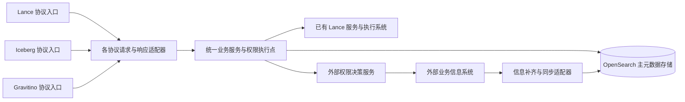

同一对象仅有一个稳定身份，三个协议视图共同引用该身份。统一业务命令记录 `entryProtocol`、协议版本和追踪信息；选择执行后端依据 `tableFormat` 和操作类型。协议入口直接调用统一业务服务，新增工作主要是共享模型补字段、OpenSearch Mapping、三种协议的序列化适配及兼容处理。

共享元数据库不改变数据格式本身。原生 Iceberg 表加载响应仍须满足 Iceberg TableMetadata，不能将 Lance Manifest 或 version 填入 Iceberg metadata-location 或 snapshot-id；缺少格式表达能力的入口明确返回不兼容。Gravitino 治理标签与 Lance 版本 Tag 也分别建模。三类协议的字段边界参见 [Lance 固定协议](https://github.com/lance-format/lance-namespace/blob/62db3400027a6afb4759e84be64365889565c7e6/docs/src/spec.yaml)、[Iceberg 固定协议](https://github.com/apache/iceberg/blob/f2b45bdff1fd1d01294647353ba4787ae6d381cc/open-api/rest-catalog-open-api.yaml)和 [Gravitino REST API](https://gravitino.apache.org/docs/1.3.1/api/rest/gravitino-rest-api/)。本章字段名称、存储结构和处理链路是平台设计。

### 13.2 模型扩展与协议适配功能规格

| 规格编号 | 功能点 | 具体开发要求 |
|---|---|---|
| MODEL-01 | 共享身份与名称 | 三种入口解析到相同 tenantId、catalogId、objectId 和 registrationGeneration；名称按配置映射，改名保留身份，删除重建隔离旧代次 |
| MODEL-02 | 元数据扩展 | 复用现有公共字段；Lance 专属信息归入相应对象的 lance 字段组，协议中无值时保留缺失，不补零或空字符串 |
| MODEL-03 | 字段与类型适配 | 保留 nullable、类型参数、嵌套、字段身份及 metadata；统一列模型与 Arrow Schema 双向转换；不能表达的语义明确失败 |
| MODEL-04 | 命令与响应适配 | 生命周期、属性变更、分页、错误、状态及 JSON / Arrow 媒体类型映射到统一服务；保持入口协议契约，不为另一协议虚构字段 |
| MODEL-05 | OpenSearch Mapping | 显式新增 key、类型、可检索性和字段所有者；补齐读写序列化、查询条件、迁移及旧记录兼容 |
| MODEL-06 | 部分更新与字段保护 | 协议 DTO 转成字段级变更命令，按字段归属合并；旧 Iceberg / Gravitino 请求未携带 lance 字段时必须保留，不能用整个 DTO 覆盖文档 |
| MODEL-07 | 版本化迁移 | 模型版本与 Mapping 版本可追踪；迁移保留对象 ID、代次、待同步状态和外部关联；后台任务与正常写入使用相同条件更新规则 |

### 13.3 按元数据类型新增 OpenSearch key

以下是**建议落库名称**，不代表已经读取过现网 Mapping。实现时先核对已有字段，同义同类型字段直接复用；本表不能导致同一事实出现两个可独立修改的主字段。公共 `objectId/tenantId/catalogId/parentId/name/tableFormat/status/registrationGeneration` 沿用现有结构，尚不存在的补齐。`resourceRevision` 是平台资源事实的业务修订号，不是 OpenSearch `_seq_no`，也不是 Lance version。

| 元数据类型 | 新增或补齐 key | OpenSearch 类型 | 来源与更新规则 |
|---|---|---|---|
| 公共模型 | metadataSchemaVersion、resourceRevision | integer、long | 平台维护；安全相关的平台事实变更递增 resourceRevision，单纯展示信息补齐不递增 |
| Catalog | lance.endpointRef、lance.protocolRevision | keyword | 保存服务配置引用和协议版本；密钥仍只保存凭证引用 |
| Namespace | lance.identifier | keyword 数组 | 保存该对象在 Lance 中的名称路径；顺序从原始文档读取，查询精确身份使用公共规范化名称键 |
| Table 元数据 | lance.managedVersioning、lance.isOnlyDeclared、lance.defaultBranch | boolean、boolean、keyword | 底层确认后更新；未返回的可选值保持缺失 |
| Table 当前状态 | lance.observedBranch、lance.observedVersion | keyword、long | 一起表示本次观测的分支与版本；不能将它们解释为所有分支的统一版本号 |
| Schema / Column | lance.vectorColumns[].fieldPath、dimension、elementType | nested 内 keyword、integer、keyword | 从真实 Arrow Schema 提取；与已有完整列类型模型共存，不以维数摘要替代完整 Schema |
| Schema / Column | lance.schemaMetadata、lance.fieldMetadata | object，enabled=false | 保存协议 metadata；fieldMetadata 使用字段标识及 metadata 的结构化内容，任意业务键不展开为 Mapping |
| Index | lance.index.uuid、indexType、fieldPaths、status、indexedRows、unindexedRows | keyword、keyword、keyword 数组、keyword、long、long | 每个索引对象保存自身定义、统计与观测上下文；索引参数归 lance.extensions |
| Version | lance.version.branch、number、manifestPath、manifestSize | keyword、long、keyword（不建索引）、long | 每个版本独立记录；number 保留协议 int64 范围，不映射到 Iceberg snapshotId |
| Tag / Branch | lance.reference.kind、name、branch、version | keyword、keyword、keyword、long | 引用对象独立记录；分支头通过 Branch 记录表达，不把无限增长历史堆进 Table 文档 |
| Materialized View | lance.view.kind、autoRefresh、sourceVersion、outputVersion、jobId、refreshStatus | keyword、boolean、long、long、keyword、keyword | 定义来自平台，版本与作业结果来自执行系统；可包含多个源依赖，完整定义归既有依赖模型或 extensions |
| Transaction | lance.transaction.id、status | keyword、keyword | 对接实际 transaction_id；job_id 不填入此字段 |
| 格式扩展内容 | lance.extensions | object，enabled=false | 保存不需检索的协议参数及原始扩展对象；有查询需求的属性再显式提升为类型化 key |
| 权限关联 | authorization.resourceId、bindingStatus、bindingRevision、attributeRevision | keyword、keyword、long、keyword | 关联外部资源及确认版本；不保存用户角色清单或可直接放行的全局 allowed 值；attributeRevision 仅供观测 |
| 外部展示信息 | enrichment.sourceSystem、externalObjectId、sourceRevision、status、fetchedAt、display | keyword、keyword、keyword、keyword、date、object | 显式绑定外部对象；display 声明 ownerName、organizationName、businessDomain，只接受该来源负责的字段 |
| 资源同步状态 | delivery.resourceSyncRequired、desiredRevision、acknowledgedRevision、nextAttemptAt | boolean、long、long、date | 与资源事实在同一文档条件更新；恢复任务依据未确认版本补发，详见第 15 章 |

向量列元数据只保存字段类型和维度，不将业务行向量装入元数据索引。Index、Version、Tag / Branch 等记录复用对应类型的公共 tableId 关联。既有列模型负责类型、精度、scale、嵌套和可空性，本表仅补 Lance 所需信息。完整新增 Mapping 示例见 [OpenSearch 字段扩展建议](../examples/opensearch-mapping-additions.json)，其中没有出现的既有字段保持原 Mapping。

新增 `lance`、`authorization`、`enrichment`、`delivery` 字段组使用显式 Mapping；未知键通过校验报错，允许自由扩展的对象单独设置 `enabled=false`，保留 `_source` 但不生成检索字段。不能对整个既有索引直接开启严格模式而破坏旧文档写入。显式 Mapping 与动态字段行为依据 [OpenSearch dynamic 参数](https://docs.opensearch.org/latest/mappings/mapping-parameters/dynamic/)。

### 13.4 共享模型参考示例

假设连接配置将 Gravitino 的 `company/lance_catalog/sales/orders`、Iceberg 的 Catalog=`lance_catalog`、namespace=`["sales"]`、name=`orders`，以及 Lance 的 `["lance_catalog","sales","orders"]` 映射为同一对象 `tbl-001`。下面是 OpenSearch 逻辑文档片段，非标准协议响应：

```json
{
  "objectId": "tbl-001",
  "tenantId": "tenant-01",
  "parentId": "ns-sales",
  "tableFormat": "LANCE",
  "registrationGeneration": 3,
  "metadataSchemaVersion": 2,
  "resourceRevision": 17,
  "lance": {
    "identifier": ["lance_catalog", "sales", "orders"],
    "managedVersioning": true,
    "isOnlyDeclared": false,
    "defaultBranch": "main",
    "observedBranch": "main",
    "observedVersion": 21,
    "vectorColumns": [{"fieldPath": "embedding", "dimension": 3, "elementType": "float32"}]
  },
  "authorization": {
    "resourceId": "tenant-01:TABLE:tbl-001:3",
    "bindingStatus": "READY",
    "bindingRevision": 17
  }
}
```

**同一业务服务、不同协议响应。** Iceberg 的 `HEAD /v1/lance_catalog/namespaces/sales` 与 Lance 的 `POST /v1/namespace/lance_catalog$sales/exists`，均解析为 `NamespaceService.exists(nsSalesId)`。服务完成统一鉴权并读取同一份主元数据；存在时分别序列化为 Iceberg HTTP 204 和 Lance HTTP 200 空响应体。这里不需要为了读取已有 Namespace 再从 Iceberg 入口转发一次 Lance HTTP 请求。

**字段级更新保留 Lance 信息。** 用户通过支持该属性修改的入口把 `properties.comment` 改为“销售订单”。适配器只产生这个字段的变更，服务在读取当前文档后使用条件更新提交；`lance.vectorColumns`、`authorization` 和 `enrichment` 均保留。若旧 DTO 的字段缺失被序列化成 null，不能据此删除其他字段；只有协议明确支持且用户显式请求的删除动作才执行。

**类型适配。** Iceberg `required=true` 对应统一列模型 `nullable=false`，输出 Arrow Field 或 Gravitino 列模型时继续保持；decimal 的 precision/scale、嵌套结构逐项保留。没有等价表达的默认值或字段属性在执行前返回具体路径与原因。

### 13.5 Mapping 更新与验收

1. 新增兼容字段时先更新 Mapping，再发布能写新字段的代码并回填缺失记录；缺失值不能未经来源核实就批量填成成功态。
2. 已有字段类型不兼容时使用新索引、数据迁移及 Alias 切换。OpenSearch 不能直接修改已有数据字段的类型，参见 [Put Mapping API](https://docs.opensearch.org/latest/api-reference/index-apis/put-mapping/)。
3. OpenSearch 是主存储，迁移必须覆盖业务对象、名称占用、在途 Operation、Tombstone、权限关联及待同步状态。采用持久变更记录追平，并在最终切换时短暂冻结写入、等待在途写完成、核对最终增量后切 Alias；恢复写入前验证条件更新和后台任务指向新索引。切换后已有新写入时，回退同样先追平新写入，不能直接切回旧索引。
4. 三种协议定位相同对象 ID；旧协议更新不丢 Lance 字段；旧 Iceberg 记录可读，新 Lance 字段能按需求查询；不允许任意扩展属性造成 Mapping 持续膨胀。
5. Namespace 属性等平台字段在 OpenSearch 中更新；只有底层协议存在对应能力时才下发。不得通过 Namespace Overwrite 伪造属性增量更新。

### 13.6 Java 代码量估算

**共享模型与协议适配：生产 Java 6,800 行，测试 Java 3,800 行，合计 10,600 行。** 生产代码中预计新增 5,300 行、修改 1,500 行。按文首统一口径估算。

| 开发内容 | 新增生产 Java 行数 | 修改生产 Java 行数 | 生产代码合计 |
|---|---:|---:|---:|
| 共享元数据字段、序列化与未知字段保护 | 1,000 | 300 | 1,300 |
| 三种协议的命令、响应、状态及错误适配 | 1,300 | 400 | 1,700 |
| 名称路径、层级与稳定身份解析 | 650 | 250 | 900 |
| Schema、字段路径及 Arrow 类型转换 | 1,200 | 200 | 1,400 |
| Mapping 管理、字段回填及旧数据兼容 | 1,150 | 350 | 1,500 |
| **生产代码合计** | **5,300** | **1,500** | **6,800** |

测试 Java 另计 **3,800 行**。本章替代原协议转换估算，按共享数据库上的协议适配和字段扩展估算；名称、类型及错误转换不在 Catalog、Namespace、Schema / Column 中重复计数。各对象业务规则仍归各对象；主存储的通用幂等和恢复归第 12 章；权限字段和外部补齐字段的业务接入分别归第 14、15 章。本章仅计其公共序列化与 Mapping 支持。

<a id="authorization"></a>

## 14. 统一权限点校验机制

### 14.1 权限执行位置与资源标识

平台维护权限点目录和执行校验，外部权限系统管理用户、组织、角色、授权关系及策略并给出决策。三种协议入口和后台操作调用同一业务服务；服务在解析稳定资源标识后、返回受保护信息或产生副作用前校验。Controller 注解可以声明入口要求，但不能替代服务层校验。默认拒绝、每次请求验证权限的原则参见 [OWASP Authorization Cheat Sheet](https://cheatsheetseries.owasp.org/cheatsheets/Authorization_Cheat_Sheet.html)。

资源引用由 `tenantId + resourceType + objectId + registrationGeneration` 组成，序列化时各分量须使用无歧义编码；本文冒号形式只用于普通字符示例。同一表的 Lance、Iceberg、Gravitino 入口使用同一 resourceId。改名保留 resourceId；同名重建产生新 ID 或代次，旧授权不能自然继承。

| 元数据类型 | 授权资源与粒度 | 处理要求 |
|---|---|---|
| Catalog / Namespace | 各自稳定资源 ID，附 parentResourceId | 创建在父资源上校验；列表权限与子对象详情权限分别处理 |
| Table / Schema / Column | 表资源；字段路径、分支和版本为结构化作用域 | 表元数据与表数据分别授权；字段限制必须真实执行 |
| Index / Version / Tag / Branch | 表资源加子对象标识及操作上下文 | 校验目标索引、版本、标签或分支，不能只校验 URL 中的表名 |
| Materialized View | 视图资源及全部源表、目标输出表资源 | 校验视图操作、源数据读取和输出写入；后台刷新保留委托身份 |
| Transaction / Operation | 事务或操作资源，关联涉及的全部对象 | 事务权限不能替代内部每项业务动作的权限 |

认证主体来自已验证的会话或令牌，租户及代理身份由可信认证上下文产生。请求中的 Lance `identity/context` 仅按已约定的可信映射使用，不能覆盖认证主体。名称解析可内部读取最小定位信息；权限通过前不输出存在性、Schema、路径或错误中的对象详情。

### 14.2 权限点与 54 个 Lance 操作映射

权限点是平台统一业务动作，不以 HTTP 方法或协议路由命名。下表列出基础权限和附加条件；权限系统负责判断角色、组织关系或继承规则，平台不自行推定“owner 一定具有所有权限”。表格中的父级指经过租户和层级校验的父资源。

平台向权限系统发布带版本的权限点目录，包含 action、适用资源类型、语义、必要上下文和支持的约束。外部系统导入目录后配置角色与策略，导入本身不授予任何用户权限。基础权限点和条件追加的权限点均须登记；未知 action 默认拒绝。创建新对象时以父资源及可信的拟建对象上下文决策，不能要求尚不存在的子对象先具备授权记录。

| 编号 / OperationId | 基础权限点 | 资源 | 附加校验 |
|---|---|---|---|
| NS-01 / `CreateNamespace` | `namespace.create` | 父级 | ExistOk 读取既有对象需 namespace.metadata.read；Overwrite 另查 namespace.delete 及受影响子对象动作 |
| NS-02 / `ListNamespaces` | `namespace.list` | 父级 | 逐个候选校验 namespace.metadata.read，执行授权分页 |
| NS-03 / `DescribeNamespace` | `namespace.metadata.read` | Namespace | 属性输出受字段可见性限制 |
| NS-04 / `NamespaceExists` | `namespace.metadata.read` | Namespace | 存在性同样受保护，不因空响应体而跳过 |
| NS-05 / `DropNamespace` | `namespace.delete` | Namespace | Cascade 检查全部子对象实际动作，含注销或物理删除差异 |
| TB-01 / `CreateTable` | `table.create` | 父 Namespace | ExistOk 需既有表 table.metadata.read；Overwrite 需目标 table.data.overwrite 及 table.schema.alter；初始数据、位置按创建范围约束 |
| TB-02 / `DeclareTable` | `table.declare` | 父 Namespace | 按声明请求模式检查既有对象及替换权限，不以声明绕过后续写权限 |
| TB-03 / `RegisterTable` | `table.register` | 父 Namespace | 校验可注册位置及存储范围；Overwrite 还需既有对象 table.deregister，禁止挟持其他对象身份 |
| TB-04 / `ListTables` | `table.list` | Namespace | 逐个候选检查 table.metadata.read |
| TB-05 / `ListAllTables` | `table.list` | Catalog | 跨 Namespace 候选均检查 table.metadata.read，不泄漏无权对象数量 |
| TB-06 / `DescribeTable` | `table.metadata.read` | Table | 返回物理 URI 另查 storage.location.read；实际下发凭证另查 storage.credentials.issue 及对应数据权限 |
| TB-07 / `TableExists` | `table.metadata.read` | Table | 指定历史版本或分支时检查对应作用域 |
| TB-08 / `RenameTable` | `table.rename` | 源 Table | 跨 Namespace 另查目标父级 table.create；检查源、目标和继承关系变化 |
| TB-09 / `DeregisterTable` | `table.deregister` | Table | 仅注销注册，不自动授予物理删除权限 |
| TB-10 / `DropTable` | `table.purge` | Table | 覆盖真实数据删除及依赖约束，不能仅凭注销权限执行 |
| TB-11 / `GetTableStats` | `table.metadata.read`、`table.data.read` | Table | 行数、数据量等统计按数据读取保护 |
| DATA-01 / `InsertIntoTable` | `table.data.insert` | Table | Overwrite 另查 table.data.overwrite；绑定 branch，写入列限制须可执行 |
| DATA-02 / `MergeInsertIntoTable` | `table.data.merge` | Table | 根据 when_* 开关追加 table.data.insert / table.data.update / table.data.delete；所有启用分支均校验 |
| DATA-03 / `UpdateTable` | `table.data.update` | Table | 覆盖 predicate、表达式引用列、目标列与分支；全表更新也需允许的作用域 |
| DATA-04 / `DeleteFromTable` | `table.data.delete` | Table | 覆盖 predicate 及分支；删除行不同于删除表文件 |
| DATA-05 / `QueryTable` | `table.data.read` | Table | 过滤、投影、计划、统计及历史版本均执行相同数据范围限制 |
| DATA-06 / `CountTableRows` | `table.data.read` | Table | 过滤、投影、计划、统计及历史版本均执行相同数据范围限制 |
| DATA-07 / `ExplainTableQueryPlan` | `table.data.read` | Table | 过滤、投影、计划、统计及历史版本均执行相同数据范围限制 |
| DATA-08 / `AnalyzeTableQueryPlan` | `table.data.read` | Table | 过滤、投影、计划、统计及历史版本均执行相同数据范围限制 |
| SC-01 / `AlterTableAddColumns` | `table.schema.alter` | Table | 校验目标字段；有表达式计算或数据重写时追加相应数据读取/更新权限 |
| SC-02 / `AlterTableAlterColumns` | `table.schema.alter` | Table | 校验目标字段；有表达式计算或数据重写时追加相应数据读取/更新权限 |
| SC-03 / `AlterTableDropColumns` | `table.schema.alter` | Table | 校验目标字段；有表达式计算或数据重写时追加相应数据读取/更新权限 |
| SC-04 / `UpdateFieldMetadata` | `table.schema.metadata.alter` | Table | 只修改协议 metadata；不得借此修改外部安全属性 |
| SC-05 / `UpdateTableSchemaMetadata` | `table.schema.metadata.alter` | Table | 只修改协议 metadata；不得借此修改外部安全属性 |
| SC-06 / `AlterTableBackfillColumns` | `table.schema.backfill`、`table.data.read`、`table.data.update` | Table | 校验来源列、目标列和分支；作业派发前重新鉴权 |
| IDX-01 / `CreateTableIndex` | `table.index.create` | Table + 索引上下文 | 覆盖目标列；替换既有索引另查 table.index.drop；构建执行使用受控服务身份 |
| IDX-02 / `CreateTableScalarIndex` | `table.index.create` | Table + 索引上下文 | 覆盖目标列；替换既有索引另查 table.index.drop；构建执行使用受控服务身份 |
| IDX-03 / `ListTableIndices` | `table.index.read` | Table | 按索引及列可见范围返回 |
| IDX-04 / `DescribeTableIndexStats` | `table.index.read`、`table.data.read` | Table + Index | 统计不得泄漏超出读取范围的数据分布 |
| IDX-05 / `DropTableIndex` | `table.index.drop` | Table + Index | 校验准确索引标识及分支，不授予删除表权限 |
| VER-01 / `ListTableVersions` | `table.version.read` | Table + 版本范围 | 覆盖分支；返回 Manifest 位置另查 storage.location.read |
| VER-02 / `DescribeTableVersion` | `table.version.read` | Table + 版本范围 | 覆盖分支；返回 Manifest 位置另查 storage.location.read |
| VER-03 / `CreateTableVersion` | `table.version.commit` | Table + 版本范围 | 校验 Manifest 归属及提交分支；批次逐项检查 |
| VER-04 / `BatchCreateTableVersions` | `table.version.commit` | Table + 版本范围 | 校验 Manifest 归属及提交分支；批次逐项检查 |
| VER-05 / `BatchDeleteTableVersions` | `table.version.delete` | Table + 版本范围 | 逐项授权并保护引用；版本记录删除不隐含文件回收权限 |
| VER-06 / `RestoreTable` | `table.version.restore` | Table + 目标版本 | 校验目标分支、来源版本与恢复范围，不以普通元数据修改权限替代 |
| REF-01 / `ListTableTags` | `table.tag.read` | Table + Tag | 返回指向版本时限制可见范围 |
| REF-02 / `GetTableTagVersion` | `table.tag.read` | Table + Tag | 返回指向版本时限制可见范围 |
| REF-03 / `CreateTableTag` | `table.tag.create` | Table + Tag | 创建或改指向时校验目标版本 table.version.read；删除引用不删除版本 |
| REF-04 / `UpdateTableTag` | `table.tag.update` | Table + Tag | 创建或改指向时校验目标版本 table.version.read；删除引用不删除版本 |
| REF-05 / `DeleteTableTag` | `table.tag.delete` | Table + Tag | 创建或改指向时校验目标版本 table.version.read；删除引用不删除版本 |
| REF-06 / `ListTableBranches` | `table.branch.read` | Table | 逐分支限制可见性 |
| REF-07 / `CreateTableBranch` | `table.branch.create` | Table + Branch | 校验源分支/版本 table.version.read |
| REF-08 / `DeleteTableBranch` | `table.branch.delete` | Table + Branch | 覆盖目标分支及其依赖，不扩大到其他分支 |
| MV-01 / `CreateMaterializedView` | `view.create` | 父 Namespace | 全部源表 table.data.read；立即/自动刷新检查 view.refresh 和输出写入/覆盖范围，并建立受控委托 |
| MV-02 / `RefreshMaterializedView` | `view.refresh` | View | 全部源表 table.data.read，输出表按实际刷新方式检查 table.data.insert / table.data.overwrite；校验委托与源版本 |
| TX-01 / `BatchCommitTables` | `transaction.commit` | 提交范围 | 每项分别展开 table.declare、table.version.commit、table.version.delete、table.deregister；全部允许后才能提交 |
| TX-02 / `DescribeTransaction` | `transaction.read` | Transaction | 校验参与对象详情可见性，不能只凭知道 transaction_id 返回内容 |
| TX-03 / `AlterTransaction` | `transaction.alter` | Transaction | 逐项校验 actions 及参与对象管理范围；终态只允许具备执行协调职责的主体更新 |

上述映射也保存为 [权限点与标准接口对照](../examples/authorization-operation-map.json)。每个标准 OperationId 必须匹配一条规则；未配置的新增入口拒绝执行，不能默认允许。

平台自有接口另需 `catalog.configure`、`catalog.metadata.read`、`namespace.properties.alter`、`table.properties.alter`、`metadata.sync.read`、`metadata.sync.execute`、`operation.read`、`operation.retry`、`storage.location.read`、`storage.credentials.issue` 和 `resource.security_attributes.alter`。查询 Operation 还需覆盖其目标资源；恢复已确认结果不重复产生副作用，真正重试业务动作时重新校验原动作权限。普通 properties 更新不允许修改 owner 身份、组织范围、安全等级等受控属性。凭证下发按目标数据权限限制可读写范围及有效期，不能下发后台通用服务凭证。

版本提交能引入新的数据内容，`table.version.commit` 应授予受信任的写入或提交协调身份，并校验 Manifest 来源和数据范围；不能将它并入普通元数据编辑权限。物化视图的 source_query 是不透明序列化内容，源依赖必须由已识别该格式的可信执行适配器解析并与请求摘要绑定，不能相信客户端自行声称的 sourceObjects；无法核实完整依赖时拒绝创建或刷新。

### 14.3 校验流程与决策契约

1. 认证并解析协议请求，取得真实操作者、服务代理身份、租户、结构化业务动作和输入摘要。
2. 按稳定 ID 实时读取资源、父级及当前状态，排除删除、重建、未完成权限绑定和挂起变更；只把平台负责的事实交给权限系统。
3. 生成本次全部 `subject/action/resource/context` 检查项。创建、跨父级改名、Cascade、合并写入、多表提交及视图刷新不能只检查第一项；对检查项批量决策并验证响应逐项完整。
4. 权限系统结合自己管理的策略和外部权威安全属性返回 `ALLOW`、`DENY` 或 `INDETERMINATE`，并返回 decisionId、policyRevision、资源修订及属性版本。只有全部必要检查明确允许，且所有返回约束可执行，才进入业务操作。
5. 执行前校验资源代次、资源修订和操作占用仍与决策一致；发生变化重新解析并鉴权。审计关联 decisionId、actor、服务身份、动作、目标、operationId 和结果，不记录凭证或完整敏感策略。

`DENY` 表示明确无权限；超时、漏项、未知资源、必要属性缺失或版本无法确认属于不可判定，均不得放行。外部故障向调用者返回协议允许的依赖不可用错误，与业务拒绝区分；保持各协议错误模型，不在标准响应里追加平台私有字段。所有新增权限交互接口都是第 15 章定义的平台与外部系统契约，不是 Lance 标准接口。

默认只在同一请求内去重检查，不启用跨请求 ALLOW 缓存。授权决策是一次请求的时点判断，不保证已开始的底层操作能被随后撤权回滚。异步任务在实际派发前重新鉴权；长任务使用有界委托期限和执行系统支持的检查点，撤权后停止后续可控执行并撤销可控访问令牌。需要“撤权立即中止所有在途操作”时，必须由权限服务、执行系统与凭证服务共同支持，不能靠平台缓存失效声称实现。

### 14.4 列表、搜索、字段限制与异步执行

| 场景 | 必须实现的行为 |
|---|---|
| 列表及 OpenSearch 搜索 | 父级列表权限通过后，候选对象按批次校验详情可见性；返回前复核当前代次、生命周期及权限关联状态。需要时使用权限系统提供的可验证查询范围预过滤，最终校验仍保留 |
| 分页与数量 | 不能先取一页再删掉无权限项就宣称正常分页；持续扫描候选并批量校验，直到填满或达到有界扫描量。未结束时保留后续游标；不返回未授权对象总数、聚合或高亮信息 |
| 游标 | 绑定租户、主体、动作、查询与排序摘要及权限版本；版本变化时明确使游标失效。游标保存最后扫描位置，未消费候选不能被跳过；下一页仍重新鉴权 |
| 行列权限 | 权限服务返回结构化字段许可和过滤约束，平台校验后在数据执行层生效。Count、Explain、Analyze、历史版本、导出及物化视图同样执行；底层无法实现某种限制时拒绝该请求，不能只隐藏页面或忽略限制 |
| 查询约束组合 | 用户过滤与权限过滤取交集；限制投影、过滤、排序和表达式中可引用的列。不能接受外部拼接的任意 SQL，也不能仅在已经分页的结果上过滤以替代执行层权限 |
| Cascade 与批量动作 | 建立受影响对象集合并逐项授权，或使用权限系统明确支持且绑定集合版本的子树决策；执行前校验集合未变化。任一不通过时不调用底层原子批量接口 |
| 后台与系统任务 | 记录执行服务身份及 onBehalfOf / delegationId；用户作业不因后台账号有广泛权限而越权。纯系统对账使用单独服务权限，只同步技术事实，不借对账触发用户数据变更 |
| 物化视图与结果 | 创建、刷新、结果读取分别鉴权；视图结果权限不得因派生过程自动放宽。策略须定义源权限变更对已物化结果的影响；没有可验证的派生授权策略时，读取结果同时校验相关源权限 |

协议支持前提只保证已有 Lance 操作可执行，不自动保证执行系统支持所有外部权限约束。自动刷新需要执行系统在派发时使用同一委托与权限检查契约；行列限制、委托失效或撤权处理无法被实际执行时，该运行配置不能启用，并列为外部执行接入的联调约束，不能在入口放行后依赖后台特权账号继续运行。

### 14.5 验收标准

- 54 个操作全部映射到权限点；同一主体通过三种协议执行同一动作，得到一致决策。
- 更换请求中的名称、租户、identity、版本、分支或子对象不能绕过校验；改名不丢授权，同名重建不继承旧授权。
- 批量、覆盖、合并、Cascade、视图和后台任务的附加动作均被检查；校验失败时无业务副作用。
- 权限依赖超时、返回缺项、属性过期、未知约束均不放行；展示信息补齐失败不影响已有有效决策。
- 列表、分页、聚合和统计不泄漏无权对象；受限字段与行过滤在实际执行层生效。

### 14.6 Java 代码量估算

**统一权限点校验：生产 Java 4,200 行，测试 Java 2,800 行，合计 7,000 行。** 生产代码中预计新增 3,600 行、修改 600 行。按文首统一口径估算。

| 开发内容 | 新增生产 Java 行数 | 修改生产 Java 行数 | 生产代码合计 |
|---|---:|---:|---:|
| 权限点目录、54 个操作及平台接口映射 | 900 | 100 | 1,000 |
| 统一权限执行器、批量决策及异常处理 | 1,000 | 200 | 1,200 |
| 搜索分页、复合动作与异步委托校验 | 1,050 | 200 | 1,250 |
| 决策约束应用、审计关联与资源版本复核 | 650 | 100 | 750 |
| **生产代码合计** | **3,600** | **600** | **4,200** |

测试 Java 另计 **2,800 行**。对象章节中已有的校验调用位置继续计入对应对象，本章只计公共机制。外部权限产品、策略管理界面和底层行列权限执行器不在此行数内；平台负责识别可执行约束、正确下发和在无法执行时拒绝。

<a id="external-integration"></a>

## 15. 外部权限系统与信息补齐交互

### 15.1 系统职责与字段归属

采用“稳定资源引用、统一批量决策、按字段归属补齐、版本化异步同步”的交互方式。权限系统与业务信息系统可以是同一个外部产品，也可以是两个服务，平台通过独立的适配接口访问，不让协议 Controller 直接依赖各外部系统的数据结构。

| 信息 | 权威维护方 | 平台保存和使用方式 |
|---|---|---|
| 对象 ID、名称、父子关系、格式、生命周期 | 平台，OpenSearch 主存储 | 形成最小资源事实并同步权限系统；名称变化不改变授权身份 |
| Schema、索引、Lance 版本与执行结果 | 已有 Lance / 执行系统提供事实，平台记录于 OpenSearch | 经过核实更新；不能被业务补齐接口覆盖 |
| 用户、角色、组织成员关系、授权与策略 | 权限系统 | 平台发起决策，不在 OpenSearch 复制完整权限关系自行判断 |
| 安全等级、资源所属组织、权限意义上的 owner 等属性 | 逐字段约定的外部权威系统 | 由权限系统取得可信版本参与判定；OpenSearch 的可选展示值和版本标记不能作为放行依据 |
| 负责人显示名、组织显示名、业务域说明等 | 业务信息系统 | 批量补齐到 enrichment，用于展示与检索，记录来源、修订、获取时间和状态 |

同一个“负责人”需要区分 `ownerId` 的权限语义和 `ownerName` 的展示语义。修改 ownerName 不能转移资源权限；修改 ownerId 必须走独立受控属性接口，由其权威系统提交并触发策略关联更新。外部提供者只能更新登记的字段白名单，不能修改 tableId、tableFormat、Schema、同步状态或权限决策。

对象关联优先由外部系统保存 `clientReference=resourceId`。若外部系统只能使用自己的 assetId 等业务 ID，适配器保存 `sourceSystem + externalObjectId` 与平台 resourceId 的显式绑定，并校验租户和代次；不得按显示名称自动匹配。同一外部来源的绑定冲突拒绝合并，未建立绑定返回未匹配状态。本文 enrichment 展示一个来源的结构；多来源时按“资源 ID + 来源系统”保存独立补齐记录和游标，不把多个来源的 sourceRevision 混在同一字段。

### 15.2 三类交互契约

以下路径是**建议的系统间接口**，需双方实现或适配现有能力，不属于三个标准协议。调用采用已认证的服务身份；用户身份只在可信委托上下文中传递。

| 契约 | 调用方向与建议接口 | 请求要点 | 响应及失败语义 |
|---|---|---|---|
| 资源事实同步 | 平台 → 权限系统：`POST /integration/v1/resources:upsert`、`POST /integration/v1/resources:retire` | resourceId、parentResourceId、generation、resourceRevision、最小事实、幂等键 | 返回 acceptedRevision；同版本同内容幂等，同版本异内容冲突，旧版本不能覆盖新版本；Retire 保留删除代次 |
| 运行时决策 | 平台 → 权限系统：`POST /integration/v1/authorization:batchCheck` | 主体、全部 action/resource 检查项、资源版本、分支/列等上下文 | 每项返回决定、decisionId、策略版本、资源及属性版本和约束；缺项或依赖不可用为不可判定 |
| 展示信息补齐 | 平台 → 业务信息系统：`POST /integration/v1/enrichment:batchGet` | 资源引用数组、fieldMask、已知来源版本 | 每项独立返回 FOUND / NOT_FOUND / NOT_MODIFIED / UNAVAILABLE；部分失败可返回已有展示值并标记 STALE |
| 权限属性取数 | 权限系统 → 属性权威系统：`POST /integration/v1/security-attributes:batchGet` | 资源/主体引用、属性集合、版本与新鲜度要求 | 返回属性值、版本和生效时间；不存在、无法确认当前版本或读取失败均不产生 ALLOW |
| 变化通知与补偿 | 外部系统 → 平台通知；平台 → 外部系统拉取 changes | eventId、sourceSystem、resourceId、generation、revision、变更类别；按来源保存 cursor | 通知至少一次投递、可重复；断点拉取和周期核对修复漏事件，游标失效时允许全量核对 |

将关键属性的取数聚合在权限系统，使一次 `batchCheck` 就能得到完整决定，避免平台先拉角色、再拉组织、再拉安全等级后自行拼策略。权限系统使用平台同步的最小资源事实或本次可信资源上下文，不在判定过程中反向调用同一个受保护业务接口，防止递归鉴权和循环依赖。

展示补齐使用缓存加异步刷新；安全属性默认在决策时从权威来源批量读取，或由权限系统提供有明确版本屏障的等价一致性能力。单纯“事件最终会到”不足以保证安全属性变更后的授权正确。`attributeRevision` 只表示曾观察的版本，不能证明目前仍有效。外部属性的体量、变化频率和一致性要求决定取数方式，可参考 [OPA External Data](https://www.openpolicyagent.org/docs/external-data) 的设计讨论；本方案不要求采用 OPA。

### 15.3 一次读取请求的具体交互示例

用户从 Lance 入口读取 `orders`，平台认证后解析到 `tenant-01:TABLE:tbl-001:3`，从 OpenSearch 实时取得当前资源事实。下面是平台向权限系统发送的自定义批量校验请求；客户端不能自行指定 subject 覆盖真实用户：

```json
{
  "requestId": "req-1001",
  "subject": {"tenantId": "tenant-01", "principalId": "user-07"},
  "callerService": "metadata-platform",
  "checks": [{
    "checkId": "check-1",
    "action": "table.metadata.read",
    "resource": {
      "resourceId": "tenant-01:TABLE:tbl-001:3",
      "resourceRevision": 17,
      "parentResourceId": "tenant-01:NAMESPACE:ns-sales:1"
    },
    "context": {"entryProtocol": "LANCE"}
  }]
}
```

权限系统确认资源版本、策略和所需的安全属性后响应：

```json
{
  "requestId": "req-1001",
  "decisions": [{
    "checkId": "check-1",
    "decision": "ALLOW",
    "decisionId": "decision-8001",
    "policyRevision": "policy-35",
    "resourceRevision": 17,
    "attributeVersions": {"business-system": "attr-91"},
    "constraints": {}
  }]
}
```

只有检查项、主体上下文和资源版本匹配，平台才返回受保护元数据。`entryProtocol` 供审计，不作为放宽权限的依据。权限系统若只持有 resourceRevision=16，则先用可信事实补齐到 17 或返回不可判定，不能悄悄用旧父级关系判定。

平台可同时准备展示信息，但只在权限通过后输出。对业务系统的补齐请求为：

```json
{
  "resources": [{"resourceId": "tenant-01:TABLE:tbl-001:3", "generation": 3}],
  "fieldMask": ["display.ownerName", "display.organizationName", "display.businessDomain"],
  "knownRevisions": {"tenant-01:TABLE:tbl-001:3": "display-108"}
}
```

参考响应：

```json
{
  "items": [{
    "resourceId": "tenant-01:TABLE:tbl-001:3",
    "generation": 3,
    "status": "FOUND",
    "sourceSystem": "business-system",
    "sourceRevision": "display-109",
    "fetchedAt": "2026-10-29T02:00:00Z",
    "fieldMask": ["display.ownerName", "display.organizationName", "display.businessDomain"],
    "values": {
      "display.ownerName": "订单负责人",
      "display.organizationName": "销售业务部",
      "display.businessDomain": "销售"
    },
    "removedFields": []
  }]
}
```

平台只合并 fieldMask 允许且属于该系统的字段；删除通过 removedFields 明示，未返回字段不能理解为删除。示例修订号是不可比较的字符串，需通过来源游标、条件请求或重新拉取当前值确认顺序，不能按字符串大小排序。展示数据过期可以返回 STALE；`NOT_FOUND` 表示未匹配到补齐记录，不能据此删除平台资源。外部私有字段不直接追加到 Lance / Iceberg / Gravitino 标准响应，可通过平台业务 DTO 展示，或使用协议明确允许且已登记的扩展属性。

### 15.4 OpenSearch 主存储下的资源绑定与可靠同步

**持久状态。** 资源文档在同一次条件更新中保存资源事实、`resourceRevision`、`authorization.bindingStatus` 和 `delivery`。`delivery.desiredRevision` 指向待发送的最新完整资源快照，`acknowledgedRevision` 是外部已确认版本。资源同步是最新状态收敛，不需要为每次中间改名都构造独立业务事件；审计历史仍保存在 Operation 中。权限资源注册可以使用以下载荷：

```json
{
  "idempotencyKey": "tenant-01:TABLE:tbl-001:3:17",
  "resourceId": "tenant-01:TABLE:tbl-001:3",
  "generation": 3,
  "resourceRevision": 17,
  "parentResourceId": "tenant-01:NAMESPACE:ns-sales:1",
  "facts": {"name": "orders", "tableFormat": "LANCE", "lifecycle": "ACTIVE"}
}
```

**创建流程。** 先校验父资源上的创建权限并持久化 Operation，原子占用名称；以稳定 ID 创建 `PROVISIONING` 资源，并保存 `bindingStatus=PENDING` 和待同步版本。按操作记录调用已有底层创建/注册接口并核实结果，完成必要的外部资源绑定；底层成功且权限系统确认所需版本后，条件更新为可用状态。权限绑定的资源事实描述业务身份及预期有效关系，平台 PROVISIONING / 协调中状态另行控制可见性，不能把外部确认标记的回写再次算作资源事实变更而形成无限重绑。资源存在不自动授予创建者所有权限，初始授权由权限系统策略决定。创建中的对象对普通查询不可见，创建者通过经授权的 Operation 查询进度。

**关键属性与移动流程。** 改名但不改变权限意义时仍同步名称；跨 Namespace 移动、父级变化及其他影响策略的事实修改先将对象置为挂起变更状态，保留旧事实与待提交事实，阻止相关业务访问；获得源、目标权限后执行并同步新事实。外部确认新版本后再激活。父级关系可能影响子树，相关访问还须检查祖先挂起状态；不能只改父对象而让子对象继续按旧继承授权访问。

**删除流程。** 先以条件更新阻止新访问并持久化删除意图，再按权限和底层操作语义执行注销或删除，最后退休外部资源。删除代次、外部确认状态和待重试信息保留在主文档的 Tombstone 中，直到外部确认及事件有效窗口过去；不能先物理删除唯一待同步记录。外部 Retire 必须带代次和修订，避免旧事件影响同名新对象。

**补偿与故障窗口。** 后台扫描 resourceSyncRequired=true 的记录，实时读取最新版本后幂等发送；收到确认时使用条件更新，只有确认版本覆盖当前 desiredRevision 才可清除待同步标记。进程在外部成功后、回写前崩溃时重发同一版本即可。业务事实和待同步标记在同一文档更新，避免假设“写业务文档 + 另写消息文档”具有事务性。OpenSearch Search 用于发现待处理对象，发现后用实时 GET 和条件写取得处理资格；近实时检索延迟只影响重试时效，不能据其未命中判定已同步。

Operation、名称占用和资源文档仍属于多文档协调。先持久化操作，再逐步推进，保存每一步可核实的状态；中途断电由恢复器继续，不能当作一个数据库事务。OpenSearch Bulk 的每项独立执行，参见 [Bulk API](https://docs.opensearch.org/latest/api-reference/document-apis/bulk/)。不存在外部确认时保持不可用或待核实状态；不得为了返回成功绕过权限绑定，也不得用重复建表修复绑定失败。同步状态可通过平台操作接口观察；标准协议不得把未完成的绑定包装成已完成业务响应，超时后按幂等记录核实结果。

### 15.5 失败、补齐与变更处理

| 情况 | 平台行为 |
|---|---|
| 权限系统不可用或安全属性无法确认 | 不返回受保护数据、不执行变更；报告依赖不可用，不能降级为使用 OpenSearch 展示属性放行 |
| 展示补齐超时或部分字段缺失 | 在授权已通过的前提下返回基础元数据和已有展示信息；平台 DTO 标记 STALE / PARTIAL，后台重试 |
| 资源同步未确认 | 新建或关键关系变更保持不可用；操作查询保留重试次数、错误和下一次执行时间 |
| 外部确认丢失 | 按资源 ID、代次和版本幂等重发，不能新建第二个权限资源 |
| 展示事件重复或乱序 | 按事件 ID 去重；版本可比较则条件应用，不可比较则重新拉取当前值；只更新该来源字段 |
| 安全属性或策略变更 | 权限系统负责后续决策读取有效版本，平台事件用于使本地展示/游标失效；不把事件到达作为撤权生效的唯一条件 |
| 字段来源不匹配或试图越界写入 | 拒绝该字段更新并记录原因，保留原有主元数据，不进行整文档替换 |
| 删除后收到旧补齐结果 | 校验 objectId、generation 和生命周期，忽略旧结果，不复活已删除资源 |

外部系统应提供批量接口、幂等写、逐项状态、来源版本、变更拉取及最小资源事实确认能力。若某项现有接口缺失，必须在联调契约中落实对应提供方；“底层已支持 Lance”不代表这些自定义外部接口也天然存在。平台适配工作计入本需求，外部产品自身的策略引擎和属性主数据维护不混入平台 Java 行数。

### 15.6 验收标准

- 创建、改名、移动、删除及同名重建可正确同步同一个稳定资源身份；任一同步点故障均可恢复。
- 外部写入成功、平台回写失败时重复调用幂等；较旧确认不能清除更新版本的待同步任务。
- 权限属性读取失败阻止访问，展示信息读取失败允许在授权后降级展示；字段来源和删除语义清晰。
- 不发生鉴权递归调用；列表按批次调用外部接口，不为每个结果逐一发起多轮查询。
- 进程重启、事件漏失、OpenSearch Refresh 延迟、父级变更、外部游标失效和删除重建均有可验证恢复路径。

### 15.7 Java 代码量估算

**外部权限与信息补齐接入：生产 Java 4,600 行，测试 Java 3,000 行，合计 7,600 行。** 生产代码中预计新增 4,100 行、修改 500 行。按文首统一口径估算。

| 开发内容 | 新增生产 Java 行数 | 修改生产 Java 行数 | 生产代码合计 |
|---|---:|---:|---:|
| 外部服务客户端、契约及认证适配 | 800 | 100 | 900 |
| 资源注册退休、版本确认与可用状态协调 | 1,100 | 150 | 1,250 |
| 展示信息批量补齐、字段归属及过期处理 | 900 | 100 | 1,000 |
| 变化通知、断点拉取及同步恢复接入 | 850 | 100 | 950 |
| 联调错误映射、状态查询及配置 | 450 | 50 | 500 |
| **生产代码合计** | **4,100** | **500** | **4,600** |

测试 Java 另计 **3,000 行**。本章复用第 12 章的条件更新、操作记录、重试与对账框架，只计外部资源和补齐契约的适配；第 14 章的权限点、决策编排不重复计算。外部权限系统调用其属性提供方的服务端实现不计入平台代码量。


<a id="acceptance"></a>

## 16. 整体验收要求

各对象章节中的验收标准共同生效，下表在底层系统已支持本文 Lance 协议的环境中验收平台接入及跨接口组合行为；外部权限及业务信息系统按第 15 章契约联调。全部平台功能完成后才能判定本需求验收通过；底层协议服务、计算引擎和事务设施的开发不属于验收交付范围。

| 用例编号 | 对象 / 场景 | 预期结果 |
|---|---|---|
| AT-01 | 54 个标准操作的契约校验 | OperationId、Method、URI、参数位置、媒体类型、响应模型与固定协议一致 |
| AT-02 | Catalog 格式路由与旧数据 | 原有 Iceberg 行为兼容，Lance 不进入 Iceberg 专有元数据提交逻辑 |
| AT-03 | Namespace 创建、列举、属性与删除 | 层级、分页、平台属性边界正确；非空 Restrict 拒绝，Cascade 可恢复 |
| AT-04 | 父 Namespace 删除与子表创建并发 | 无可见孤儿表，无越权删除 |
| AT-05 | 100 并发同名表创建，跨多个 Pod | 只有一个有效名称拥有者和对应注册 |
| AT-06 | 同幂等键重复及同键异输入 | 重复返回同一结果；异输入返回冲突 |
| AT-07 | 空表、初始数据、Declare 与 Register | 真实 Schema、物理数据、声明态与注册状态匹配 |
| AT-08 | 底层成功后 OpenSearch 不可用或节点退出 | 不重复执行业务写入，恢复后补齐元数据 |
| AT-09 | 超时但底层实际完成 | 保留待核实操作，确认后返回同一结果 |
| AT-10 | Rename 与 Create / Drop 交错竞争 | 名称映射正确，无双 ACTIVE 名称，旧名释放时机正确 |
| AT-11 | Deregister / Drop / DeleteFromTable | 分别满足保留文件、删除表数据、删除行的语义 |
| AT-12 | Arrow 类型与字段演进 | 向量、嵌套、可空性、特殊字符、metadata 均正确保存 |
| AT-13 | 回填作业与依赖冲突 | job_id 可追踪，失败不伪装成功；不合法依赖变更被拒绝 |
| AT-14 | 数据写入、合并、更新、删除 | 行结果、影响行数（协议返回时）与版本一致，无重复副作用 |
| AT-15 | 向量 / 全文 / 过滤查询与计划 | 查询内容、Arrow file、裸整数、JSON 字符串及历史读取均正确 |
| AT-16 | 三类索引创建与删除 | 构建状态、覆盖行数、版本上下文可核实；不误删表数据 |
| AT-17 | 原生与托管版本模式 | 提交权威清晰，单版本冲突及批量原子要求满足 |
| AT-18 | 版本记录清理与 Restore | 引用保护有效，物理回收责任明确，恢复后读取一致 |
| AT-19 | Tag / Branch 全部操作 | 引用指向正确，分支隔离，默认分支及在途操作保护有效 |
| AT-20 | 物化视图创建及手动 / 自动刷新 | 源版本、输出版本、作业状态匹配，失败保留最近成功结果 |
| AT-21 | 多表提交与事务 actions 中途失败 | 权威元数据全成功或全不生效，不暴露伪原子结果 |
| AT-22 | 外部 SDK 变更、事件乱序/重复/遗漏 | 通过通知和对账恢复，旧结果不覆盖当前确认状态 |
| AT-23 | 删除后同名重建，再收到旧事件 | tableId / generation 隔离，旧对象不复活，新对象不被误删 |
| AT-24 | 越权、凭证下发、审计与错误 | 无未授权副作用，敏感内容不入日志或索引 |
| AT-25 | 大报文、断流、资源释放与索引迁移 | 无持续资源泄漏，失败可诊断，存量 Iceberg 数据保持可用 |
| AT-26 | 三种协议共享模型与字段保护 | 同一对象共用 ID，名称、类型、响应及错误适配正确；旧协议写入不丢失 Lance 新增字段 |
| AT-27 | 主存储新增 Mapping 与迁移 | 新 key 类型明确、任意属性不膨胀 Mapping；对象、占用和待同步状态完整迁移 |
| AT-28 | 54 个操作与平台接口权限覆盖 | 所有入口、复合动作和异步任务执行统一权限校验，无默认放行路径 |
| AT-29 | 外部权限与安全属性故障 | 超时、未知版本、漏项、未知约束均不放行；返回可区分的错误 |
| AT-30 | 展示信息补齐与字段归属 | 权限已通过时可降级展示；展示字段不修改安全属性或技术主元数据 |
| AT-31 | 资源绑定、移动、删除与重建 | 稳定 ID 和代次正确；外部确认前保持受控状态，旧事件不能污染新对象 |
| AT-32 | 外部成功但平台回写失败 | 幂等重发、条件确认、游标恢复及对账有效，较旧确认不清除更新任务 |
| AT-33 | 权限分页、统计与派生结果 | 无无权对象数量泄漏；过滤及字段限制实际生效，视图和历史读取不绕过源权限策略 |
| AT-34 | OpenSearch 主存储协调中读取 | Refresh 延迟不导致重复创建或越权；多对象写到一半时不暴露伪原子结果 |

开发交付物包括统一业务接口与 Lance Adapter、共享模型的协议适配器及操作映射表、上述对象的主元数据模型和 OpenSearch 新增字段映射、统一权限执行器和 54 项权限映射、外部资源绑定与信息补齐契约、版本及事务接口接入与结果跟踪、平台同步与恢复机制、接口契约和验收用例、配置与运维说明。完成情况按对象及接口逐项检查，验证平台正确使用底层协议语义并处理异常；不交付底层 Lance 协议服务、执行引擎或原子提交设施。

<a id="architecture-views"></a>

## 17. 4+1 架构视图与关键流程

本章将前述功能规格整理为逻辑、开发、进程、物理和场景五个视角，流程以第 12—15 章的存储、权限和外部交互规则为准。三种协议共用 OpenSearch 主元数据存储；底层已支持固定 Lance 协议；权限策略和安全属性由外部权威系统提供。

所有图使用 Markdown 的 `mermaid` 围栏代码块，节点、连线和判断条件均可直接编辑。支持 Mermaid 的 Markdown 阅读器可渲染图形；其他阅读器保留图形源代码。可复制的独立文件见 [4+1 架构视图 Markdown](architecture-4plus1.md)。实线表示调用、依赖或流程推进，标注“异步”的连线表示后台处理，不表示必须引入消息中间件。

| 视图 | 回答的问题 | 本章内容 |
|---|---|---|
| [逻辑视图](#view-logical) | 系统有哪些职责与核心对象 | 共享业务服务、元数据对象与外部系统边界 |
| [开发视图](#view-development) | Java 模块如何组织、依赖如何约束 | 协议入口、应用服务、领域模型、接口与实现 |
| [进程视图](#view-process) | 一次操作如何执行、失败后如何处理 | 请求、鉴权、创建、变更、补齐、恢复、批量提交、异步作业与删除 |
| [物理视图](#view-physical) | 服务和存储部署在哪里 | 无状态服务实例、后台任务、OpenSearch 与外部依赖 |
| [场景视图](#view-scenarios) | 上述设计如何支撑真实业务 | 典型使用场景与功能、流程、验收用例对应关系 |

<a id="view-logical"></a>

### 17.1 逻辑视图：职责与共享元数据

三种协议只形成不同的请求与响应视图，业务服务操作相同的对象。Table 元数据与 Table 数据分别管理；Schema、Index、Version、Tag / Branch 等通过稳定表身份关联。下图中的元数据对象均落在同一套主存储体系中，不表示各自独立建库。

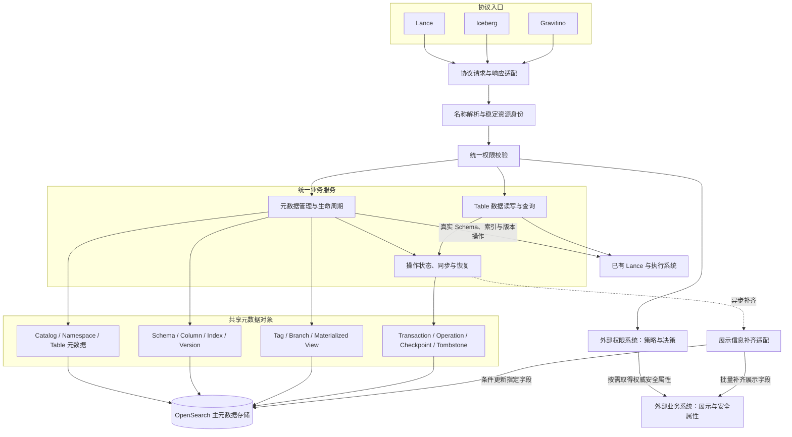

权限系统使用稳定 resourceId，业务补齐系统使用同一引用或显式绑定的 externalObjectId。展示字段只影响展示与检索；安全属性通过权限系统参与决策。Lance 的物理事实与平台身份分别有明确来源，不能仅写 OpenSearch 就认为底层数据操作已成功。

<a id="view-development"></a>

### 17.2 开发视图：Java 模块与依赖方向

以下为建议的包或模块边界，可映射到现有工程，无须为每个框框创建独立进程。箭头表示代码依赖；应用服务通过接口调用基础设施，协议入口不直接操作 OpenSearch 或调用外部权限客户端。

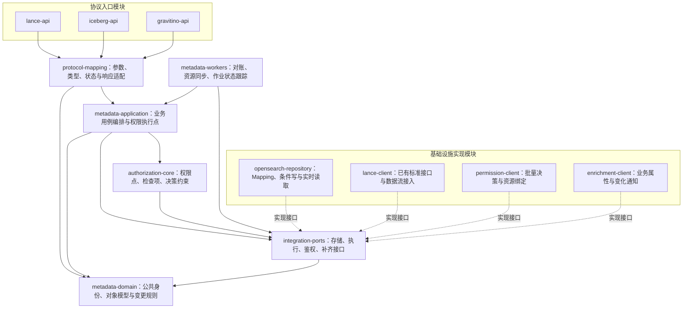

协议 DTO 的缺失字段不能转成全量文档覆盖。公共转换、权限执行和恢复框架各实现一次；后台任务复用业务规则，使用明确的服务身份或用户委托。模块拆分不新增功能范围，Java 估算仍对应第 1.5 节及各对象章节。

<a id="view-process"></a>

### 17.3 进程视图：关键执行流程

流程中的“条件写”指携带当前文档并发版本的 OpenSearch 更新；冲突后重新读取和判断，不能取消条件强行覆盖。“待核实”与“失败”不同：结果未知时保留占用和操作状态，通过已有查询能力确认结果后再推进。

<a id="flow-request"></a>

#### 17.3.1 统一请求与读取流程

该流程覆盖三种协议的共同入口。列表先检查父级列表权限，再批量检查候选对象；数据查询及统计按数据读取权限执行。展示信息只在业务响应允许的字段中输出。

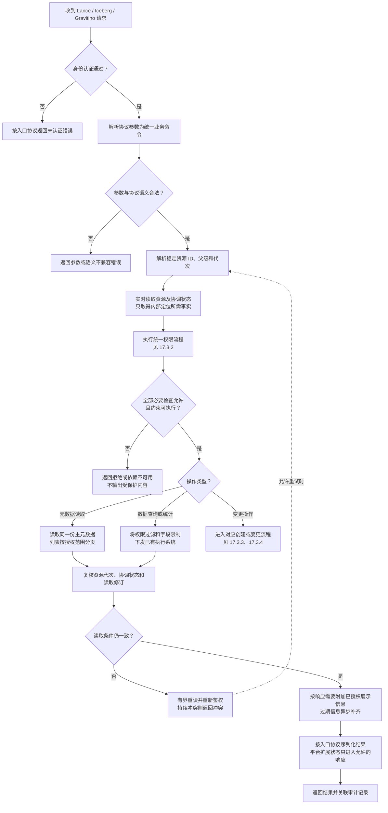

列表候选来自 Search，但结果输出前仍核对当前资源状态。批量鉴权和游标遵守第 14.4 节：继续扫描候选以填充授权页，不返回未授权对象数量。

<a id="flow-authorization"></a>

#### 17.3.2 权限系统与安全属性系统交互

一次业务操作展开为全部检查项后统一调用 batchCheck。权限系统取得安全属性并作出决策，平台执行约束；业务系统的展示字段不进入这条放行链路。

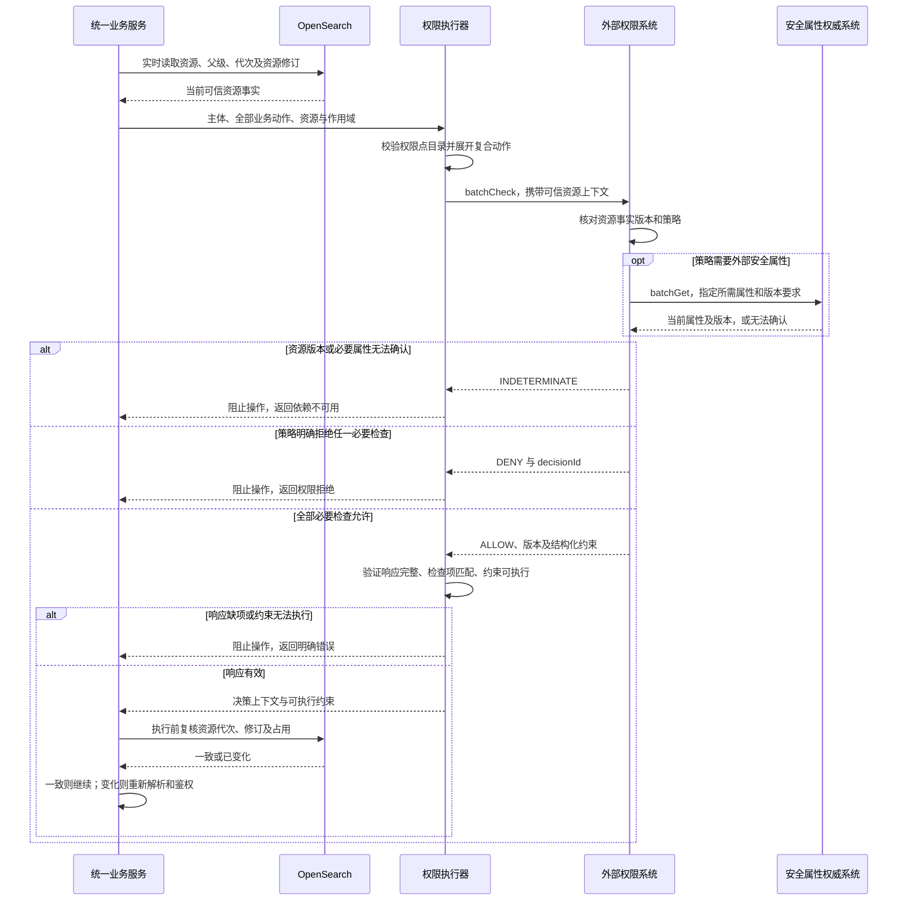

安全属性系统与权限系统可以部署在同一产品内，职责仍分开。权限系统无需回调同一个受保护业务接口；超时、缺项和未知版本均不允许回退到 OpenSearch 中的展示值。

<a id="flow-create"></a>

#### 17.3.3 创建或注册对象与权限资源绑定

适用于 Namespace、Table、物化视图等需要新建平台身份的操作。各对象的底层调用及模式以对应规格为准；存在同名对象时，先按 Create / ExistOk / Overwrite 的语义和附加权限处理。

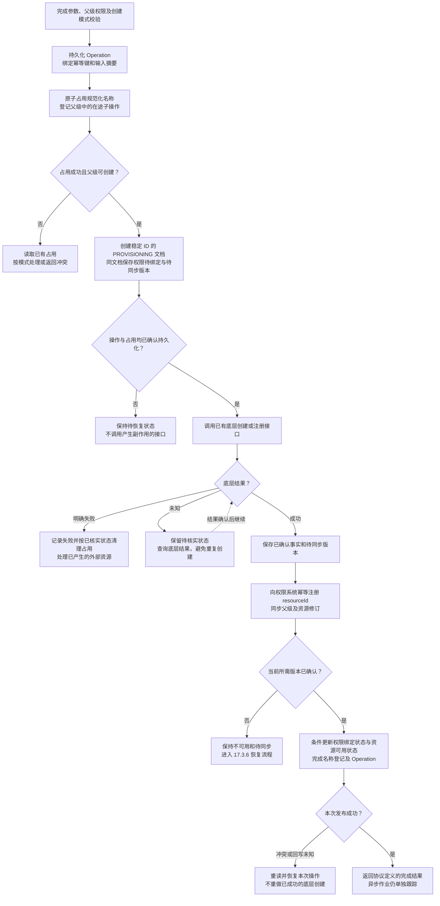

权限资源存在不代表创建者自动获得全部权限。外部绑定确认之前，普通业务查询不可见；创建者通过经授权的 Operation 查询进度，标准接口不把待绑定状态伪装成完成。

<a id="flow-change"></a>

#### 17.3.4 元数据变更、Schema 变更与跨 Namespace 移动

同一个流程区分平台自身字段更新和需要调用底层的真实变更。跨 Namespace 移动须检查源、目标和继承关系；外部权威安全属性修改走其维护方，不通过普通 properties 更新。

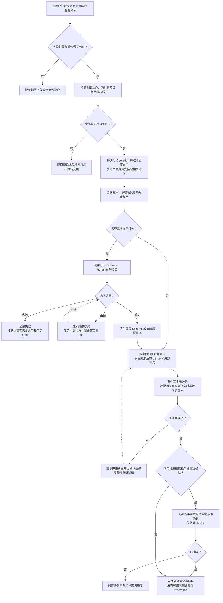

同对象的不同字段更新仍受并发控制保护。对已成功的底层变更，恢复目标是补齐主元数据；对尚未执行的变更，资源修订变化后必须重新鉴权。不能重新调用底层操作来“修复”一次 OpenSearch 写入失败。

<a id="flow-enrichment"></a>

#### 17.3.5 展示信息补齐与降级

展示请求已获得相应业务权限后，可以使用已有补齐结果。后台补齐只更新白名单字段；权限所需的安全属性不走该降级流程。

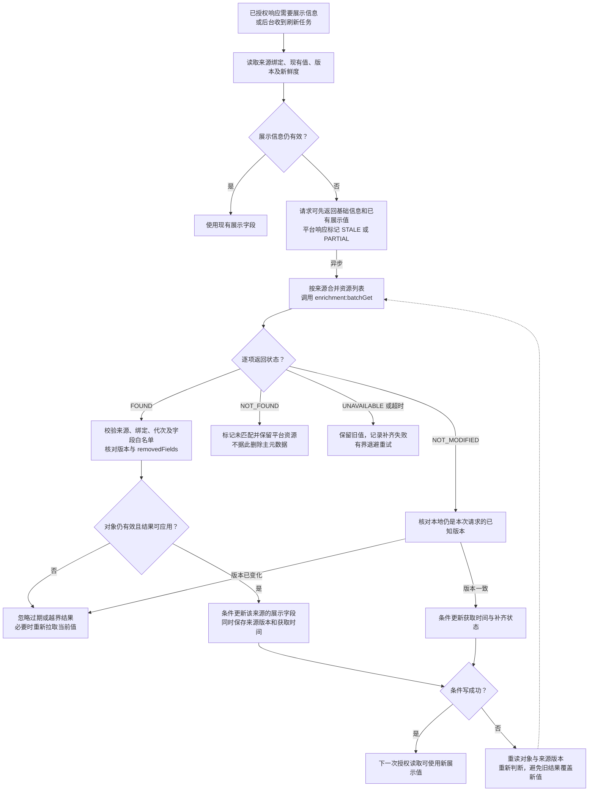

外部 ownerName 是展示名，不能借补齐修改 ownerId 或组织授权关系。每个来源保存独立版本；不可比较的来源修订号通过重新取当前值判断，不能按字符串大小排序。

<a id="flow-recovery"></a>

#### 17.3.6 权限资源同步与故障恢复

正常提交、外部变化通知、周期扫描和进程重启都可以触发同一恢复流程。待同步标记与资源事实在同一文档中保存，扫描只负责发现任务，处理资格仍通过实时读取及条件写取得。

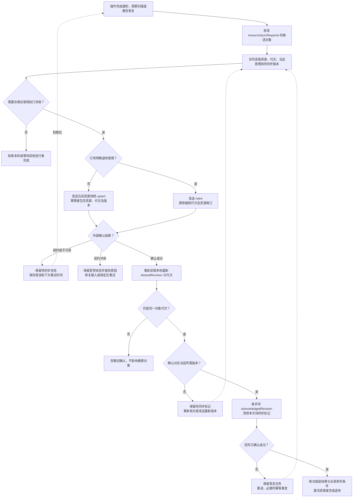

外部成功而平台回写失败只会引起幂等重发，不能生成第二个权限资源。确认回写本身不增加资源事实修订，避免无限同步；较旧确认不能清除更新版本的任务。

<a id="flow-batch"></a>

#### 17.3.7 多表原子提交与主元数据发布

底层原子性由已有 BatchCommitTables 等接口提供。平台负责全量鉴权、参与资源占用和 OpenSearch 主元数据恢复；Bulk 逐项写入完成之前，不发布一个伪完整的业务结果。

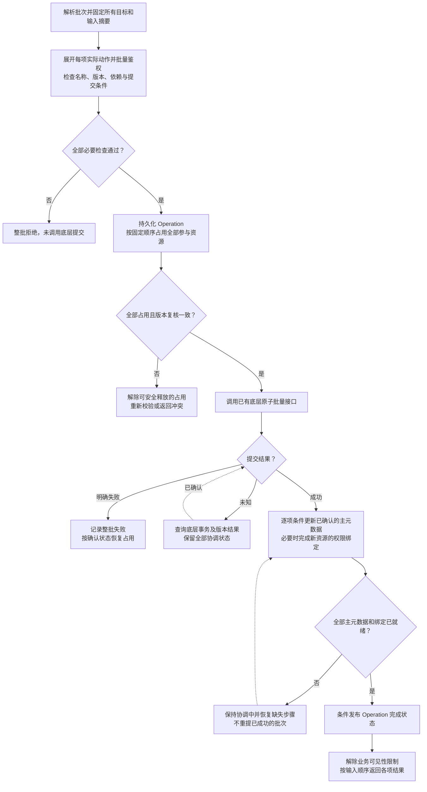

参与对象的读取均检查关联 Operation；需要一致的多对象结果时还须复核整个读取集合。协调中可等待或返回明确的暂不可用状态，不能返回部分新值混合部分旧值。

<a id="flow-jobs"></a>

#### 17.3.8 回填、索引构建与物化视图刷新

平台接入已有执行能力并跟踪结果。job_id、transaction_id 和平台 operationId 分别保存；自动刷新仍由已有系统调度，调度时须执行相同的委托和权限检查。

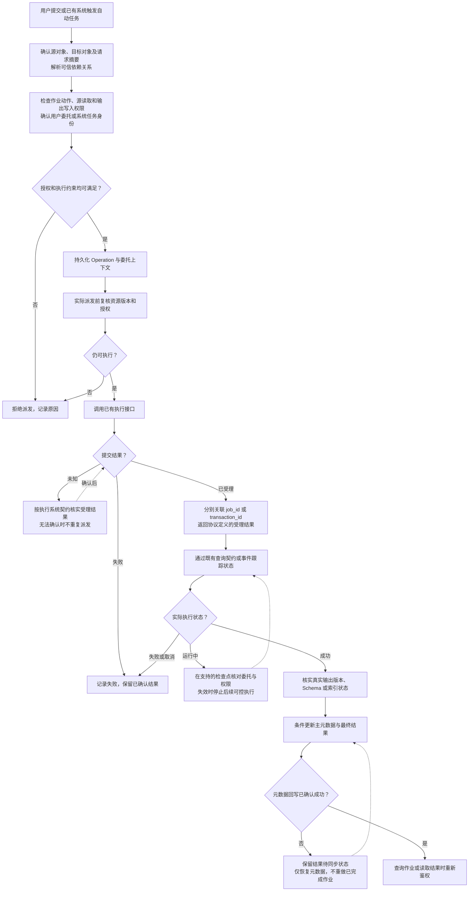

已受理不等于已成功。撤权不被描述为能回滚所有在途底层操作；执行系统无法满足所需委托检查或行列约束时，不启用相应运行配置。

<a id="flow-delete"></a>

#### 17.3.9 注销、物理删除与外部资源退休

注销和物理删除使用不同权限点。Cascade 先确定并保护受影响对象集合，逐项检查权限；删除期间阻止新的子对象创建和受保护业务访问。

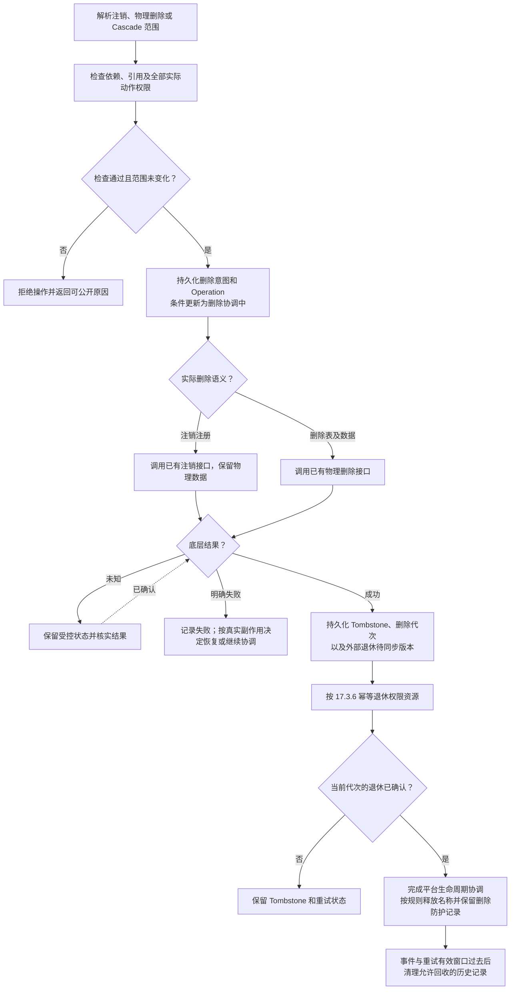

同名重建使用新 ID 或代次。旧补齐响应、旧授权确认和旧删除任务均不能修改新对象；清理前不能删除唯一待同步记录。

<a id="view-physical"></a>

### 17.4 物理视图：部署与故障边界

下图表示逻辑部署关系，实例数量、分片和容量沿用实际环境配置。接口服务与后台任务可共部署，也可分别扩容；持久状态都保存在共享主存储，不依赖单个 JVM 的内存锁或任务队列保证一致性。

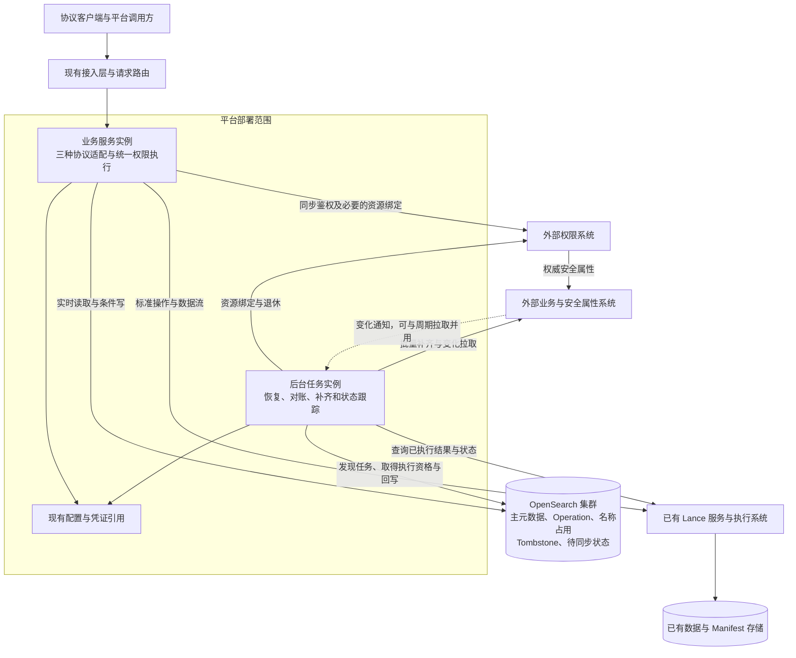

| 故障边界 | 对业务的影响与恢复方式 |
|---|---|
| 业务实例退出 | 其他实例依据持久 Operation 恢复；不能靠进程内状态推定底层失败 |
| 后台实例退出或重复执行 | 条件占用、幂等外部接口及版本确认避免重复副作用 |
| OpenSearch 不可用 | 无法确认资源和写入意图时阻止新副作用；已执行操作恢复后核实并补齐主元数据 |
| 权限或安全属性系统不可用 | 受保护访问不能放行；已有执行中的任务按委托及执行系统契约处理 |
| 展示补齐系统不可用 | 权限已通过的请求可以返回基础信息和已有展示值，后台重试 |
| Lance 操作超时 | 保留结果未知状态，通过真实查询核实，不立即重做修改操作 |

<a id="view-scenarios"></a>

### 17.5 场景视图：用例驱动的“+1”

场景视图将调用者、业务目标、关键流程和验收用例串联起来，用来核对前四个视图能否共同完成需求。

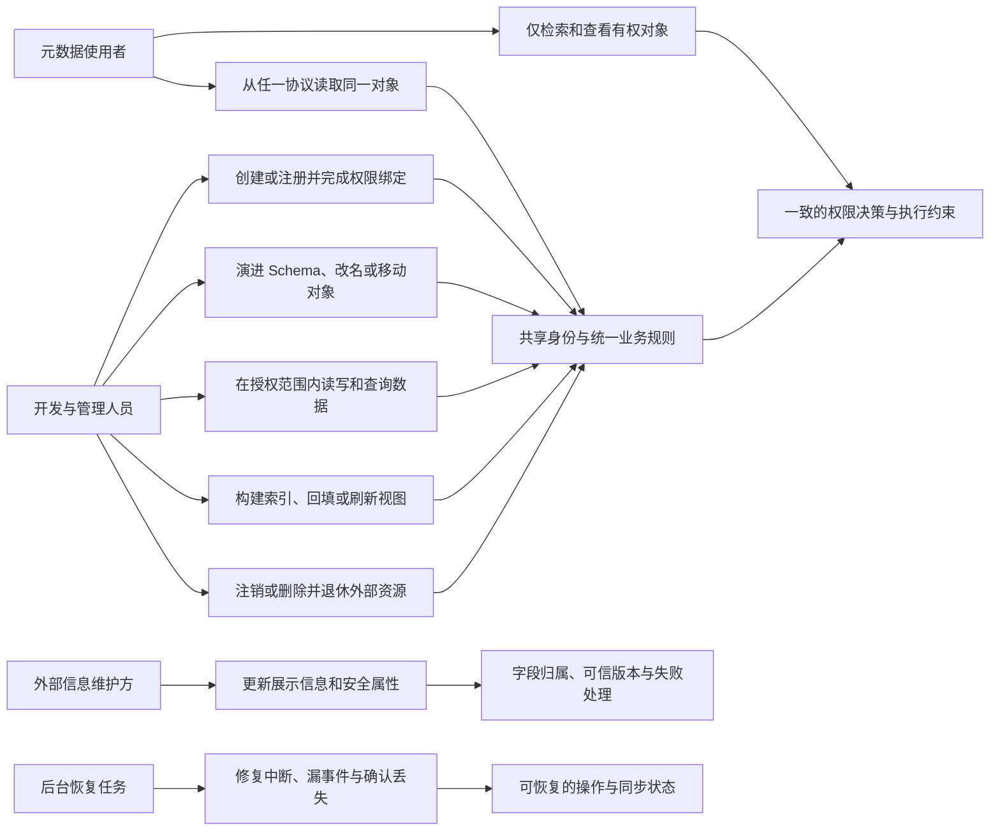

| 场景 | 关键流程 | 需要验证的结果 | 对应验收 |
|---|---|---|---|
| 同一表从三种协议访问 | [统一请求](#flow-request)、[统一鉴权](#flow-authorization) | 定位相同对象 ID，同一动作使用相同权限点，响应符合入口协议 | AT-02、AT-26、AT-28 |
| 列表搜索中混有无权对象 | [统一请求](#flow-request)、[统一鉴权](#flow-authorization) | 无越权结果、数量或统计泄漏，授权分页可以继续 | AT-24、AT-33 |
| 创建成功但权限绑定暂时失败 | [对象创建](#flow-create)、[同步恢复](#flow-recovery) | 对象保持受控，恢复后激活，不重复创建底层表 | AT-07、AT-31、AT-32 |
| 旧协议更新公共字段 | [元数据变更](#flow-change) | Lance 扩展字段保留，条件冲突不覆盖其他已生效修改 | AT-12、AT-26、AT-27 |
| 跨 Namespace 移动并发生继承变化 | [元数据变更](#flow-change)、[统一鉴权](#flow-authorization) | 校验源和目标，外部确认新关系前不按旧关系继续访问 | AT-10、AT-28、AT-31 |
| 展示信息超时或权限属性缺失 | [展示补齐](#flow-enrichment)、[权限交互](#flow-authorization) | 前者允许授权后的降级展示，后者阻止操作 | AT-29、AT-30 |
| 原子提交成功但主元数据只写入部分 | [批量提交](#flow-batch)、[同步恢复](#flow-recovery) | 不暴露伪完整结果，恢复缺失记录，不重新提交底层事务 | AT-08、AT-21、AT-34 |
| 后台作业排队期间权限变化 | [异步作业](#flow-jobs) | 派发前重新鉴权，受理与完成分开，不能借服务账号越权 | AT-13、AT-20、AT-28 |
| 删除重建后收到旧事件或旧确认 | [注销删除](#flow-delete)、[同步恢复](#flow-recovery) | 对象 ID 与代次隔离，旧对象不复活，新对象不被修改 | AT-23、AT-31、AT-32 |

上述流程与对象章节共同作为实现和联调依据。图中的外部交互仍按第 15 章自定义契约实施，不能将其当作 Lance 标准路由；图中的状态和示例名称也不改变既有 54 个标准接口的请求与响应模型。
